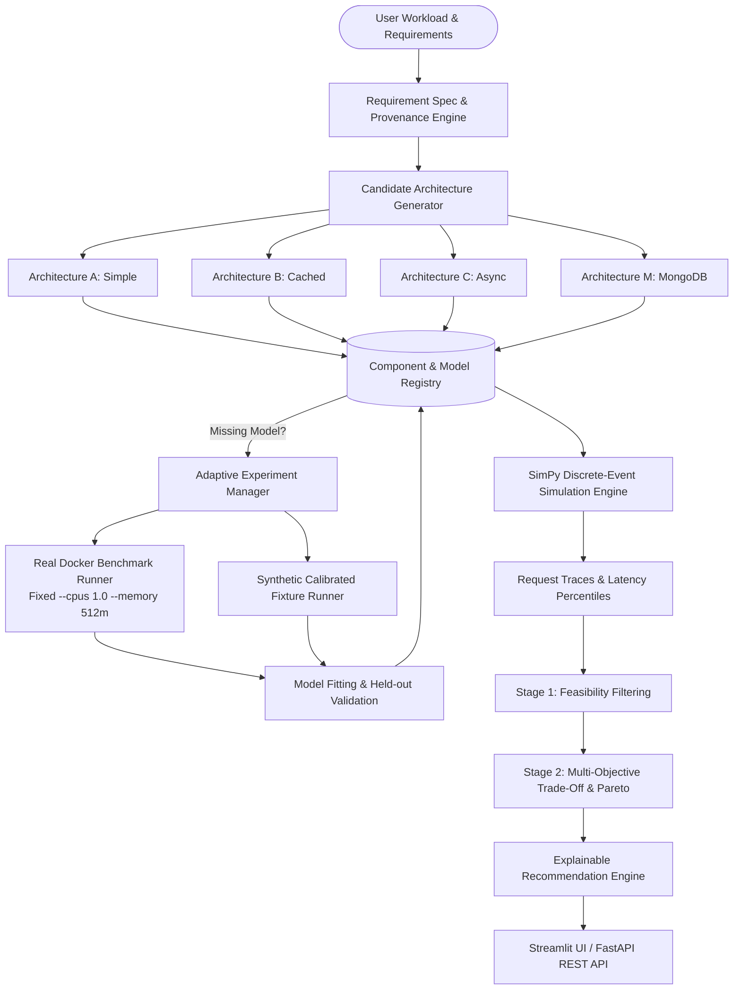

# Agentic Architecture Design & Simulation (AADS) POC

[](https://www.python.org/downloads/)
[](https://simpy.readthedocs.io/)
[](https://fastapi.tiangolo.com/)
[](https://streamlit.io/)
[](tests/)

A working proof-of-concept for an AI agent that designs, benchmarks, simulates, and recommends backend system architectures based on empirical evidence and discrete-event simulation.

---

## 1. Mission & Core Principle

**Core Principle:** *The objective is architecture comparison and recommendation, not perfect performance prediction. Performance estimates are evidence used to make a better architectural decision.*

Rather than relying on LLM hallucinations or static rulebooks, AADS:
1. Validates application requirements and explicitly tracks information provenance (User Facts vs. Agent Assumptions vs. Empirical Measurements).
2. Generates candidate architectures (Simple, Cached Reads, Async Write Queue).
3. Discovers missing or out-of-range performance models in a persistent SQLite registry.
4. Executes controlled, repeatable benchmarks (using real Docker containers with fixed CPU/RAM limits or labeled synthetic fixtures).
5. Fits performance models using strict held-out validation (70/30 split, RMSE, MAPE, $R^2$).
6. Simulates candidate architectures under the same workload using **SimPy** request-level discrete events.
7. Evaluates architectures via a **Two-Stage Decision Engine**:
   - **Stage 1 (Feasibility Filtering):** Checks hard SLA targets (p95 latency, throughput, budget cap) and detects uncertainty boundary overlaps.
   - **Stage 2 (Trade-off Comparison):** Performs Pareto dominance analysis, multi-objective preference scoring, and produces explainable recommendations.

---

## 2. System Architecture



---

## 3. Candidate Architectures (Social Media Feed Scenario)

| Architecture | Request Path | Monthly Cost | Key Trade-off |
| :--- | :--- | :--- | :--- |
| **Architecture A — Simple** | API $\rightarrow$ PostgreSQL | **$133.00** | Lowest cost and zero cache complexity; DB is primary bottleneck. |
| **Architecture B — Cached Reads** | API $\rightarrow$ Redis $\rightarrow$ PostgreSQL on miss | **$176.00** | Sub-millisecond reads (85% cache hits shield DB); added Redis cost & invalidation. |
| **Architecture C — Async Processing** | API $\rightarrow$ Queue $\rightarrow$ Worker $\rightarrow$ PostgreSQL (+ Redis) | **$216.00** | Decoupled write spikes & rapid HTTP 202 ack; highest operational complexity. |
| **Architecture M — Document Store** | API $\rightarrow$ MongoDB 7.0 | **$127.00** | Used to demonstrate automated missing-model discovery and calibration. |

---

## 4. Scientific Credibility & Anti-Hallucination Guarantees

- **No Fabricated Measurements:** Synthetic fixtures are explicitly tagged with `is_synthetic_fixture = True`. Real container benchmarks record full container fingerprints (`docker:postgres:16-alpine:cpus=1.0:mem=512m`).
- **Repeated Benchmark Trials:** Controlled trials execute 3 replications per configuration, recording variance $\sigma^2$ across runs.
- **Decomposition of Service Time vs. Queuing:** End-to-end benchmark response time is strictly decomposed into pure service demand ($S \le \frac{N}{X} \times 1000$). SimPy independently simulates queuing contention, preventing double-counting of congestion.
- **Held-Out Model Validation:** Empirical models are fitted on 70% of benchmark configurations and evaluated on a held-out 30% test split. Models must satisfy $R^2 \ge 0.70$ and $\text{MAPE} \le 35\%$ to be validated.
- **Out-of-Range Extrapolation Guard:** Workloads exceeding benchmarked operating boundaries `[min_rps, max_rps]` are flagged with `OUT_OF_RANGE` status and subject to uncertainty penalties ($2.5\times$).
- **Uncertainty-Aware Feasibility:** If the 95% confidence interval around p95 latency crosses the user SLA threshold, the architecture is classified as `UNCERTAIN` rather than falsely guaranteed as feasible.

---

## 5. Getting Started & Installation

### Prerequisites
- Python 3.11+ (Python 3.12 recommended)
- `uv` package manager (or standard `pip`)
- Docker (optional, for running live container benchmarks with `pgbench`)

### Setup Virtual Environment
```bash
# Clone or navigate to the repository
cd /path/to/AADS

# Create virtual environment with Python 3.12
uv venv --python 3.12 .venv
source .venv/bin/activate

# Install dependencies in editable mode
uv pip install -e .
```

---

## 6. How to Run

### Option 1: Run the Complete End-to-End CLI Demo
Demonstrates the full lifecycle from requirements to missing-model discovery, benchmarking, SimPy simulation, and recommendation:
```bash
.venv/bin/python run_demo.py
```

### Option 2: Launch the Streamlit Web Application
Provides an interactive dashboard to customize workloads, view DAGs, trigger live benchmarks, run SimPy simulations, and inspect Pareto trade-offs:
```bash
.venv/bin/python -m streamlit run aads/ui/streamlit_app.py --server.port 8501
```

### Option 3: Start the FastAPI Backend Server
Launches the REST API server with interactive Swagger documentation at `http://localhost:8000/docs`:
```bash
.venv/bin/python -m uvicorn aads.api.app:app --host 0.0.0.0 --port 8000 --reload
```

### Option 4: Run the Full Test Suite
Runs all 27 unit and end-to-end integration tests:
```bash
.venv/bin/pytest -v
```

---

## 7. Project Structure

```
AADS/
├── pyproject.toml              # Project dependencies and pytest configuration
├── README.md                   # System documentation and execution guide
├── run_demo.py                 # Standalone end-to-end CLI demonstration script
├── aads/
│   ├── core/
│   │   ├── config.py           # Externalized system settings, pricing, and resource limits
│   │   └── schemas.py          # Pydantic data contracts (Workload, Component, Experiment, Result)
│   ├── generator/
│   │   └── candidate_generator.py # Generates Architectures A, B, C, M with DAG validation
│   ├── registry/
│   │   └── component_registry.py  # SQLite-backed model and experiment registry
│   ├── benchmark/
│   │   ├── runner_interface.py    # Abstract BenchmarkRunner contract
│   │   ├── docker_runner.py       # Live Docker pgbench runner with resource isolation
│   │   ├── synthetic_runner.py    # Calibrated synthetic fixture runner with trial variance
│   │   └── experiment_manager.py  # Adaptive fixed-baseline-then-adaptive experiment runner
│   ├── modeling/
│   │   ├── model_interface.py     # ComponentPerformanceModel base contract
│   │   ├── lookup_model.py        # Baseline k-NN / inverse-distance interpolation
│   │   ├── regression_model.py    # Piecewise Ridge regression isolating service demand
│   │   └── model_trainer.py       # 70/30 held-out evaluator computing RMSE, MAPE, R²
│   ├── simulation/
│   │   ├── simpy_engine.py        # SimPy request-level discrete-event simulation engine
│   │   └── metrics_collector.py   # Latency percentiles (p50, p90, p95, p99), utilizations, bottlenecks
│   ├── evaluation/
│   │   ├── feasibility_filter.py  # Stage 1: Hard constraint evaluation & uncertainty boundaries
│   │   ├── tradeoff_analyzer.py   # Stage 2: Pareto dominance & multi-objective preference scoring
│   │   └── recommender.py         # Synthesizes explainable recommendation with rationale & risks
│   ├── api/
│   │   ├── app.py                 # FastAPI application entrypoint
│   │   └── routes.py              # REST API endpoints
│   └── ui/
│       └── streamlit_app.py       # Rich interactive Streamlit dashboard
└── tests/
    ├── conftest.py                # Reusable test fixtures
    ├── test_schemas.py            # Workload and provenance schema validation tests
    ├── test_candidate_generator.py # Candidate DAG and topology tests
    ├── test_registry.py           # Registry CRUD and compatibility check tests
    ├── test_benchmarks.py         # Synthetic and Docker benchmark runner tests
    ├── test_modeling.py           # Model fitting and held-out validation tests
    ├── test_simulation.py         # SimPy discrete-event simulation tests
    ├── test_evaluation.py         # Feasibility filtering and Pareto analysis tests
    └── test_end_to_end.py         # Full end-to-end Python & FastAPI integration tests
```

---

## 8. Summary of Capabilities vs. Limitations

| Capability | Status | Implementation Details |
| :--- | :---: | :--- |
| **Requirements Validation** | ✅ Active | Explicit tracking of User Facts vs. Agent Assumptions. |
| **Candidate Generation** | ✅ Active | Deterministic template graphs with DAG connectivity validation. |
| **Missing Model Discovery** | ✅ Active | Detects unsupported components (e.g. MongoDB 7.0) and triggers calibration. |
| **Controlled Benchmarks** | ✅ Active | Real Docker containers (`--cpus 1.0 --memory 512m`) or labeled synthetic fixtures. |
| **Statistical Model Fitting** | ✅ Active | 70/30 held-out split, RMSE/MAPE/$R^2$ quality gating, operating bounds. |
| **Discrete-Event SimPy** | ✅ Active | Request-level Poisson arrivals, contention, cache hit rate, and async workers. |
| **Multi-Objective Evaluator** | ✅ Active | Stage 1 SLA filtering, Stage 2 Pareto ranking, and explainable recommendations. |
| *Network Partition / Chaos* | ⚠️ Limitation | Simulates timeouts/queuing; cross-datacenter partition splits not modeled. |
| *Hardware Virtualization* | ⚠️ Limitation | Assumes fixed container cgroups; noisy-neighbor hypervisor jitter not modeled. |
