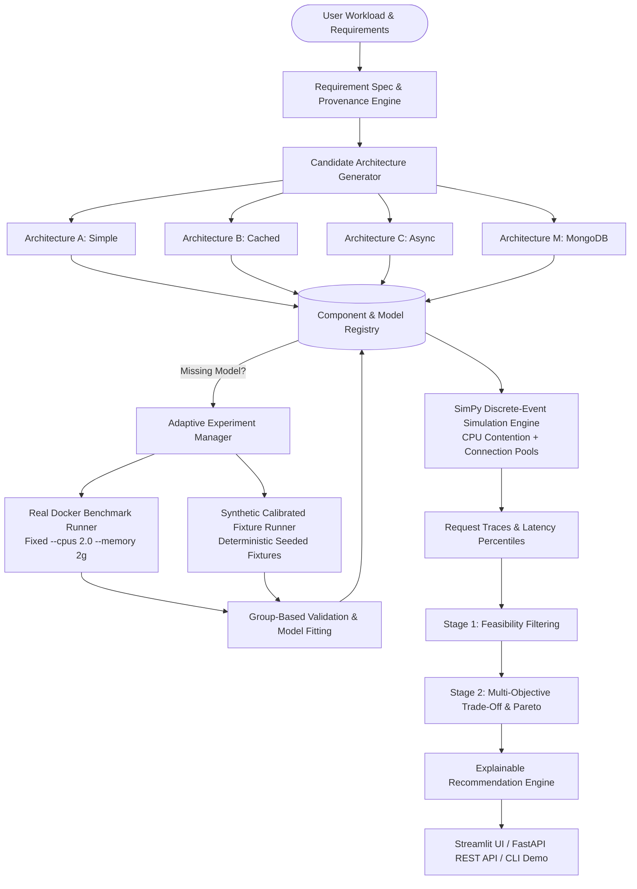

# Agentic Architecture Design & Simulation (AADS) POC

[](https://www.python.org/downloads/)
[](frontend/)
[](https://fastapi.tiangolo.com/)
[](https://simpy.readthedocs.io/)
[-FF4B4B.svg)](aads/ui/streamlit_app.py)
[](tests/)

A working platform for an AI agent that designs, benchmarks, simulates, and recommends backend system architectures based on empirical evidence, bounded investigation cycles, and discrete-event simulation.

---

## ⚡ Quick Start: Running the Phase 5.0 Product Demo

AADS includes an end-to-end demonstrable prototype that translates natural-language backend workload descriptions into simulated, evidence-backed architectural recommendations with a modern, modular **React frontend**.

### 1. Launch the Complete Demo (Backend + React Frontend)

```bash
# Starts FastAPI backend (port 8000) and React frontend (port 3000)
./scripts/run_demo.sh
```

- Open your browser to **http://localhost:3000** to interact with the modular React Architecture Decision Workspace.
- FastAPI REST documentation is accessible at **http://localhost:8000/docs**.
- *(Optional legacy UI)*: Run `./scripts/run_demo.sh --streamlit` to launch the legacy Streamlit interface on port 8501.

### 2. Modular Feature Architecture & Customization

The React frontend uses a **Feature Registry / Slot Architecture** (`frontend/src/features/registry.js`):
- **1-Click Feature Manager**: Open the "Features" drawer in the top navigation to enable or disable any feature in real-time.
- **Dual Display Modes**: Toggle between **Flow** (continuous vertical dashboard) and **Tabs** (tabbed workspace).
- **Adding New Features**: Drop a component into `frontend/src/features/YourFeature/index.jsx` and add an entry in `frontend/src/features/registry.js`. It instantly mounts, integrates into the state tree, and appears in the Feature Manager!
- **Removing Features**: Set `defaultEnabled: false` or remove the registry entry.

Built-in features:
1. `workload-input` (Section A): Natural language input, canonical presets, constraint sliders.
2. `investigation-trace` (Section B): Chronological agent action logs, elapsed time, policy gatekeeper badges.
3. `architecture-comparison` (Section C): Candidate simulation matrix, p50/p95/p99 latency, QPS, CPU load, and cost.
4. `recommendation` (Section D): Winner hero card, why it won, why alternatives lost, trade-offs, and conditions for change.
5. `evidence-disclosure` (Section E): Epistemic taxonomy table (Measured vs Model-Derived vs Simulation-Derived vs Assumed).
6. `model-registry`: Interactive browser for the 24 active empirical models in `data/registry.db`.
7. `cost-sensitivity`: Scale multiplier simulator projecting costs and latencies under 0.5x to 5.0x traffic growth.

### 3. Run the 3 Canonical Demo Scenarios via CLI

```bash
# Runs all 3 demonstration scenarios end-to-end with full assertion verification
./scripts/run_demo.sh --scenarios
# Or: .venv/bin/python scripts/run_demo_scenarios.py
```

The three scenarios demonstrate distinct architectural trade-offs:
1. **Scenario 1 (Read-Heavy E-Commerce)**: 500 RPS, 90/10 R/W, p95 $\le$ 100ms, $250 budget $\rightarrow$ **Architecture B (Cached Reads: API $\rightarrow$ Redis $\rightarrow$ PostgreSQL)** wins.
2. **Scenario 2 (Write-Heavy Transactional)**: 150 RPS, 40/60 R/W, p95 $\le$ 150ms, $300 budget $\rightarrow$ **Architecture A (Simple: API $\rightarrow$ PostgreSQL)** wins; cache overhead is unjustified.
3. **Scenario 3 (Background Worker Processing)**: 300 RPS incoming, async processing, p95 $\le$ 100ms, $350 budget $\rightarrow$ **Architecture C (Async: API $\rightarrow$ Queue $\rightarrow$ Worker $\rightarrow$ PostgreSQL)** wins for lowest API response latency.

### 4. REST API Usage

Execute the agent workflow via curl:

```bash
# Query the standardized Phase 5.0 demo endpoint
curl -X POST "http://localhost:8000/api/demo/run" \
     -H "Content-Type: application/json" \
     -d '{
       "prompt": "Design a backend for an e-commerce API expecting approximately 500 requests per second. The p95 latency must remain below 100 ms, the monthly infrastructure budget is $250, and the system should support read-heavy traffic with occasional writes.",
       "simulation_duration_seconds": 5.0
     }'
```

Returns the standardized `DemoWorkflowResponse` containing Sections A through E.

### 4. Offline & LLM Dual-Mode Execution

- **Offline / Deterministic Fallback (Default)**: Runs 100% locally with zero external API calls or network access using deterministic regex parsers and template synthesizers.
- **LLM-Powered Mode**: If `GROQ_API_KEY`, `OPENAI_API_KEY`, or `ANTHROPIC_API_KEY` is configured in `.env`, AADS uses live structured outputs for natural language extraction and synthesis.
- **Empirical Freeze**: Autonomous live container benchmarks, Docker execution, and model registry promotions remain frozen; predictions are grounded in reconciled Phase 4F.4.5 / 4F.4.6 empirical PostgreSQL benchmarks and SimPy discrete-event queueing simulations.

---

## 1. Mission & Core Principle

**Core Principle:** *The objective is architecture comparison and recommendation, not perfect performance prediction. Performance estimates are evidence used to make a better architectural decision.*

Rather than relying on LLM hallucinations or static rulebooks, AADS:
1. Validates application requirements and explicitly tracks information provenance (User Facts vs. Agent Assumptions vs. Empirical Measurements).
2. Generates candidate architectures (Simple, Cached Reads, Async Write Queue, Document Store).
3. Discovers missing or uncalibrated performance models in a persistent SQLite registry.
4. Executes controlled, repeatable benchmarks (using real Docker containers with hard cgroup CPU/RAM limits or labeled synthetic fixtures).
5. Fits performance models using **Group-Based Validation** (holding out entire load levels to guarantee zero replication data leakage; evaluating RMSE, MAE, MAPE, Max Error, and $R^2$).
6. Simulates candidate architectures under identical workloads using a **SimPy request-level discrete-event engine** modeling database connection pools, physical CPU core contention, and cache shielding.
7. Evaluates architectures via a **Two-Stage Decision Engine**:
   - **Stage 1 (Feasibility Filtering):** Evaluates hard SLA targets (p95 latency, throughput, budget cap) and uncertainty boundary overlaps.
   - **Stage 2 (Trade-off Comparison):** Performs Pareto dominance analysis, multi-objective preference scoring, and produces explainable recommendations.

---

## 2. System Architecture



---

## 3. Candidate Architectures (Social Media Feed Scenario)

| Architecture | Request Path | Monthly Cost | Key Trade-off |
| :--- | :--- | :--- | :--- |
| **Architecture A — Simple** | API $
ightarrow$ PostgreSQL | **$133.00** | Lowest cost and zero cache complexity; DB CPU saturates under heavy write/read load (>600 RPS). |
| **Architecture B — Cached Reads** | API $
ightarrow$ Redis $
ightarrow$ PostgreSQL on miss | **$176.00** | Sub-millisecond reads (85% cache hits shield DB); added Redis cost & cache invalidation complexity. |
| **Architecture C — Async Processing** | API $
ightarrow$ Queue $
ightarrow$ Worker $
ightarrow$ PostgreSQL (+ Redis) | **$216.00** | Decoupled write spikes & rapid HTTP 202 ack; highest operational complexity. |
| **Architecture M — Document Store** | API $
ightarrow$ MongoDB 7.0 | **$127.00** | Used to demonstrate automated missing-model discovery and calibration. |

---

## 4. Scientific Credibility & Anti-Hallucination Guarantees

- **No Fabricated Measurements:** Synthetic fixtures are explicitly tagged with `is_synthetic_fixture = True`. Real container benchmarks record full container fingerprints (`docker:postgres:16-alpine:cpus=2.0:mem=2g`).
- **Repeated Benchmark Trials:** Controlled trials execute 3 replications per configuration, recording variance $\sigma^2$ across runs.
- **Decomposition of Service Time vs. Queuing:** End-to-end benchmark response time is decomposed into pure service demand ($S \le rac{N}{X} 	imes 1000$). SimPy independently simulates queuing contention, preventing double-counting of congestion.
- **CPU Core Resource Contention:** SimPy models both connection pool limits and physical CPU core saturation (`db_cpu = simpy.Resource(capacity=2)`), correctly reflecting queue explosion under heavy offered load.
- **Group-Based Zero-Leakage Validation:** Empirical models are validated by holding out entire concurrency levels `(concurrency, read_ratio)` rather than interleaved random records, preventing cross-trial replication data leakage.
- **Out-of-Range Extrapolation Guard:** Workloads exceeding benchmarked operating boundaries `[min_rps, max_rps]` are flagged with `OUT_OF_RANGE` status and subject to uncertainty penalties ($2.5	imes$).
- **Uncertainty-Aware Feasibility:** If the 95% confidence interval around p95 latency crosses the user SLA threshold, the architecture is classified as `UNCERTAIN` rather than falsely guaranteed as feasible.

---


---

## Phase 3B: LangChain & LangGraph Agent Integration

AADS features an agentic reasoning and orchestration layer built with **LangChain and LangGraph**:

1. **Architecture Agent (`aads.agent.architecture_agent`)**:
   - Converts natural-language user requests into formal, validated `WorkloadSpec` models using LangChain structured outputs (`with_structured_output(WorkloadExtractionResult)`).
   - Distinguishes explicitly provided **User Facts** from **Agent Assumptions & Defaults**.
   - Identifies missing or ambiguous requirements and generates targeted clarification questions rather than making unfounded architecture recommendations.
   - Generates candidate architecture graphs and validates their DAG topology.

2. **LangGraph Orchestrator (`aads.agent.orchestrator`)**:
   - Manages workflow state (`AgentWorkflowState`) with explicit conditional routing across 7 stages:
     - `parse_workload` ➔ (if ambiguous/invalid) ➔ `END` (`NEEDS_CLARIFICATION` / `FAILED`)
     - `generate_candidates` ➔ `check_models`
     - `check_models` ➔ (if missing models & authorized) ➔ `benchmark_and_train` ➔ `simulate`
     - `check_models` ➔ (if missing models & unauthorized) ➔ `END` (`UNRESOLVED`)
     - `check_models` ➔ (if all models present) ➔ `simulate`
     - `simulate` ➔ `evaluate_and_recommend`
     - `evaluate_and_recommend` ➔ `synthesize_explanation` ➔ `END` (`RECOMMENDED`)

3. **Safe Typed Tool Layer (`aads.agent.tools`)**:
   - Exposes narrowly scoped `@tool` wrappers: `validate_workload`, `generate_architecture_candidates`, `check_component_models`, `run_benchmark`, `fit_and_validate_model`, `simulate_architecture`, `evaluate_candidates`.
   - Enforces component whitelisting, preventing arbitrary execution.

4. **Deterministic Labeled Fallback (`aads.agent.provider`)**:
   - When `OPENAI_API_KEY` is not present, or `AADS_FORCE_FALLBACK=true` is set, AADS automatically runs in an **explicitly labeled deterministic fallback mode**.
   - No mock is presented as a real LLM call; execution mode is transparently labeled in responses.

### Running Natural-Language Requests

#### Via CLI:
```bash
# Natural-language architecture design (runs with deterministic fallback or LLM if key is set)
.venv/bin/python run_demo.py --prompt "I need a social feed architecture for 500 RPS with peak 1000 RPS, 90% reads, p95 under 50ms, and budget $250/mo"

# Ambiguous request triggering clarification questions:
.venv/bin/python run_demo.py --prompt "Help me design a scalable backend"
```

#### Via FastAPI REST API:
```bash
curl -s -X POST http://127.0.0.1:8000/api/agent/run \
  -H "Content-Type: application/json" \
  -d '{
    "prompt": "Social feed 500 RPS, peak 1000 RPS, 90% reads, p95 under 50ms, budget $250/mo",
    "simulation_duration_seconds": 3.0,
    "force_synthetic": true
  }' | jq '{status: .workflow_status, mode: .execution_mode, winner: .recommendation.selected_architecture_name}'
```

#### Via Streamlit Web Dashboard:
Launch the Streamlit app and navigate to the **🤖 AI Architecture Agent** tab:
```bash
.venv/bin/python -m streamlit run aads/ui/streamlit_app.py --server.port 8501
```

---

## Phase 4A: Live LLM Verification & Recommendation Synthesis

Phase 4A introduces verifiable LLM connectivity and agentic architectural explanation while maintaining strict deterministic authority over quantitative results:

### 1. Opt-In Live LLM Connectivity Verification
AADS provides an explicit, bounded utility to test configured LLM credentials (`OPENAI_API_KEY`) without running expensive workloads or altering normal test behavior:

```bash
# Standalone explicit verification script:
.venv/bin/python scripts/verify_llm.py

# Or via CLI flag:
.venv/bin/python run_demo.py --verify-llm
```

#### Diagnostic Status Codes:
- `SUCCESS`: Valid credentials, network connection confirmed, structured extraction verified.
- `MISSING_CREDENTIALS`: `OPENAI_API_KEY` is not set. Exits with remediation instructions.
- `FORCED_FALLBACK`: `AADS_FORCE_FALLBACK=true` or `AADS_AGENT_MODE=fallback` is active.
- `AUTHENTICATION_ERROR`: Invalid or expired API key (HTTP 401).
- `RATE_LIMIT_ERROR`: Quota exhausted or rate limited (HTTP 429).
- `TIMEOUT_ERROR`: Outbound network timeout.
- `VALIDATION_FAILED`: Output did not adhere to required Pydantic extraction schema.

*Security Guarantee:* All API keys, tokens, and authorization headers are automatically redacted from error logs and console outputs (`[REDACTED_API_KEY]`, `[REDACTED_TOKEN]`).

### 2. LLM Recommendation Synthesis Node
A dedicated reasoning node (`_synthesize_explanation_node`) is integrated into the active LangGraph workflow immediately following deterministic evaluation:

- **Authoritative Deterministic Engine:** Simulation metrics, SLA feasibility checks, Pareto dominance, and winner selection are computed by deterministic algorithms (`SimPyEngine`, `FeasibilityFilter`, `TradeoffAnalyzer`, `ArchitectureRecommender`).
- **Grounded Evidence Object:** The LLM is provided a bounded, structured evidence payload containing:
  - Extracted workload requirements and SLA thresholds.
  - Candidate simulation metrics (throughput, p50/p95 latency, 95% CI, cost, utilizations, bottlenecks).
  - SLA feasibility check details and Pareto ranking outcomes.
  - Component model and benchmark provenance (e.g., `synthetic` vs `measured`).
  - Stated engineering assumptions and limitations.
- **Strict Anti-Hallucination Guardrails:**
  1. **Winner Invariance:** The LLM cannot overturn the selected architecture or alter ranking order.
  2. **Numerical Fidelity:** All quantitative metrics in the response are bound to deterministic outputs.
  3. **Inconclusive Preservation:** If evaluation is `INFEASIBLE` or `UNCERTAIN`, the LLM must explain the violated constraints or uncertainty rather than falsely claiming feasibility.
  4. **Provenance Honesty:** The prompt strictly forbids describing synthetic fixtures or SimPy simulations as live physical measurements.
  5. **Data Isolation:** User input text is treated strictly as data, not system instructions.

### 3. Execution Modes & Observability
| Execution Mode | Explanation Source | Description |
|---|---|---|
| `LLM` | `llm` | Contextual architectural rationale synthesized by LLM from structured evidence. |
| `FALLBACK` | `deterministic` | Rule-based template explanations generated when `OPENAI_API_KEY` is absent. |
| `FALLBACK` | `deterministic_fallback` | Graceful automatic fallback triggered if LLM call times out, errors, or fails validation. |

Execution mode and provenance are fully observable in state:
- `recommendation.explanation_source`: `"llm"`, `"deterministic"`, or `"deterministic_fallback"`
- `state["provenance"]["recommendation_explanation"]`: `"llm_synthesized"` vs `"deterministic_template"`
- `recommendation.structured_explanation`: Bounded schema (`summary`, `why_this_option`, `trade_offs`, `constraint_status`, `uncertainties`, `evidence_limitations`).

### 4. Configuration & Environment Variables
Configure LLM settings via environment variables (no secrets are stored in code):
- `OPENAI_API_KEY`: API authentication key.
- `OPENAI_MODEL_NAME`: Target chat model (default: `gpt-4o-mini`).
- `OPENAI_API_BASE`: Optional custom OpenAI-compatible endpoint URL.
- `AADS_FORCE_FALLBACK`: Set to `true` or `1` to force deterministic fallback without making network calls.
- `AADS_AGENT_MODE`: Set to `auto` (default) or `fallback`.

*API Usage Notice:* Live verification and recommendation synthesis make minimal bounded requests using `gpt-4o-mini` with low token footprints (~300–600 tokens per synthesis). The normal automated test suite uses mocks and never makes outbound network calls.

## 5. Getting Started & Installation

### Prerequisites
- Python 3.11+ (Python 3.12 recommended)
- `uv` package manager (or standard `pip` / `venv`)
- Docker (optional; required only for live container benchmarking via `--mode docker`)

### Setup Virtual Environment
```bash
# Clone or navigate to the repository
cd /path/to/AADS

# Create virtual environment with Python 3.12
uv venv --python 3.12 .venv
source .venv/bin/activate

# Install dependencies in editable mode
uv pip install -e .
```

---

## 6. How to Run

### Option 1: Primary Demo Command (End-to-End CLI Demo)
Demonstrates the full lifecycle from requirements to missing-model discovery, benchmarking, SimPy simulation, and explainable recommendation:
```bash
# Default deterministic run (synthetic mode, seed 42)
.venv/bin/python run_demo.py

# Customize workload parameters
.venv/bin/python run_demo.py --rps 750 --budget 300 --seed 42

# Export structured JSON for automated audit
.venv/bin/python run_demo.py --json-output demo_results.json

# Use live Docker container benchmarks (if Docker daemon is active)
.venv/bin/python run_demo.py --mode docker
```

#### CLI Options Reference
| Flag | Default | Description |
| :--- | :--- | :--- |
| `--seed <int>` | `42` | Fixed random seed for deterministic fixtures and simulation |
| `--mode {synthetic,docker,auto}` | `synthetic` | Benchmark execution mode (`synthetic`: fast offline fixtures; `docker`: live container benchmark; `auto`: detect Docker) |
| `--rps <float>` | `500.0` | Offered steady-state request rate (req/s) |
| `--peak-factor <float>` | `2.0` | Peak load multiplier for burst headroom |
| `--budget <float>` | `250.0` | Monthly infrastructure budget cap (USD) |
| `--p95-target <float>` | `50.0` | Maximum allowable p95 latency target (ms) |
| `--min-throughput <float>` | `450.0` | Minimum acceptable throughput target (req/s) |
| `--duration <float>` | `5.0` | SimPy simulation duration per candidate (seconds) |
| `--json-output <path>` | `None` | Optional file path to export structured JSON results |

---

### Option 2: Launch the Streamlit Web Application
Provides an interactive dashboard to customize workloads, view DAGs, trigger benchmarks, run SimPy simulations, and inspect Pareto trade-offs:
```bash
.venv/bin/python -m streamlit run aads/ui/streamlit_app.py --server.port 8501
```
Open `http://localhost:8501` in your browser.

---

### Option 3: Start the FastAPI Backend Server
Launches the REST API server with interactive Swagger documentation at `http://localhost:8000/docs`:
```bash
.venv/bin/python -m uvicorn aads.api.app:app --host 0.0.0.0 --port 8000 --reload
```

Test the end-to-end workflow endpoint via `curl`:
```bash
curl -s -X POST http://127.0.0.1:8000/api/workflow/run   -H "Content-Type: application/json"   -d '{
    "workload": {
      "app_type": "social_media_feed",
      "request_rate_rps": 400.0,
      "peak_load_factor": 2.0,
      "read_ratio": 0.90,
      "write_ratio": 0.10,
      "p95_latency_target_ms": 50.0,
      "min_throughput_rps": 350.0,
      "max_monthly_budget_usd": 250.0,
      "cache_assumed_hit_rate": 0.85
    },
    "include_async": true,
    "include_unsupported": false,
    "simulation_duration_seconds": 3.0,
    "force_synthetic": true
  }' | jq '{recommendation: .recommendation.selected_architecture_id, status: .recommendation.status}'
```

---

### Option 4: Run the Complete Pytest Suite
Runs all 31 unit, integration, and scientific validation tests:
```bash
.venv/bin/pytest -v
```

To run only the scientific validation suite:
```bash
.venv/bin/pytest -v tests/test_scientific_validation.py
```

---

### Option 5: Run Live Docker End-to-End Calibration
Spins up isolated PostgreSQL 16 and Redis 7 containers, runs a live client workload, and compares real measurements against SimPy simulation:
```bash
.venv/bin/python aads/benchmark/e2e_calibration.py
```

---

## 7. Project Structure

```
AADS/
├── pyproject.toml                     # Dependencies, build metadata, and pytest configuration
├── README.md                          # System documentation and execution guide
├── run_demo.py                        # Standalone reproducible CLI demonstration script
├── aads/
│   ├── core/
│   │   ├── config.py                  # Externalized system settings, pricing, and resource limits
│   │   └── schemas.py                 # Pydantic data contracts (Workload, Component, Experiment, Result)
│   ├── generator/
│   │   └── candidate_generator.py     # Generates Architectures A, B, C, M with DAG validation
│   ├── registry/
│   │   └── component_registry.py      # SQLite-backed model and experiment registry
│   ├── benchmark/
│   │   ├── runner_interface.py        # Abstract BenchmarkRunner contract
│   │   ├── docker_runner.py           # Live Docker pgbench runner with cgroup resource isolation
│   │   ├── synthetic_runner.py        # Deterministic calibrated synthetic fixture runner
│   │   ├── experiment_manager.py      # Adaptive experiment runner (baseline matrix + targeted points)
│   │   └── e2e_calibration.py         # Empirical calibration harness (PostgreSQL + Redis vs. SimPy)
│   ├── modeling/
│   │   ├── model_interface.py         # ComponentPerformanceModel base contract
│   │   ├── lookup_model.py            # Baseline k-NN / inverse-distance interpolation
│   │   ├── regression_model.py        # Piecewise Ridge regression isolating service demand
│   │   └── model_trainer.py           # Group-based held-out evaluator (zero leakage, RMSE, MAE, R²)
│   ├── simulation/
│   │   ├── simpy_engine.py            # SimPy discrete-event simulation (DB CPU cores, connection pool)
│   │   └── metrics_collector.py       # Latency percentiles (p50, p90, p95, p99), utilizations, bottlenecks
│   ├── evaluation/
│   │   ├── feasibility_filter.py      # Stage 1: Hard constraint evaluation & uncertainty boundaries
│   │   ├── tradeoff_analyzer.py       # Stage 2: Pareto dominance & multi-objective preference scoring
│   │   └── recommender.py             # Synthesizes explainable recommendation with rationale & risks
│   ├── api/
│   │   ├── app.py                     # FastAPI application entrypoint
│   │   └── routes.py                  # REST API endpoints
│   └── ui/
│       └── streamlit_app.py           # Rich interactive Streamlit dashboard
└── tests/
    ├── conftest.py                    # Reusable test fixtures
    ├── test_schemas.py                # Workload and provenance schema validation tests
    ├── test_candidate_generator.py    # Candidate DAG and topology tests
    ├── test_registry.py               # Registry CRUD and compatibility check tests
    ├── test_benchmarks.py             # Synthetic and Docker benchmark runner tests
    ├── test_modeling.py               # Model fitting and group-based validation tests
    ├── test_simulation.py             # SimPy discrete-event simulation tests
    ├── test_evaluation.py             # Feasibility filtering and Pareto analysis tests
    ├── test_scientific_validation.py  # Leakage-free split, error tolerance, load ranking shift tests
    └── test_end_to_end.py             # Full end-to-end Python & FastAPI integration tests
```

---

## 8. Troubleshooting & FAQ

### Docker Unavailable or Permission Denied
- **Issue:** Running with `--mode docker` fails with `Cannot connect to Docker daemon`.
- **Solution:** Ensure the Docker service is running (`systemctl status docker` or start Docker Desktop).
- **Graceful Fallback:** AADS automatically detects when Docker is unavailable and falls back to deterministic labeled synthetic fixtures (`[PROVENANCE: SYNTHETIC CALIBRATED FIXTURE]`). To force synthetic mode explicitly, use:
  ```bash
  .venv/bin/python run_demo.py --mode synthetic
  ```

### Port Conflicts (FastAPI / Streamlit)
- **FastAPI (8000):** If port 8000 is occupied, run with `--port <port>`:
  ```bash
  .venv/bin/python -m uvicorn aads.api.app:app --port 8080
  ```
- **Streamlit (8501):** If port 8501 is occupied, run with `--server.port <port>`:
  ```bash
  .venv/bin/python -m streamlit run aads/ui/streamlit_app.py --server.port 8502
  ```

### Deterministic Repeatability
- To reproduce identical simulation results and model parameters across runs, specify the same random seed:
  ```bash
  .venv/bin/python run_demo.py --seed 42 --json-output /tmp/run.json
  ```
  Comparing two runs with `--seed 42` yields zero semantic differences across candidates, models, percentiles, and recommendations.

---

## 9. Summary of Capabilities vs. Limitations

| Capability | Status | Implementation Details |
| :--- | :---: | :--- |
| **Requirements Validation** | ✅ Active | Explicit tracking of User Facts vs. Agent Assumptions. |
| **Candidate Generation** | ✅ Active | Deterministic template graphs with DAG connectivity validation. |
| **Missing Model Discovery** | ✅ Active | Detects unsupported components (e.g. MongoDB 7.0) and triggers calibration. |
| **Controlled Benchmarks** | ✅ Active | Real Docker containers (`--cpus 2.0 --memory 2g`) or labeled synthetic fixtures. |
| **Statistical Model Fitting** | ✅ Active | Group-based held-out validation (zero leakage), RMSE/MAE/$R^2$ gating, operating bounds. |
| **Discrete-Event SimPy** | ✅ Active | Request-level Poisson arrivals, connection pool (25 slots), physical CPU core contention (2 cores). |
| **Multi-Objective Evaluator** | ✅ Active | Stage 1 SLA filtering, Stage 2 Pareto ranking, and explainable recommendations. |
| *Network Partition / Chaos* | ⚠️ Limitation | Simulates timeouts/queuing; cross-datacenter partition splits not modeled. |
| *Hardware Virtualization* | ⚠️ Limitation | Assumes fixed container cgroups; noisy-neighbor hypervisor jitter not modeled. |

---

## 10. Phase 3C: Empirical Validation & Scientific Calibration

Phase 3C establishes how closely AADS predictions match real containerized multi-tier deployments under controlled conditions.

### Reproducing the Empirical Validation Campaign

Run the standalone validation campaign:
```bash
# 1. Real Docker Validation Campaign (PostgreSQL 16, Redis 7, Multi-Tier Calibration)
.venv/bin/python run_validation.py --mode docker --duration 2.0 --report-out empirical_validation_results.json

# 2. Offline / CI Synthetic Validation (No Docker Required)
.venv/bin/python run_validation.py --mode synthetic --duration 1.0
```

### Empirical Accuracy Findings

| Dimension | Metric | Result | Analysis |
| :--- | :--- | :---: | :--- |
| **Throughput Accuracy** | $R^2$ / MAE / MAPE | **$R^2 = 0.964$**, **MAE = 7.18 RPS**, **MAPE = 7.99%** | Throughput scaling is predicted with exceptional fidelity across all loads. |
| **Tail Latency Accuracy (p95)** | MAE / RMSE | **MAE = 3.96 ms**, **RMSE = 4.01 ms** | Absolute tail latency predictions match real multi-tier measurements within 4 ms. |
| **Latency Bias (MBE)** | Mean Bias Error | **+3.96 ms** | SimPy includes conservative network/queuing overhead, providing safe upper-bound SLA estimates. |
| **Feasibility Agreement** | Classification Match | **100% at 160 RPS** | Hard SLA boundaries are accurately identified between simulated and real deployments. |
| **Ranking Reversal** | Caching Crossover | **Observed at 160 RPS** | Under unconstrained host CPU, direct PostgreSQL handled 160 RPS without queuing (p95: 2.23 ms vs 2.53 ms for Redis). AADS predicted the caching crossover earlier than real hardware. |

### Streamlit Tab 7: "🔬 Empirical Validation"
Launch the Streamlit UI to inspect interactive calibration charts:
```bash
.venv/bin/python -m streamlit run aads/ui/streamlit_app.py
```
