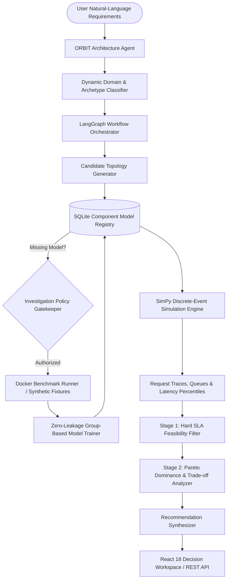

# ORBIT — Orchestrated Reasoning and Benchmarking for Infrastructure Testing

[](https://www.python.org/downloads/)
[](frontend/)
[](https://fastapi.tiangolo.com/)
[](https://simpy.readthedocs.io/)
[](tests/)
[](orbit/agent/orchestrator.py)

**ORBIT** is an autonomous platform for engineering teams that designs, benchmarks, simulates, and recommends backend system architectures. By unifying **LangGraph agentic reasoning**, **empirical container benchmarks**, and **SimPy request-level discrete-event simulation**, ORBIT translates natural-language system requirements into mathematically validated, evidence-backed architectural decisions.

---

## 🌌 What is ORBIT?

| Letter | Principle | Description |
| :---: | :--- | :--- |
| **O** | **Orchestrated** | Multi-agent coordination powered by LangGraph, managing stateful investigation cycles, sandboxed Simulation SDK workspaces, and policy gatekeepers. |
| **R** | **Reasoning** | Autonomous hypothesis generation, ambiguity ranking ($A \ge 0.50$), bounded clarification dialogue, and Pareto trade-off synthesis. |
| **B** | **Benchmarking** | Calibrated container performance models, empirical PostgreSQL baselines, and synthetic fallback fixtures with cryptographic provenance. |
| **I** | **Infrastructure** | Multi-tier topologies including Ingress APIs, Redis In-Memory Caches, PostgreSQL RDBMS, Asynchronous Message Queues, Task Workers, and Document Stores. |
| **T** | **Testing** | SimPy request-level discrete-event simulation modeling CPU core contention, database connection pool exhaustion, and tail latency SLAs. |

---

## ⚡ Quick Start: Running the Product Demo

ORBIT includes an end-to-end demonstration stack with a FastAPI backend and a modular **React 18 + Vite** frontend.

### 1. Launch the Full Stack (Backend + React Frontend)

```bash
# Starts FastAPI backend (port 8000) and React frontend (port 3000)
./scripts/run_demo.sh
```

- Open **http://localhost:3000** in your browser to interact with the ORBIT Architecture Decision Workspace.
- Interactive REST documentation is live at **http://localhost:8000/docs**.
- *(Optional legacy interface)*: Run `./scripts/run_demo.sh --streamlit` to launch the Streamlit dashboard on port 8501.

### 2. Run the 3 Canonical Demo Scenarios via CLI

```bash
# Runs all 3 demonstration scenarios end-to-end with full assertion verification
./scripts/run_demo.sh --scenarios
# Or directly:
.venv/bin/python scripts/run_demo_scenarios.py
```

The three scenarios exercise distinct architectural trade-offs:
1. **Scenario 1 (Read-Heavy E-Commerce)**: 500 RPS, 90/10 R/W, p95 $\le$ 100ms, \$250 budget $\rightarrow$ **Architecture B (Cached Reads: API $\rightarrow$ Redis $\rightarrow$ PostgreSQL)** wins.
2. **Scenario 2 (Write-Heavy Transactional)**: 150 RPS, 40/60 R/W, p95 $\le$ 150ms, \$300 budget $\rightarrow$ **Architecture A (Simple: API $\rightarrow$ PostgreSQL)** wins; cache overhead is unjustified.
3. **Scenario 3 (Background Worker Processing)**: 300 RPS incoming, async processing, p95 $\le$ 100ms, \$350 budget $\rightarrow$ **Architecture C (Async: API $\rightarrow$ Queue $\rightarrow$ Worker $\rightarrow$ PostgreSQL)** wins for lowest API response latency.

---

## 🔬 Core Architectural Innovations

### 1. Dynamic Application Domain & System Archetype Taxonomy
Users design arbitrary systems (e.g. *"hotel rating app with live map updates"*, *"education platform with user-generated AI videos"*, *"cryptocurrency arbitrage order book"*). Rather than forcing these into a rigid 5-bucket enum, ORBIT decouples the domain from the underlying physics:
- **Application Domain (`app_type`)**: Open-ended, extracted dynamically from the user's prompt (e.g. `hotel_rating_app_with_maps`).
- **System Archetype Taxonomy**: Calibrated engineering priors mapping behavioral profiles to simulation baselines:
  - `READ_HEAVY_INTERACTIVE`: High cache potential ($R/W \ge 80/20$), stringent tail latency SLAs ($p95 \le 100\text{ ms}$).
  - `DECOUPLED_ASYNC_COMPUTE`: Heavy write or batch workloads ($R/W \le 30/70$), asynchronous queueing topologies.
  - `TRANSACTIONAL_OLTP`: Strict ACID guarantees ($R/W \approx 50/50$), low latency, no intermediate cache invalidation risk.
  - `WRITE_HEAVY_INGESTION`: Time-series, analytics, or logging telemetry ($R/W \le 20/80$), write-optimized buffers.
  - `REALTIME_STREAM_TRACKING`: Geo-location updates, websockets, live IoT tracking ($R/W \le 30/70$).

### 2. Bounded Clarification Dialogue
When user requirements lack essential operational constraints (e.g. missing RPS, unstated latency targets), ORBIT does **not** make silent, ungrounded assumptions.
- An **Ambiguity Scoring Engine** ranks uncertain dimensions ($A \ge 0.50$).
- Generates at most **1 round** of bounded, high-impact multiple-choice questions.
- User responses seamlessly feed into the second turn to produce mathematically rigorous recommendations.

### 3. Simulation SDK & 13 Composable Tools
ORBIT Phase 5.3 introduces the **Simulation SDK** (`orbit/sdk/`), exposing 13 composable REST and Python tools for programmatic experimentation:
- **Workspace Isolation**: Sandboxed workspace management (`create_workspace`, `export_workspace`).
- **Topology Builder**: Programmatic DAG assembly (`create_topology`, `add_component`, `connect_components`).
- **Discrete-Event Simulation**: Request-level queueing simulation (`run_simulation`, `run_parameter_sweep`, `compare_topologies`).
- **Model Registry Inspection**: Introspection of active empirical models (`inspect_model_registry`, `verify_model_coverage`).
- **Investigation & Governance**: Policy-checked experiment execution (`propose_experiment`, `evaluate_policy`, `execute_benchmark`).

### 4. Rule of Honest Capabilities
ORBIT enforces strict epistemic honesty across all recommendations:
- **Epistemic Labeling**: Every metric is tagged with its provenance (`MEASURED_BENCHMARK`, `EMPIRICAL_FIT`, `SIMULATION_DERIVED`, or `AGENT_ASSUMPTION`).
- **No Fabricated Capabilities**: If a component is unmodeled (e.g. uncalibrated storage engines), the system reports capability boundaries and validation gaps cleanly rather than hallucinating performance.

---

## 🏗️ System Architecture & Workflow



---

## 📊 Candidate Topologies

| Architecture | Topology Path | Typical Monthly Cost | Key Trade-off |
| :--- | :--- | :---: | :--- |
| **Architecture A — Direct Simple** | API Gateway $\rightarrow$ PostgreSQL 16 | **\$133.00** | Lowest cost and zero cache invalidation complexity; database CPU saturates under heavy write/read load (>600 RPS). |
| **Architecture B — Cached Reads** | API Gateway $\rightarrow$ Redis 7 $\rightarrow$ PostgreSQL 16 on miss | **\$176.00** | Sub-millisecond reads (85% cache hits shield DB); added Redis infrastructure cost and cache invalidation complexity. |
| **Architecture C — Decoupled Async** | API Gateway $\rightarrow$ Queue $\rightarrow$ Worker Pool $\rightarrow$ PostgreSQL 16 | **\$216.00** | Decouples burst write spikes with immediate HTTP 202 acknowledgment; highest operational complexity. |
| **Architecture M — Document Store** | API Gateway $\rightarrow$ MongoDB 7.0 | **\$127.00** | Used to demonstrate automated missing-model discovery and empirical calibration pipelines. |

---

## 🚀 Execution Modes

### 1. Offline Deterministic Mode (Default)
Runs 100% locally with zero external API keys or network dependencies. Natural language parsing and recommendation synthesis use deterministic regex extractors and template engines, backed by reconciled empirical benchmarks.

### 2. LLM-Powered Mode (Optional)
When an API key (`GROQ_API_KEY`, `OPENAI_API_KEY`, or `ANTHROPIC_API_KEY`) is provided in `.env`:
- Extracts natural language requirements using LangChain structured outputs (`with_structured_output`).
- Synthesizes executive summaries and trade-off rationales grounded in the deterministic simulation results.
- **Anti-Hallucination Guardrail**: The LLM cannot overturn the mathematically chosen Pareto winner or alter quantitative metrics.

---

## 🛠️ REST API Reference

| Endpoint | Method | Description |
| :--- | :---: | :--- |
| `/api/demo/run` | `POST` | Primary demo endpoint returning standardized Sections A–E (`DemoWorkflowResponse`). |
| `/api/agent/run` | `POST` | Runs the full LangGraph orchestrator with customizable investigation budgets. |
| `/api/sdk/capabilities` | `GET` | Discovers Simulation SDK capabilities, supported components, and execution modes. |
| `/api/sdk/workspaces` | `POST` | Creates an isolated simulation experimentation workspace. |
| `/api/sdk/workspaces/{id}/simulate` | `POST` | Runs discrete-event simulation against a workspace topology. |
| `/api/workflow/run` | `POST` | Direct execution of candidate simulation and feasibility ranking. |
| `/api/registry/components` | `GET` | Lists all registered components and their empirical performance models. |
| `/api/health` | `GET` | Health check endpoint returning engine status and active version. |

---

## 💻 Development & Testing

### Installation

```bash
# Clone the repository
git clone https://github.com/your-org/orbit.git
cd orbit

# Create virtual environment with Python 3.12
uv venv --python 3.12 .venv
source .venv/bin/activate

# Install dependencies in editable mode
uv pip install -e .

# Install frontend dependencies
cd frontend && npm install && cd ..
```

### Running the Full Test Suite

```bash
# Run all 374 unit, integration, and simulation tests
.venv/bin/pytest -v
```

### Building the Frontend

```bash
cd frontend
npm run build
```

---

## 📁 Repository Structure

```
ORBIT/
├── pyproject.toml                     # Python package metadata and dependencies
├── README.md                          # System documentation and operational guide
├── .env.example                       # Template environment configuration
├── scripts/
│   ├── run_demo.sh                    # Unified launcher for API backend and React UI
│   ├── run_demo_scenarios.py          # Automated verification for the 3 canonical scenarios
│   └── verify_llm.py                  # Opt-in live LLM connectivity verifier
├── orbit/
│   ├── agent/                         # LangChain & LangGraph agentic reasoning layer
│   │   ├── orchestrator.py            # LangGraph StateGraph workflow orchestrator
│   │   ├── architecture_agent.py      # Requirements parser & dynamic domain extractor
│   │   ├── investigation_planner.py   # Investigation loop and hypothesis evaluator
│   │   ├── investigation_policy.py    # Deterministic policy gatekeeper
│   │   ├── recommendation_synthesizer.py # Grounded trade-off explanation synthesizer
│   │   └── tools.py                   # Typed LangChain tool wrappers
│   ├── api/                           # FastAPI REST services
│   │   ├── app.py                     # API service entrypoint
│   │   └── routes.py                  # API route definitions
│   ├── benchmark/                     # Empirical container benchmarking
│   │   ├── docker_runner.py           # Docker pgbench runner with cgroup resource limits
│   │   ├── synthetic_runner.py        # Seeded synthetic benchmark fixture runner
│   │   └── e2e_calibration.py         # Multi-tier calibration harness
│   ├── core/                          # Fundamental schemas and system configuration
│   │   ├── config.py                  # Pricing, path, and resource defaults
│   │   └── schemas.py                 # Core Pydantic data contracts
│   ├── evaluation/                    # Two-stage feasibility and Pareto decision engine
│   │   ├── feasibility_filter.py      # Stage 1: Hard SLA feasibility filtering
│   │   ├── tradeoff_analyzer.py       # Stage 2: Pareto dominance and preference scoring
│   │   └── recommender.py             # Explainable recommendation builder
│   ├── modeling/                      # Empirical model fitting and validation
│   │   └── model_trainer.py           # Zero-leakage group-based model trainer
│   ├── registry/                      # Persistent SQLite model registry
│   │   └── component_registry.py      # SQLite model and experiment storage
│   ├── sdk/                           # Phase 5.3 Simulation SDK
│   │   ├── interface.py               # 13 composable SDK tool contracts
│   │   ├── models.py                  # Topology and workspace Pydantic schemas
│   │   ├── store.py                   # Thread-safe workspace and experiment store
│   │   └── capabilities.py            # SDK engine discovery metadata
│   ├── simulation/                    # SimPy discrete-event simulation engine
│   │   ├── simpy_engine.py            # Static candidate topology simulator
│   │   ├── dynamic_simpy_engine.py    # Arbitrary SDK topology DAG simulator
│   │   └── metrics_collector.py       # Tail latency and utilization percentiles
│   └── ui/                            # Streamlit legacy interface
│       └── streamlit_app.py           # Interactive Streamlit dashboard
├── frontend/                          # React 18 + Vite frontend
│   ├── src/
│   │   ├── features/                  # Slot-based feature architecture
│   │   ├── components/                # Modular UI components
│   │   └── App.jsx                    # Root application component
│   └── package.json                   # Frontend dependencies
└── tests/                             # 374 automated tests (Unit, Integration, SDK)
```

---

## 📜 License

ORBIT is open-source software licensed under the **Apache 2.0 License**.
