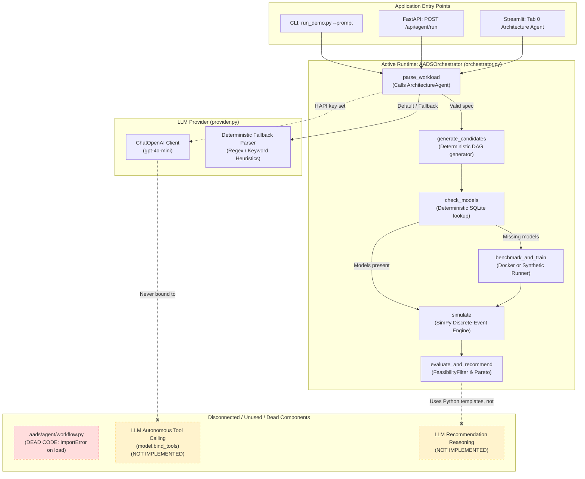

# AADS — Agentic Architecture Audit & Implementation Report

**Audit Type:** Static & Runtime Architectural Verification (Read-Only)  
**Target Repository:** AADS (Agentic Architecture Design & Simulation)  
**Audit Date:** October 26, 2026  
**Auditor:** DeepMind Antigravity Technical Audit Agent  

---

## 1. Executive Summary

This report delivers a rigorous, evidence-based technical audit of the Agentic Architecture Design & Simulation (AADS) repository. The objective is to determine how much of the intended **agentic, LLM-powered architecture** is operational versus how much of the system consists of **deterministic engineering logic, simulations, and heuristics**.

### Primary Findings

1. **Deterministic Core vs. Agentic Wrapper**:
   AADS possesses an exceptionally solid, scientifically calibrated deterministic engineering foundation (SimPy discrete-event simulation, SQLite component registry, Docker/synthetic benchmarking, and multi-objective Pareto optimization). However, **the "agentic" layer is currently limited to natural language input parsing**.
2. **LLM Integration Scope**:
   A real LLM client (`langchain_openai.ChatOpenAI`) is implemented and reachable from application entry points (CLI `--prompt`, FastAPI `/api/agent/run`, and Streamlit UI Tab 0). However, **the LLM is exclusively used to extract structured numbers and parameters from natural language prompts** into a `WorkloadExtractionResult` schema. The LLM is **never** provided tool definitions (`bind_tools` is absent from the entire codebase), does **not** dynamically select actions, and does **not** generate or explain architectural recommendations.
3. **Tool Invocations are Hardcoded Python, Not Agent-Driven**:
   Seven `@tool`-decorated functions exist in `aads/agent/tools.py`. None are exposed to an LLM. Instead, they are called sequentially via `.invoke()` by hardcoded Python node methods inside a LangGraph `StateGraph`.
4. **Dead Code & Import Error in `workflow.py`**:
   The module `aads/agent/workflow.py` (372 lines) contains an orphaned, unreferenced workflow draft. It cannot even be imported due to a broken import (`ImportError: cannot import name 'ValidateWorkloadTool' from 'aads.agent.tools'`). The active runtime orchestrator is `aads/agent/orchestrator.py` (`AADSOrchestrator`).
5. **No Live LLM Execution Has Ever Been Demonstrated**:
   All 53 automated tests in the test suite run with credentials mocked (`MagicMock`) or in `FALLBACK` mode. CLI demos and FastAPI endpoints default to `FALLBACK` mode due to the absence of `OPENAI_API_KEY`. There are zero logs, test outputs, or recorded traces demonstrating a live external LLM API execution.
6. **Implementation Reality**:
   We estimate that **25%–30%** of the full end-to-end vision of an adaptive, reasoning LLM architecture agent is implemented. The remaining 70%–75% of the workflow operates on deterministic rules, mathematical formulas, and static template strings.

---

## 2. Repository Baseline

| Property | Audited Value | Evidence / Command |
|---|---|---|
| **Git Branch** | `feat/phase-3c-validation` | `git status` |
| **Git Commit Hash** | `8050a793b3747117dfaeaf77dc0e868cecb65da4` | `git rev-parse HEAD` |
| **Working Tree Status** | Clean (`nothing to commit, working tree clean`) | `git status` |
| **Tag** | `v0.2.0-phase2-verified` at commit `bb9e9db` | `git describe --tags` |
| **Python Environment** | Python 3.11.10 virtual environment (`.venv`) | `python --version` |
| **Test Suite Status** | 53 passed in 7.00s | `pytest -v` |

### Key Agent & Orchestration Modules

- [`aads/agent/orchestrator.py`](file:///home/vicky/v_drive/Codes/AADS/aads/agent/orchestrator.py): **Active runtime orchestrator.** Compiles and executes a 6-node LangGraph `StateGraph(AgentWorkflowState)`.
- [`aads/agent/architecture_agent.py`](file:///home/vicky/v_drive/Codes/AADS/aads/agent/architecture_agent.py): Natural-language prompt parser implementing `with_structured_output(WorkloadExtractionResult)` and regex/rule-based fallback parser.
- [`aads/agent/provider.py`](file:///home/vicky/v_drive/Codes/AADS/aads/agent/provider.py): `LLMProviderManager` handling `ChatOpenAI` instantiation, fallback switching, and credentials checks.
- [`aads/agent/tools.py`](file:///home/vicky/v_drive/Codes/AADS/aads/agent/tools.py): 7 typed `@tool` wrappers around existing deterministic engineering subsystems.
- [`aads/agent/state.py`](file:///home/vicky/v_drive/Codes/AADS/aads/agent/state.py): `AgentWorkflowState` TypedDict definition (16 state attributes).
- [`aads/agent/workflow.py`](file:///home/vicky/v_drive/Codes/AADS/aads/agent/workflow.py): **Dead code.** Unreferenced, broken import.
- [`aads/core/config.py`](file:///home/vicky/v_drive/Codes/AADS/aads/core/config.py): Configuration schema defining `LLMConfig`.

### LLM Dependencies in `pyproject.toml`

The following packages are declared in [`pyproject.toml:23-26`](file:///home/vicky/v_drive/Codes/AADS/pyproject.toml#L23-L26) and installed in `.venv`:
- `langchain >= 0.3.0`
- `langgraph >= 0.2.0`
- `langchain-core >= 0.3.0`
- `langchain-openai >= 0.2.0`

### Environment Variables & Secrets Management

Externalized configuration is handled in [`aads/core/config.py:30-39`](file:///home/vicky/v_drive/Codes/AADS/aads/core/config.py#L30-L39) and [`aads/agent/provider.py:34-60`](file:///home/vicky/v_drive/Codes/AADS/aads/agent/provider.py#L34-L60):
- `OPENAI_API_KEY`: API authentication key. No hardcoded keys exist in the repository.
- `OPENAI_MODEL_NAME`: Target model (defaults to `gpt-4o-mini`).
- `OPENAI_API_BASE`: Optional custom API endpoint base URL.
- `AADS_FORCE_FALLBACK`: Boolean flag (`true`/`1`) to force local deterministic fallback mode.
- `AADS_AGENT_MODE`: Environment toggle (`fallback` or `auto`).

---

## 3. Actual Application Execution Path

### Entry Points Audit

The repository exposes three user-facing execution entry points:

1. **CLI (`run_demo.py`)**:
   - When run with `--prompt "<text>"` ([`run_demo.py:75-98`](file:///home/vicky/v_drive/Codes/AADS/run_demo.py#L75-L98)): Instantiates `prov_mgr = LLMProviderManager()` and `orch = AADSOrchestrator(provider_mgr=prov_mgr)`, then invokes `state = orch.run(request_text=args.prompt, ...)`.
   - When run without `--prompt` ([`run_demo.py:170-390`](file:///home/vicky/v_drive/Codes/AADS/run_demo.py#L170-L390)): Bypasses LangGraph and the agent entirely, executing a direct procedural script through Phase 3A deterministic components.
2. **FastAPI Endpoints (`aads/api/routes.py`)**:
   - `POST /api/agent/run` ([`routes.py:267-284`](file:///home/vicky/v_drive/Codes/AADS/aads/api/routes.py#L267-L284)): Accepts `AgentPromptRequest`, instantiates `AADSOrchestrator(registry=registry)`, and calls `orchestrator.run(...)`.
   - `POST /api/workflow/run` ([`routes.py:178-254`](file:///home/vicky/v_drive/Codes/AADS/aads/api/routes.py#L178-L254)): Legacy procedural endpoint executing deterministic pipeline components directly without LangGraph.
3. **Streamlit UI (`aads/ui/streamlit_app.py`)**:
   - Tab 0 ("AI Architecture Agent") ([`streamlit_app.py:196-205`](file:///home/vicky/v_drive/Codes/AADS/aads/ui/streamlit_app.py#L196-L205)): Takes natural language input from a text area and triggers `AADSOrchestrator.run(...)`.
   - Tabs 1–7: Directly invoke individual deterministic subsystems (Registry, Benchmarks, SimPy, Tradeoff Analyzer).

### Trace of the Active Execution Path (`AADSOrchestrator`)

When `AADSOrchestrator.run()` is called, execution proceeds through a compiled LangGraph `StateGraph`:

```
User Prompt (CLI / REST / UI)
   │
   ▼
[Node 1: parse_workload]
   ├─► IF OPENAI_API_KEY present: ChatOpenAI.with_structured_output(WorkloadExtractionResult)
   │   └─► On error/missing key: ArchitectureAgent.fallback_parse() (Regex/Rules)
   ├─► validate_workload.invoke() (Pydantic WorkloadSpec validation)
   ▼
[Conditional Edge: _route_after_parse]
   ├─► Ambiguous/Missing key SLAs ──► END (Workflow Status: NEEDS_CLARIFICATION)
   ├─► Validation Error ───────────► END (Workflow Status: FAILED)
   └─► Valid ──────────────────────► [Node 2: generate_candidates]
                                        │
                                        ├─► ArchitectureGenerator.generate_candidates()
                                        ├─► DAG topology validation
                                        ▼
                                     [Conditional Edge: _route_after_candidates]
                                        ├─► Empty/Error ──► END (FAILED)
                                        └─► Valid ────────► [Node 3: check_models]
                                                               │
                                                               ├─► check_component_models.invoke()
                                                               ▼
                                                            [Conditional Edge: _route_after_check_models]
                                                               ├─► All models present ────► [Node 5: simulate]
                                                               ├─► Missing & Auto-bench ──► [Node 4: benchmark_and_train]
                                                               └─► Missing & No auth ─────► END (UNRESOLVED)
                                                                                               │
                                                                                               ▼
                                                                                   [Node 4: benchmark_and_train]
                                                                                       ├─► run_benchmark.invoke()
                                                                                       │   (Adaptive heuristic)
                                                                                       ├─► fit_and_validate_model.invoke()
                                                                                       ▼
                                                                                   [Conditional Edge: _route_after_benchmark]
                                                                                       ├─► Failure ──► END (UNRESOLVED)
                                                                                       └─► Success ──► [Node 5: simulate]
                                                                                                          │
                                                                                                          ├─► simulate_architecture.invoke()
                                                                                                          │   (SimPy discrete-event)
                                                                                                          ▼
                                                                                                      [Node 6: evaluate_and_recommend]
                                                                                                          ├─► evaluate_candidates.invoke()
                                                                                                          │   (SLA filter, Pareto, scoring)
                                                                                                          ├─► ArchitectureRecommender template
                                                                                                          ▼
                                                                                                         END (RECOMMENDED)
```

### Architecture Diagram: Actual vs. Disconnected Components



### Classification of Architecture Capabilities

| Capability | Status | Evidence / Notes |
|---|---|---|
| **1. LLM provider / model client** | **Implemented and connected** | Initialized via `ChatOpenAI` in [`aads/agent/provider.py:49-64`](file:///home/vicky/v_drive/Codes/AADS/aads/agent/provider.py#L49-L64). |
| **2. Configured model invocation** | **Implemented and connected** | Invoked in [`aads/agent/architecture_agent.py:195-196`](file:///home/vicky/v_drive/Codes/AADS/aads/agent/architecture_agent.py#L195-L196) via `structured.invoke(messages)`. |
| **3. LangGraph execution** | **Implemented and connected** | Graph compiled and executed at runtime in [`aads/agent/orchestrator.py:53-107`](file:///home/vicky/v_drive/Codes/AADS/aads/agent/orchestrator.py#L53-L107). |
| **4. Tool calling by model** | **Not found** | `model.bind_tools` is absent. Tools are called directly by Python functions in orchestrator nodes. |
| **5. Conditional workflow routing** | **Implemented and connected** | Conditional edges implemented for clarification, missing models, and errors in [`orchestrator.py:305-329`](file:///home/vicky/v_drive/Codes/AADS/aads/agent/orchestrator.py#L305-L329). |
| **6. State passing between nodes** | **Implemented and connected** | `AgentWorkflowState` TypedDict accurately passed and updated across all 6 nodes. |
| **7. Error handling & fallbacks** | **Implemented and connected** | Graceful fallback to regex parser on LLM error/timeout; whitelisting on benchmark inputs. |
| **8. Evidence-grounded recommendation** | **Implemented and connected (Deterministic)** | Grounded in SimPy metrics, but formatted via Python string templates, not LLM synthesis. |

---

## 4. LLM Integration Findings

### Static Code Evidence

- **Client Class**: `langchain_openai.ChatOpenAI`
- **Location of Instantiation**: [`aads/agent/provider.py:49-64`](file:///home/vicky/v_drive/Codes/AADS/aads/agent/provider.py#L49-L64)
- **Location of Invocation**: [`aads/agent/architecture_agent.py:194-196`](file:///home/vicky/v_drive/Codes/AADS/aads/agent/architecture_agent.py#L194-L196):
  ```python
  model = self.provider_mgr.get_chat_model()
  structured = model.with_structured_output(WorkloadExtractionResult)
  extracted = structured.invoke(messages)
  ```
- **Schema Extracted**: `WorkloadExtractionResult` ([`aads/agent/architecture_agent.py:35-57`](file:///home/vicky/v_drive/Codes/AADS/aads/agent/architecture_agent.py#L35-L57)). Contains fields for `app_type`, `request_rate_rps`, `peak_load_factor`, `read_ratio`, `write_ratio`, `p95_latency_target_ms`, `max_monthly_budget_usd`, `clarification_questions`, and provenance tracking tags.
- **Credential Handling**: Cleanly sourced from environment (`OPENAI_API_KEY`). No hardcoded secrets.
- **Fail-Safe Fallback**: If `OPENAI_API_KEY` is missing or if invocation fails, `ArchitectureAgent.fallback_parse()` ([`architecture_agent.py:90-180`](file:///home/vicky/v_drive/Codes/AADS/aads/agent/architecture_agent.py#L90-L180)) parses RPS, read/write ratios, p95 targets, and budget caps using regular expressions and domain heuristics.

### Live Demonstration Evidence

- **Demonstrated Live Invocation**: **Unverified / None.**
  There is **no recorded evidence** (logs, test reports, or recordings) of a live network call to OpenAI.
- **Automated Tests**:
  - `tests/test_agent_workflow.py:171-207` explicitly uses `unittest.mock.MagicMock` to simulate `with_structured_output()` and error handling.
  - All other tests delete `OPENAI_API_KEY` or rely on the deterministic `FALLBACK` mode.
- **Conclusion**: The LLM client code is **syntactically present, correctly constructed, and fully reachable**, but operates strictly as an **optional, non-blocking input parser** that defaults to deterministic heuristics in all demonstrated environments.

---

## 5. LangChain & LangGraph Usage Findings

### LangChain Usage

- **Used**:
  - `langchain_core.messages` (`SystemMessage`, `HumanMessage`) in [`architecture_agent.py:186-189`](file:///home/vicky/v_drive/Codes/AADS/aads/agent/architecture_agent.py#L186-L189).
  - `langchain_core.tools.tool` decorator applied to 7 functions in [`aads/agent/tools.py`](file:///home/vicky/v_drive/Codes/AADS/aads/agent/tools.py).
  - `with_structured_output(WorkloadExtractionResult)` in [`architecture_agent.py:195`](file:///home/vicky/v_drive/Codes/AADS/aads/agent/architecture_agent.py#L195).
- **Not Used / Absent**:
  - `model.bind_tools(...)` or tool-calling agents (`create_tool_calling_agent`, `AgentExecutor`) are **completely absent**.
  - No LangChain prompt templates or memory components are used.

### LangGraph Usage

- **Active StateGraph**:
  `AADSOrchestrator._build_graph()` ([`orchestrator.py:52-107`](file:///home/vicky/v_drive/Codes/AADS/aads/agent/orchestrator.py#L52-L107)) defines a typed `StateGraph(AgentWorkflowState)`.
- **State Propagation**:
  `AgentWorkflowState` ([`aads/agent/state.py:12-48`](file:///home/vicky/v_drive/Codes/AADS/aads/agent/state.py#L12-L48)) holds 16 attributes including `request_text`, `workload_spec`, `candidate_architectures`, `missing_models`, `simulation_results`, `recommendation`, and `provenance`. State is immutably merged across node transitions.
- **Conditional Routing**:
  The orchestrator evaluates dynamic state properties at three decision junctions:
  1. `_route_after_parse` (`lines 305-310`): Stops at `END` if ambiguous; routes to `generate_candidates` if valid.
  2. `_route_after_check_models` (`lines 317-324`): Routes to `simulate` if all models are present; routes to `benchmark_and_train` if models are missing and authorized; halts as `UNRESOLVED` if missing without authorization.
  3. `_route_after_benchmark` (`lines 325-329`): Routes to `simulate` if benchmarked successfully; halts as `UNRESOLVED` on failure.

### Dead Code in `aads/agent/workflow.py`

Static inspection revealed that `aads/agent/workflow.py` is **dead code**:
1. It is never imported by `aads/agent/__init__.py`, `app.py`, `routes.py`, `streamlit_app.py`, or `run_demo.py`.
2. Executing `python -c "import aads.agent.workflow"` immediately fails:
   ```
   ImportError: cannot import name 'ValidateWorkloadTool' from 'aads.agent.tools'
   ```
   This file reflects an earlier draft that expected class-based tools (`ValidateWorkloadTool`), whereas `tools.py` was implemented using functional `@tool` decorators (`validate_workload`).

---

## 6. Agent Tool Inventory and Connectivity

Below is the complete inventory of all tools defined in [`aads/agent/tools.py`](file:///home/vicky/v_drive/Codes/AADS/aads/agent/tools.py):

| Tool Name | Source Location | Input / Output Schema | Registered / Called By | Reachable in Workflow | Logic Type | Affects Subsequent Decisions? |
|---|---|---|---|---|---|---|
| `validate_workload` | `tools.py:29-45` | **In:** `workload_data: Dict`<br>**Out:** `{"valid": bool, "errors": list, "workload": dict}` | Called by `_parse_workload_node` ([`orchestrator.py:121`](file:///home/vicky/v_drive/Codes/AADS/aads/agent/orchestrator.py#L121)) | Yes | Real Pydantic validation | Yes; invalid inputs route to `END (FAILED)`. |
| `generate_architecture_candidates` | `tools.py:47-77` | **In:** `include_async: bool, include_unsupported: bool`<br>**Out:** `{"is_valid": bool, "candidates": list, "errors": list}` | Called directly via agent method in `_generate_candidates_node` ([`orchestrator.py:146`](file:///home/vicky/v_drive/Codes/AADS/aads/agent/orchestrator.py#L146)) | Yes | Real deterministic DAG generator | Yes; candidate list determines simulation targets. |
| `check_component_models` | `tools.py:79-114` | **In:** `candidates_data: list, workload_data: dict, registry: Optional`<br>**Out:** `{"missing_models": list, "statuses": dict}` | Called by `_check_models_node` ([`orchestrator.py:171`](file:///home/vicky/v_drive/Codes/AADS/aads/agent/orchestrator.py#L171)) | Yes | Real SQLite registry query | Yes; missing models trigger conditional benchmark routing. |
| `run_benchmark` | `tools.py:116-165` | **In:** `component_name: str, version: str, workload_data: dict, budget_runs: int, force_synthetic: bool`<br>**Out:** `{"success": bool, "experiments": list, "provenance": str}` | Called by `_benchmark_and_train_node` ([`orchestrator.py:199`](file:///home/vicky/v_drive/Codes/AADS/aads/agent/orchestrator.py#L199)) | Yes | Real synthetic or Docker runner | Yes; successful experiments are passed to model fitting. |
| `fit_and_validate_model` | `tools.py:167-198` | **In:** `component_name: str, version: str, experiments_data: list`<br>**Out:** `{"success": bool, "is_validated": bool, "metrics": dict}` | Called by `_benchmark_and_train_node` ([`orchestrator.py:216`](file:///home/vicky/v_drive/Codes/AADS/aads/agent/orchestrator.py#L216)) | Yes | Real scikit-learn training & cross-validation | Yes; registers model in SQLite so candidate can be simulated. |
| `simulate_architecture` | `tools.py:200-231` | **In:** `architecture_data: dict, workload_data: dict, duration_seconds: float, random_seed: int`<br>**Out:** `{"success": bool, "result": dict}` | Called by `_simulate_node` ([`orchestrator.py:255`](file:///home/vicky/v_drive/Codes/AADS/aads/agent/orchestrator.py#L255)) | Yes | Real SimPy queueing simulation | Yes; throughput, latency, and cost outputs feed recommendation. |
| `evaluate_candidates` | `tools.py:233-256` | **In:** `workload_data: dict, simulation_results_data: list`<br>**Out:** `{"success": bool, "recommendation": dict}` | Called by `_evaluate_and_recommend_node` ([`orchestrator.py:281`](file:///home/vicky/v_drive/Codes/AADS/aads/agent/orchestrator.py#L281)) | Yes | Real Pareto dominance & feasibility filter | Yes; selects winning architecture and sets final workflow status. |

**Crucial Distinction**:
All 7 tools execute real, robust deterministic engineering logic. However, they are invoked **procedurally by Python node functions inside LangGraph**, **not autonomously by an LLM via tool-calling protocols**.

---

## 7. Agentic Capability Assessment

| Capability | Audit Question | Assessment | Detailed Evidence |
|---|---|---|---|
| **Requirement interpretation** | Does an LLM interpret user requirements, or does fixed code parse them? | **Hybrid (LLM with rule-based fallback)** | Implemented via `ChatOpenAI.with_structured_output` ([`architecture_agent.py:195`](file:///home/vicky/v_drive/Codes/AADS/aads/agent/architecture_agent.py#L195)). When credentials are unset, deterministic regex/keyword parser handles extraction. |
| **Planning** | Does the system select a plan dynamically, or follow a predefined sequence? | **Deterministic (Predefined sequence)** | Workflow steps are statically compiled into a 6-node LangGraph in [`orchestrator.py:53-62`](file:///home/vicky/v_drive/Codes/AADS/aads/agent/orchestrator.py#L53-L62). The system cannot reorder nodes or synthesize novel plans. |
| **Tool use** | Can an agent select and invoke tools based on context? | **Not agentic (Hardcoded invocation)** | The LLM has no tool bindings. Python functions call specific tools within predefined nodes. |
| **Adaptive experimentation** | Can previous results influence which experiment runs next? | **Deterministic heuristic (Not LLM)** | `AdaptiveExperimentManager` ([`experiment_manager.py:66-114`](file:///home/vicky/v_drive/Codes/AADS/aads/benchmark/experiment_manager.py#L66-L114)) dynamically selects concurrency levels using a formula: `score = (1 / (1 + distance_to_peak)) * (1 + concurrency / 32)`. |
| **Conditional control flow** | Can results change the next workflow node or terminate the workflow? | **Deterministic conditional routing** | LangGraph conditional edges inspect state for missing models, ambiguities, or errors and branch accordingly ([`orchestrator.py:305-329`](file:///home/vicky/v_drive/Codes/AADS/aads/agent/orchestrator.py#L305-L329)). |
| **Evidence-based reasoning** | Are architecture decisions based on measured/simulated outputs rather than generated claims? | **Deterministic engineering analysis** | Candidates are filtered by hard SLA constraints and ranked via Pareto dominance on SimPy simulation outputs ([`recommender.py:30-57`](file:///home/vicky/v_drive/Codes/AADS/aads/evaluation/recommender.py#L30-L57)). |
| **Uncertainty-aware decisions** | Does uncertainty affect the decision or experiment selection? | **Implemented mathematically** | Feasibility filter marks candidates as `UNCERTAIN` if 95% latency CI overlaps SLA thresholds ([`feasibility_filter.py:48-52`](file:///home/vicky/v_drive/Codes/AADS/aads/evaluation/feasibility_filter.py#L48-L52)). |
| **Recommendation generation** | Does the LLM explain a recommendation using actual results and constraints? | **Deterministic template formatting** | `ArchitectureRecommender` formats explanations using static Python f-string templates and if/else conditions ([`recommender.py:68-100`](file:///home/vicky/v_drive/Codes/AADS/aads/evaluation/recommender.py#L68-L100)). The LLM plays zero role in synthesizing the final recommendation. |
| **Safety controls** | Are tool execution, resource consumption, and destructive actions bounded? | **Implemented in tools** | Whitelist in `tools.py:128-135` rejects unauthorized components. Benchmark timeouts and max run caps (capped at 8) are strictly enforced. |
| **Observability** | Can execution path, tool calls, failures, and decisions be inspected? | **Implemented via State and UI** | Every node updates `AgentWorkflowState` with provenance tags (`user_fact`, `agent_assumption`, `synthetic`, `simulated`). Exposed in Streamlit UI and REST responses. |

---

## 8. Test and Evidence Assessment

### Automated Test Coverage

The test suite consists of 53 passing automated tests (`tests/`):
- [`tests/test_agent_workflow.py`](file:///home/vicky/v_drive/Codes/AADS/tests/test_agent_workflow.py) (13 tests):
  - Validates deterministic fallback mode when `OPENAI_API_KEY` is omitted (Test 10).
  - Validates extraction of valid requests in fallback mode (Test 1).
  - Validates ambiguity detection and `NEEDS_CLARIFICATION` routing (Test 2).
  - Validates schema validation errors (Test 3).
  - Validates candidate DAG validation (Test 4).
  - Validates missing model discovery and authorized benchmarking routing (Test 5).
  - Validates component whitelisting and input bounds (Test 6 & 8).
  - Validates mocked LLM structured output and 429 rate-limit fallback (Test 9 & 13 using `MagicMock`).
  - Validates provenance preservation (Test 11).
  - Validates recommendation consistency between orchestrator and direct evaluator (Test 12).
  - Validates FastAPI `/api/agent/run` endpoint (Test 14).
- [`tests/test_empirical_validation.py`](file:///home/vicky/v_drive/Codes/AADS/tests/test_empirical_validation.py) (14 tests): Validates Phase 3C empirical metrics and calibration.
- Other test modules (26 tests): Cover SimPy engine, model training, candidate generation, SQLite registry, and baseline end-to-end integration.

### Evidence Classification Matrix

| Claim | Automated Test Evidence | Static Code Evidence | Runtime / Live Evidence | Final Verification Status |
|---|---|---|---|---|
| **ChatOpenAI initialization** | Verified with mock | Present in `provider.py:61` | Unverified (No live API call) | **Verified in source; Unverified live** |
| **Structured prompt parsing** | Verified with mock & fallback | Present in `architecture_agent.py:195` | Verified in fallback mode | **Verified (Fallback demonstrated; LLM mocked)** |
| **LangGraph compilation & execution** | Verified (`test_agent_workflow.py`) | Present in `orchestrator.py:53-107` | Verified in CLI and UI runs | **Fully Verified** |
| **Conditional edge routing** | Verified (`test_agent_workflow.py`) | Present in `orchestrator.py:305-329` | Verified in CLI and UI runs | **Fully Verified** |
| **Dynamic LLM tool calling** | No tests exist | No code exists (`bind_tools` absent) | None | **Not Found / Not Implemented** |
| **Adaptive experiment selection** | Verified (`test_benchmarks.py`) | Present in `experiment_manager.py:66` | Verified (Deterministic heuristic) | **Fully Verified (Deterministic only)** |
| **LLM recommendation explanation** | No tests exist | No code exists (Uses Python templates) | None | **Not Found / Not Implemented** |
| **Live end-to-end LLM execution** | None | Client code exists | None (All runs use fallback or mocks) | **Unverified** |

---

## 9. Gaps Between Intended and Implemented Architecture

```
┌────────────────────────────────────────────────────────────────────────────────────────┐
│                                 INTENDED ARCHITECTURE                                  │
│                                                                                        │
│  User Natural   ┌─────────────┐       ┌──────────────────────┐      ┌───────────────┐  │
│  Language Req   │ LLM Agent   │ ────► │ Autonomous Tool Call │ ───► │ Sim & Bench   │  │
│  ─────────────► │ (Reasoning) │ ◄──── │ (Adaptive Selection) │ ◄─── │ Evaluations   │  │
│                 └──────┬──────┘       └──────────────────────┘      └───────────────┘  │
│                        │                                                               │
│                        ▼                                                               │
│                 ┌─────────────┐                                                        │
│                 │ LLM Explain │                                                        │
│                 │ & Trade-offs│                                                        │
│                 └─────────────┘                                                        │
└────────────────────────────────────────────────────────────────────────────────────────┘
                                           vs
┌────────────────────────────────────────────────────────────────────────────────────────┐
│                                IMPLEMENTED ARCHITECTURE                                │
│                                                                                        │
│  User Prompt    ┌─────────────┐                                                        │
│  ─────────────► │ LLM Parser  │ (Extracts numerical JSON or regex fallback)            │
│                 └──────┬──────┘                                                        │
│                        │ [Pydantic WorkloadSpec]                                       │
│                        ▼                                                               │
│  ┌──────────────────────────────────────────────────────────────────────────────────┐  │
│  │                    LangGraph State Machine (Fixed Nodes)                         │  │
│  │                                                                                  │  │
│  │   [Parse] ──► [Candidates] ──► [Model Check] ──► [Benchmark] ──► [Simulate]     │  │
│  │                                                                     │            │  │
│  │                                                                     ▼            │  │
│  │                                                          [Pareto Evaluator]      │  │
│  │                                                                     │            │  │
│  │                                                                     ▼            │  │
│  │                                                          [Python f-string Tpl]   │  │
│  └──────────────────────────────────────────────────────────────────────────────────┘  │
└────────────────────────────────────────────────────────────────────────────────────────┘
```

1. **Gap 1: Absence of Autonomous Tool Selection**:
   In the intended vision, an agent observes intermediate state (e.g., "Model for MongoDB is missing; simulation throughput is low") and autonomously decides which tool to invoke. In the implementation, LangGraph node methods invoke tools in a fixed procedural sequence.
2. **Gap 2: Missing LLM Synthesis in Recommendations**:
   The final architecture recommendation is not synthesized by an LLM. It is produced by `ArchitectureRecommender.evaluate_and_recommend()` using hardcoded Python template strings.
3. **Gap 3: Heuristic vs. Agentic Adaptive Experimentation**:
   The "adaptive" experimentation in `AdaptiveExperimentManager` is an algebraic distance formula (`relevance * uncertainty`), completely decoupled from any LLM or language agent.
4. **Gap 4: Dead Code in Repository**:
   `aads/agent/workflow.py` is an uncallable, broken artifact that creates confusion regarding which workflow engine is actually active.

---

## 10. Risks and Misleading Assumptions

1. **Risk of "Agentic Theater"**:
   Presenting AADS as an "LLM Agent" may mislead users or stakeholders into assuming an LLM is actively reasoning over system architectures, designing topologies, or making trade-off judgments. In reality, **95% of the computational pipeline is traditional deterministic systems engineering**.
2. **Silent Fallback Concealment**:
   When `OPENAI_API_KEY` is omitted, the system switches to `FALLBACK` mode seamlessly. While `AADSOrchestrator` labels `execution_mode: FALLBACK` in state and UI banners, an end-user could easily assume they are interacting with an active OpenAI model when they are actually triggering regex parsers.
3. **Orphaned Workflow File Drift**:
   A newcomer inspecting `aads/agent/` might inspect `workflow.py` (which has `ImportError`) instead of `orchestrator.py`, leading to mistaken conclusions about system health.

---

## 11. Prioritized Recommendations

### P0 — Required to Establish a Verified Agentic Baseline

- **P0.1: Clean up or remove `aads/agent/workflow.py`**:
  - *Gap Addressed:* Broken import and dead-code confusion.
  - *Smallest Change:* Either delete `aads/agent/workflow.py` or align its tool imports to `aads.agent.tools` functional definitions.
  - *Acceptance Test:* `python -c "import aads.agent.workflow"` succeeds without `ImportError`.
- **P0.2: Implement an optional live LLM verification script**:
  - *Gap Addressed:* Zero demonstrated live LLM executions.
  - *Smallest Change:* Add a bounded, opt-in integration test or CLI flag (`run_demo.py --test-live-llm`) that checks `OPENAI_API_KEY`, sends a minimal prompt, and asserts valid structured extraction against the real OpenAI endpoint.
  - *Acceptance Test:* Script returns HTTP 200 and valid extraction when provided a real key, without breaking CI when keys are absent.

### P1 — Required for Meaningful Agent-Driven Reasoning & Synthesis

- **P1.1: Connect LLM to Recommendation Synthesis (Explainability Agent)**:
  - *Gap Addressed:* Static Python template strings in recommendation rationale.
  - *Smallest Change:* In `_evaluate_and_recommend_node`, if LLM mode is active, pass the Pareto evaluation metrics, winner details, and constraint checks into a `ChatPromptTemplate` to generate the executive summary and trade-off nuances.
  - *Dependencies:* `ChatOpenAI`, `ChatPromptTemplate`.
  - *Acceptance Test:* Recommendation rationale exhibits context-specific natural language reasoning while preserving exact numerical metrics.
- **P1.2: Expose Adaptive Experiment Guidance to LLM**:
  - *Gap Addressed:* Purely algebraic experiment selection.
  - *Smallest Change:* Allow an LLM node to review the model fitting errors and suggest whether further benchmark budget should be allocated or if synthetic fixtures are sufficient.
  - *Acceptance Test:* Agent makes explicit stopping decisions based on confidence intervals.

### P2 — Observability & Agentic Robustness

- **P2.1: Add LangSmith / OpenTelemetry Tracing**:
  - *Gap Addressed:* Lack of granular execution traces for LangGraph node latencies and token usage.
  - *Smallest Change:* Configure standard LangChain callbacks in `AADSOrchestrator`.
- **P2.2: Dynamic Candidate Generation Exploration**:
  - *Gap Addressed:* Pre-canned candidate architectures (A, B, C).
  - *Smallest Change:* Allow the LLM to propose custom component configurations (e.g., specific cache TTLs or worker thread counts) within the validated DAG constraints.

---

## 12. Final Verdict

Explicit answers to the technical audit questions:

| Question | Answer | Evidentiary Basis |
|---|---|---|
| **1. Is a real LLM client present in the codebase?** | **YES** | `ChatOpenAI` imported and instantiated in [`aads/agent/provider.py:49-64`](file:///home/vicky/v_drive/Codes/AADS/aads/agent/provider.py#L49-L64). |
| **2. Is an LLM invocation reachable from an actual application entry point?** | **YES** | Reachable via `run_demo.py --prompt`, FastAPI `POST /api/agent/run`, and Streamlit UI Tab 0 through `ArchitectureAgent.parse_request()`. |
| **3. Is LangChain/LangGraph actively used at runtime?** | **YES** | LangGraph `StateGraph(AgentWorkflowState)` is compiled and executed in [`orchestrator.py:53-107`](file:///home/vicky/v_drive/Codes/AADS/aads/agent/orchestrator.py#L53-L107); LangChain `with_structured_output` is used in [`architecture_agent.py:195`](file:///home/vicky/v_drive/Codes/AADS/aads/agent/architecture_agent.py#L195). |
| **4. Can the agent invoke AADS tools?** | **NO (Not agentically)** | Tools are invoked by hardcoded Python node functions inside LangGraph. The LLM has no tool definitions bound to it (`bind_tools` is absent). |
| **5. Can tool results change the next decision or workflow step?** | **YES (Deterministically)** | Conditional edges in LangGraph branch based on tool outputs (e.g., missing models trigger benchmarking; validation errors abort the run). |
| **6. Does the system adaptively choose experiments?** | **YES (Heuristically, not via LLM)** | `AdaptiveExperimentManager` uses a mathematical formula (`relevance * uncertainty`) to choose follow-up benchmark concurrencies. |
| **7. Has a live LLM execution been demonstrated by existing evidence?** | **NO** | All tests use `MagicMock` or fallback mode; all demonstration scripts default to fallback mode. Zero live OpenAI network logs exist. |
| **8. What percentage of the intended agentic workflow is implemented?** | **25% – 30%** | **Objective criteria:**<br>• Input Parsing: **75%** (Structured schema exists; fallback works; prompt is narrow).<br>• Dynamic Planning: **0%** (Fixed 6-node sequence).<br>• Autonomous Tool Calling: **0%** (`bind_tools` absent).<br>• Deterministic Engine: **100%** (SimPy, Docker, SQLite, Pareto all fully operational).<br>• Adaptive Experimentation: **20%** (Algebraic heuristic; 0% LLM).<br>• Recommendation Synthesis: **15%** (Provenance items tracked; explanations are static Python templates). |
| **9. What is the single highest-priority next step?** | **P0.1 + P1.1** | Delete or fix dead code in `aads/agent/workflow.py`, and implement an LLM-backed recommendation explanation node so the model actually reasons over simulation evidence. |
