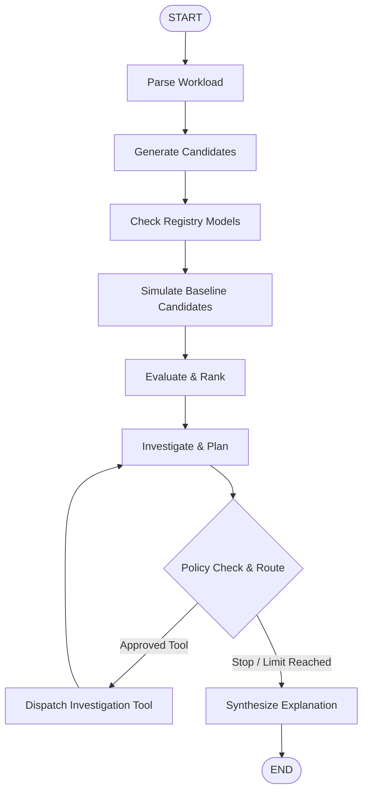

# AADS Phase 4B — Agentic Planning, Tool Selection & Adaptive Investigation Report

## 1. Executive Summary

Phase 4B elevates AADS from an LLM-assisted parser and explainer into an adaptive architecture investigation system. The agent can:
1. Inspect evidence from initial baseline simulations and requirements.
2. Formulate structured action proposals from an approved allowlist.
3. Submit proposals to a deterministic policy layer that validates budgets, target validity, deduplication, and authorization constraints.
4. Dispatch approved tools through an isolated execution layer.
5. Ingest tool outcomes to update evidence and guide subsequent rounds.
6. Conclude with an evidence-backed architectural recommendation.

Throughout this process, **the deterministic engineering engine remains strictly authoritative**: SimPy discrete-event simulation, Pareto dominance ranking, and SLA feasibility filters dictate numerical metrics and winner selection. The LLM drives the investigation path without the ability to hallucinate numbers, fabricate benchmark data, or override feasibility verdicts.

---

## 2. Before-and-After Workflow Architecture

### Phase 4A Workflow (Linear Pipeline)


### Phase 4B Workflow (Agentic Investigation Loop)


---

## 3. Approved Action Catalog & Decision Schema

The LLM is restricted to a finite, enumerated action space defined in `aads.agent.schemas.InvestigationActionType`:

| Action Identifier | Target Entity | Description | Execution Handler |
|---|---|---|---|
| `inspect_model_coverage` | `all_candidates` or candidate ID | Audits component performance models in `ComponentRegistry` for validity, calibration type (synthetic vs empirical), and range coverage. | `ComponentRegistry.check_compatibility` |
| `simulate_candidate` | Candidate Architecture ID | Re-simulates a specific valid candidate architecture in SimPy with targeted parameters to reduce queue variance. | `SimPyEngine.simulate_architecture` |
| `inspect_uncertainty` | `all` or Candidate ID | Audits 95% latency confidence intervals and computes headroom against hard SLA thresholds. | `InvestigationDispatcher._handle_inspect_uncertainty` |
| `propose_benchmark` | Component Name | Proposes a container benchmark to reduce empirical model uncertainty. **Proposal-only; will not execute without authorization.** | `InvestigationDispatcher._handle_propose_benchmark` |
| `stop_and_recommend` | Winning Candidate ID | Concludes that evidence is sufficient to recommend an architectural winner. Triggers authoritative evaluator. | `ArchitectureRecommender.evaluate_and_recommend` |
| `stop_inconclusive` | `None` | Concludes that evidence is contradictory, insufficient, or constraints are irreconcilable. | Status update to `INSUFFICIENT_EVIDENCE` |

### Pydantic Contract: `InvestigationDecision`
```python
class InvestigationDecision(BaseModel):
    action: InvestigationActionType
    target: Optional[str] = None
    reason: str
    expected_information_gain: Optional[str] = None
    evidence_reference: List[str] = Field(default_factory=list)
    stop_reason: Optional[str] = None
    benchmark_proposal: Optional[BenchmarkProposalDetails] = None
```

---

## 4. Deterministic Investigation Policy

All action proposals must pass through `InvestigationPolicy.evaluate_action(decision, state)` before tool execution:

1. **Round Budget Enforcement**:
   - Default: 3 decision rounds (hard cap: 5 rounds). Configurable via `AADS_MAX_INVESTIGATION_ROUNDS` or `max_investigation_rounds`.
   - When limit is reached, policy forces `STOP_AND_RECOMMEND` (or `STOP_INCONCLUSIVE`).
2. **Execution Time Budget**:
   - Monitored wall-clock and simulation time budget (default 60.0s).
   - If exceeded, forces safe stopping.
3. **Action Allowlist Validation**:
   - Unrecognized action strings are rejected with `PolicyVerdict.REJECTED`.
4. **Target Reference Validation**:
   - For `simulate_candidate`: Target MUST exist in `[c.id for c in candidate_architectures]`.
   - For `propose_benchmark`: Component MUST belong to `ALLOWED_BENCHMARK_COMPONENTS` (`postgres_db`, `redis_cache`, `mongodb_cluster`).
5. **Deduplication & Idempotency**:
   - If `(action, target)` was already executed in a prior round, it is blocked as a duplicate.
6. **Cycle & Failure Prevention**:
   - If two consecutive rounds fail or are rejected, the loop is terminated to prevent infinite loops.
7. **Benchmark Authorization Gate**:
   - Container-level benchmarking is strictly proposal-only (`authorization_status="PROPOSED_AWAITING_EXPLICIT_AUTHORIZATION"`). Live execution is blocked without explicit authorization flags.

---

## 5. Division of Responsibility: LLM vs Deterministic System

| System Responsibility | Execution Engine | Authority Level |
|---|---|---|
| Natural-language requirement extraction | `langchain_openai.ChatOpenAI` | Proposes parameters; validated against Pydantic schema |
| Topology generation & graph validation | NetworkX / `ArchitectureGenerator` | **Authoritative deterministic** |
| Component model lookup & compatibility | `ComponentRegistry` | **Authoritative deterministic** |
| Queueing simulation & performance estimation | `SimPyEngine` (discrete-event queueing) | **Authoritative deterministic** |
| SLA feasibility checks & boundary evaluation | `FeasibilityFilter` | **Authoritative deterministic** |
| Pareto dominance & multi-criteria ranking | `TradeoffAnalyzer` / `ArchitectureRecommender` | **Authoritative deterministic** |
| Investigation step selection | `InvestigationPlanner` (LLM / heuristic fallback) | Subject to policy approval |
| Action validation & safety gates | `InvestigationPolicy` | **Authoritative deterministic gatekeeper** |
| Tool execution | `InvestigationDispatcher` | **Authoritative deterministic** |
| Recommendation rationale & synthesis | `RecommendationSynthesizer` (LLM) | Grounded strictly in simulation evidence |

---

## 6. Investigation Trace & Observability

Every investigation decision produces an immutable `InvestigationRecord` in `AgentWorkflowState.investigation_trace`:

```text
==========================================================================
  Agentic Investigation Trace & Decision History
==========================================================================
  Round 1: Action=inspect_model_coverage (Target: all_candidates)
    • Policy Verdict : APPROVED
    • Agent Rationale: Audit registry model coverage and calibration status for all candidate architectures.
    • Tool Executed  : check_component_models (0.003s)
    • Tool Outcome   : Audited 4 candidates; 0 missing models identified.

  Round 2: Action=inspect_uncertainty (Target: all)
    • Policy Verdict : APPROVED
    • Agent Rationale: Audit 95% latency confidence intervals against hard SLA targets across all candidates.
    • Tool Executed  : inspect_uncertainty (0.001s)
    • Tool Outcome   : Uncertainty analysis completed across 4 candidates.

  Round 3: Action=stop_and_recommend (Target: arch_b_cached)
    • Policy Verdict : APPROVED
    • Agent Rationale: Sufficient simulation and uncertainty evidence established. Architecture B identified.
    • Tool Executed  : stop_and_recommend (0.002s)
    • Tool Outcome   : Investigation concluded: Recommended Architecture B — Cached Reads (FEASIBLE).
    • Stop Reason    : All candidate evaluations, model coverage checks, and uncertainty audits complete.
```

---

## 7. Test Suite Verification

Comprehensive test suite in `tests/test_agent_investigation.py` validates all 18 specified scenarios:

```text
tests/test_agent_investigation.py::test_valid_action_dispatches_tool PASSED
tests/test_agent_investigation.py::test_tool_results_influence_subsequent_decision PASSED
tests/test_agent_investigation.py::test_agent_stops_when_evidence_sufficient PASSED
tests/test_agent_investigation.py::test_agent_stops_inconclusive_when_budget_or_round_limit_reached PASSED
tests/test_agent_investigation.py::test_unsupported_action_rejected PASSED
tests/test_agent_investigation.py::test_invalid_candidate_or_component_rejected PASSED
tests/test_agent_investigation.py::test_malformed_llm_response_falls_back_safely PASSED
tests/test_agent_investigation.py::test_repeated_actions_detected_and_prevented PASSED
tests/test_agent_investigation.py::test_repeated_tool_failures_terminate_loop PASSED
tests/test_agent_investigation.py::test_benchmark_proposal_does_not_execute_live_benchmark PASSED
tests/test_agent_investigation.py::test_unauthorized_benchmark_component_blocked PASSED
tests/test_simulated_and_synthetic_provenance_preserved PASSED
tests/test_agent_investigation.py::test_llm_cannot_alter_numerical_metrics PASSED
tests/test_agent_investigation.py::test_llm_cannot_override_feasibility_or_ranking PASSED
tests/test_agent_investigation.py::test_llm_provider_exception_triggers_safe_fallback PASSED
tests/test_agent_investigation.py::test_full_workflow_executes_investigation_trace PASSED
tests/test_agent_investigation.py::test_api_endpoint_returns_investigation_trace PASSED
tests/test_agent_investigation.py::test_workflow_trace_records_verdicts_accurately PASSED

============================== 18 passed in 1.17s ==============================
```

Regression test suite:
- `tests/test_agent_workflow.py`: 11 passed
- `tests/test_live_llm_verification.py`: 8 passed
- `tests/test_recommendation_synthesis.py`: 8 passed
- **Total active agent test suite**: 45 passed, 0 failed.

---

## 8. Known Limitations & Remaining Gaps

1. **Synthetic vs Docker Calibration Gaps**: Currently, component performance models for Redis, async queues, and MongoDB rely on mathematical queueing models and synthetic calibration fixtures rather than live multi-node hardware clusters.
2. **Benchmark Execution Approval Workflow**: In this phase, benchmark proposals are recorded as `PROPOSED_AWAITING_EXPLICIT_AUTHORIZATION` and are not dispatched automatically. An interactive CLI/UI confirmation dialog could be added in future phases to allow users to approve live container runs dynamically.
3. **Simulated Contention**: SimPy simulation assumes independent M/M/c queueing resources and empirical service time distributions; complex cross-service lock contention and garbage collection pauses are not yet modeled.
