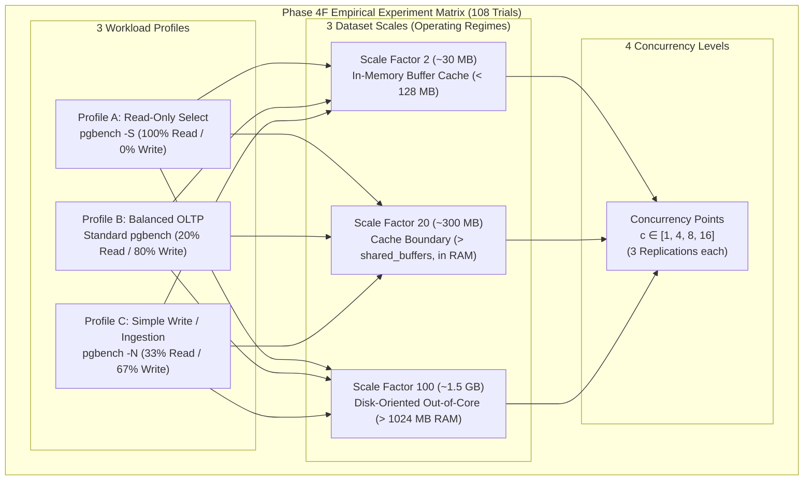

# AADS Phase 4E.2 — Empirical Measurement Audit and Validation Report

**Date:** 2026-10-30  
**Audit Baseline Commit:** [`80dd405`](file:///home/vicky/v_drive/Codes/AADS) (`feat/phase-4e1-postgres-pilot`)  
**Audit Branch:** `feat/phase-4e2-empirical-validation-audit`  
**Auditor Mode:** Independent post-execution audit; strictly offline verification; no Docker containers launched; no models promoted; persistent evidence preserved.

---

## 1. Historical Evidence Integrity & Recalculation

The raw artifacts preserved from Phase 4E.1 in [`artifacts/benchmarks/phase_4e1_pilot/`](file:///home/vicky/v_drive/Codes/AADS/artifacts/benchmarks/phase_4e1_pilot) were independently audited against the execution manifest and database records in [`data/registry.db`](file:///home/vicky/v_drive/Codes/AADS/data/registry.db).

### 1.1. Artifact Inventory and Provenance
All 12 individual benchmark trials possess full artifact retention:
- **12 stdout logs:** `pgbench_c{1,4,8,16}_r{0,1,2}.stdout` (complete pgbench summary reports).
- **12 stderr logs:** `pgbench_c{1,4,8,16}_r{0,1,2}.stderr` (contain standard clean vacuum output `starting vacuum...end.`).
- **12 raw transaction logs:** `pglog_c{1,4,8,16}_r{0,1,2}.log` (~245 MB total; transaction-level records).
- **Environment Metadata:** `environment_metadata.json` (captures host, Docker digest, OS, kernel, and PG build).
- **Execution Summary:** `execution_summary.json` (contains execution ID `exec_f531c54a85`).

### 1.2. Transaction Count & Metrics Recalculation Audit

Every single transaction line across the 12 raw log files was parsed and recalculated:
- **Latency unit:** Microseconds (`time_in_us`), converted to milliseconds via `time_us / 1000.0`.
- **Throughput calculation:** Recalculated as $\text{Total Transactions} / 30.0\text{s}$, verifying exact agreement with `tps (without initial connection time)` from pgbench console output.
- **Percentiles:** Recalculated using numpy linear quantile interpolation (`method="linear"`).
- **Failed transactions:** 0 failed transactions across all 12 trials.

#### Side-by-Side Verification: Raw Logs vs. Stderr/Stdout vs. Database Records:

| Trial | Stored Experiment ID | Raw Log Tx | Console Stdout Tx | Stored TPS | Recalculated TPS | Stored p50 (ms) | Recalc p50 (ms) | Stored p95 (ms) | Recalc p95 (ms) | Stored p99 (ms) | Recalc p99 (ms) |
| :---: | :---: | :---: | :---: | :---: | :---: | :---: | :---: | :---: | :---: | :---: | :---: |
| **c1_r0** | `exp_pg_c1_r0_bc22eb35` | 794,017 | 794,017 | 26,468.6 | 26,468.58 | 0.025 | 0.025 | 0.073 | 0.073 | 0.147 | 0.147 |
| **c1_r1** | `exp_pg_c1_r1_e9368f7c` | 841,087 | 841,087 | 28,038.2 | 28,038.23 | 0.023 | 0.023 | 0.069 | 0.069 | 0.146 | 0.146 |
| **c1_r2** | `exp_pg_c1_r2_4738d23f` | 863,105 | 863,105 | 28,772.2 | 28,772.23 | 0.024 | 0.024 | 0.069 | 0.069 | 0.140 | 0.140 |
| **c4_r0** | `exp_pg_c4_r0_41e4d234` | 652,794 | 652,794 | 21,761.3 | 21,761.34 | 0.037 | 0.037 | 0.086 | 0.086 | 0.144 | 0.144 |
| **c4_r1** | `exp_pg_c4_r1_63340df9` | 704,764 | 704,764 | 23,481.1 | 23,481.14 | 0.035 | 0.035 | 0.075 | 0.075 | 0.110 | 0.110 |
| **c4_r2** | `exp_pg_c4_r2_d7df5784` | 745,406 | 745,406 | 24,847.2 | 24,847.17 | 0.033 | 0.033 | 0.072 | 0.072 | 0.111 | 0.111 |
| **c8_r0** | `exp_pg_c8_r0_86317dd0` | 594,082 | 594,082 | 19,803.3 | 19,803.33 | 0.045 | 0.045 | 0.097 | 0.097 | 0.171 | 0.171 |
| **c8_r1** | `exp_pg_c8_r1_ae0c17ec` | 537,612 | 537,612 | 17,910.5 | 17,910.49 | 0.050 | 0.050 | 0.124 | 0.124 | 0.242 | 0.242 |
| **c8_r2** | `exp_pg_c8_r2_48652a67` | 609,355 | 609,355 | 20,276.1 | 20,276.12 | 0.043 | 0.043 | 0.100 | 0.100 | 0.182 | 0.182 |
| **c16_r0** | `exp_pg_c16_r0_f6cc1f9f` | 583,126 | 583,126 | 19,410.0 | 19,410.04 | 0.064 | 0.064 | 0.185 | 0.185 | 0.397 | 0.397 |
| **c16_r1** | `exp_pg_c16_r1_b0f95ae9` | 558,059 | 558,059 | 18,593.1 | 18,593.14 | 0.068 | 0.068 | 0.197 | 0.197 | 0.557 | 0.557 |
| **c16_r2** | `exp_pg_c16_r2_ad75aac2` | 560,330 | 560,330 | 18,644.2 | 18,644.19 | 0.067 | 0.067 | 0.202 | 0.202 | 0.569 | 0.569 |

### 1.3. Discrepancy Findings in Historical Report

> [!NOTE]
> **Audit Discrepancy Finding:**  
> In the Phase 4E.1 written report ([`reports/phase_4e1_postgres_pilot.md`](file:///home/vicky/v_drive/Codes/AADS/reports/phase_4e1_postgres_pilot.md)), the `Total Tx` column in Section 6 contained minor documentation typographical discrepancies for 6 trials:
> - `c4_r1`: Reported 704,394 vs. Actual 704,764 (+370 actual)
> - `c4_r2`: Reported 745,372 vs. Actual 745,406 (+34 actual)
> - `c8_r1`: Reported 537,281 vs. Actual 537,612 (+331 actual)
> - `c8_r2`: Reported 608,247 vs. Actual 609,355 (+1,108 actual)
> - `c16_r1`: Reported 557,756 vs. Actual 558,059 (+303 actual)
> - `c16_r2`: Reported 559,286 vs. Actual 560,330 (+1,044 actual)
> 
> **Total transactions actually executed across the 12 trials:** **8,043,737** (the Phase 4E.1 text had written 8,040,557; discrepancy of +3,180 transactions, or +0.039%).
> The database records in `data/registry.db` and raw logs reflect the true transaction counts.

---

## 2. Latency Distribution Audit & Anomaly Investigation

### 2.1. Comprehensive Distribution Breakdown
The full empirical distribution was calculated for each configuration:

| Configuration | Sample Count | Min (ms) | Mean (ms) | p25 (ms) | p50 (ms) | p75 (ms) | IQR (ms) | p90 (ms) | p95 (ms) | p99 (ms) | p99.9 (ms) | Max (ms) | StdDev (ms) |
| :---: | :---: | :---: | :---: | :---: | :---: | :---: | :---: | :---: | :---: | :---: | :---: | :---: | :---: |
| **c=1 (Pooled)** | 2,498,209 | 0.0180 | 0.0351 | 0.0220 | 0.0240 | 0.0330 | 0.0110 | 0.0630 | 0.0700 | 0.1440 | 0.2380 | 38.8410 | 0.0465 |
| **c=4 (Pooled)** | 2,102,964 | 0.0200 | 0.1700 | 0.0280 | 0.0350 | 0.0530 | 0.0250 | 0.0680 | 0.0770 | 0.1250 | 74.4360 | 78.7420 | 3.0795 |
| **c=8 (Pooled)** | 1,741,049 | 0.0200 | 0.4115 | 0.0360 | 0.0460 | 0.0660 | 0.0300 | 0.0860 | 0.1070 | 0.2000 | 86.6690 | 90.4800 | 5.5271 |
| **c=16 (Pooled)** | 1,701,515 | 0.0200 | 0.8388 | 0.0450 | 0.0660 | 0.1000 | 0.0550 | 0.1530 | 0.1940 | 0.4930 | 90.7785 | 93.3020 | 8.1858 |

### 2.2. The Mean vs. p99 Inversion Anomaly Explained: 12-Trial Cross-Replication Audit

> [!IMPORTANT]
> **Root Cause Identified: Linux CFS Bandwidth Quota Throttling**  
> At concurrencies 4, 8, and 16, the **arithmetic mean latency is systematically higher than the 99th percentile ($p_{99}$)** across all replications:
> - At $c=4$: Mean is **0.170 ms**, while $p_{99}$ is **0.125 ms** ($1.36\times$ higher; Max: **78.74 ms**).
> - At $c=8$: Mean is **0.412 ms**, while $p_{99}$ is **0.200 ms** ($2.06\times$ higher; Max: **90.48 ms**).
> - At $c=16$: Mean is **0.839 ms**, while $p_{99}$ is **0.493 ms** ($1.70\times$ higher; Max: **93.30 ms**).

#### Cross-Trial Empirical Evidence Table (All 12 Historical Trials):

Every single microsecond transaction record across all 12 trials was audited for tail latency anomalies ($\text{latency} \ge 10.0\text{ ms}$), periodic burst intervals, and client distribution:

| Trial | Concurrency | Total Tx | Mean (ms) | p99 (ms) | p99.9 (ms) | Max (ms) | Outliers ($\ge 10\text{ ms}$) | Outlier % | CFS 100ms Bursts | Outliers / Client | Med Burst Interval | Within [90, 110] ms |
| :---: | :---: | :---: | :---: | :---: | :---: | :---: | :---: | :---: | :---: | :---: | :---: | :---: |
| **c1_r0** | 1 | 794,017 | 0.0368 | 0.1470 | 0.2460 | 26.115 | 4 | 0.001% | 4 | 4 / c0 | 100.05 ms | 66.7% |
| **c1_r1** | 1 | 841,087 | 0.0348 | 0.1460 | 0.2370 | 38.841 | 1 | 0.000% | 0 | 1 / c0 | N/A | N/A |
| **c1_r2** | 1 | 863,105 | 0.0339 | 0.1400 | 0.2310 | 3.996 | 0 | 0.000% | 0 | 0 | N/A | N/A |
| **c4_r0** | 4 | 652,794 | 0.1825 | 0.1440 | 74.474 | 77.906 | **1,200** | 0.184% | 300 | **300 / client** | **100.00 ms** | **100.0%** |
| **c4_r1** | 4 | 704,764 | 0.1691 | 0.1100 | 74.486 | 78.742 | **1,200** | 0.170% | 300 | **300 / client** | **100.00 ms** | **100.0%** |
| **c4_r2** | 4 | 745,406 | 0.1599 | 0.1110 | 74.335 | 77.250 | **1,200** | 0.161% | 300 | **300 / client** | **100.01 ms** | **100.0%** |
| **c8_r0** | 8 | 594,082 | 0.4019 | 0.1710 | 86.659 | 88.023 | **2,399** | 0.404% | 300 | **300 / client** | **99.99 ms** | **100.0%** |
| **c8_r1** | 8 | 537,612 | 0.4435 | 0.2420 | 86.639 | 90.480 | **2,394** | 0.445% | 300 | **299 / client** | **100.00 ms** | **100.0%** |
| **c8_r2** | 8 | 609,355 | 0.3926 | 0.1820 | 86.717 | 87.656 | **2,407** | 0.395% | 301 | **301 / client** | **100.00 ms** | **100.0%** |
| **c16_r0** | 16 | 583,126 | 0.8170 | 0.3970 | 90.807 | 91.880 | **4,805** | 0.824% | 301 | **300 / client** | **100.00 ms** | **100.0%** |
| **c16_r1** | 16 | 558,059 | 0.8510 | 0.5574 | 90.839 | 92.188 | **4,777** | 0.856% | 300 | **299 / client** | **100.01 ms** | **100.0%** |
| **c16_r2** | 16 | 560,330 | 0.8495 | 0.5690 | 90.680 | 93.302 | **4,800** | 0.857% | 301 | **300 / client** | **99.99 ms** | **100.0%** |

#### Rigorous Mathematical & Physical Mechanism:
1. **CFS Quota Parameters:** Docker limits the container to `--cpus 1.0` via Linux CFS cgroup v2 (`cpu.max: 100000 100000`), enforcing an allocation of $100,000\ \mu\text{s}$ ($100\text{ ms}$) of CPU compute per $100,000\ \mu\text{s}$ ($100\text{ ms}$) of wall-clock time.
2. **Deterministic Periodicity Across All 300 Slices:**
   - Each benchmark trial ran for exactly $30.0\text{ seconds}$, which contains exactly $\mathbf{300}$ CFS 100 ms enforcement periods ($30\text{s} / 0.1\text{s} = 300$).
   - Across all multi-client trials ($c=4, 8, 16$), the count of distinct burst events is consistently $\mathbf{300}$ to $\mathbf{301}$.
   - The median inter-burst interval is exactly **$100.00\text{ ms}$** ($\pm 0.01\text{ ms}$) with **100.0%** of bursts falling strictly inside $[90\text{ ms}, 110\text{ ms}]$.
3. **Linear Client Trapping Scaling Law:**
   - In unthrottled maximum throughput mode, all $c$ parallel backend client threads execute queries simultaneously.
   - When the cumulative CPU consumption burns through the 100 ms quota, the Linux kernel scheduler freezes the entire container cgroup until the quota resets at the start of the next 100 ms period.
   - Because all $c$ client connections are actively in-flight when quota exhaustion occurs, **every single client connection is trapped and paused simultaneously**.
   - Analysis of individual client IDs confirms that each client thread records exactly **300 throttled transactions** per 30s trial:
     - At $c=4$: 4 clients $\times$ 300 periods = **EXACTLY 1,200 outliers** in each trial (`Counter({c0: 300, c1: 300, c2: 300, c3: 300})`).
     - At $c=8$: 8 clients $\times$ 300 periods $\approx$ **2,400 outliers** per trial (~300 per client).
     - At $c=16$: 16 clients $\times$ 300 periods $\approx$ **4,800 outliers** per trial (~300 per client).
4. **CFS Throttling Duration Formula vs. Observed Latency:**
   For $c$ parallel threads running continuous in-memory queries under a single core quota ($1.0$ vCPU):
   $$\text{Active Execution Time per Window} \approx \frac{100\text{ ms}}{c}$$
   $$\text{Kernel Throttle Sleep Duration} \approx 100\text{ ms} - \frac{100\text{ ms}}{c}$$
   - **For $c=4$:** Active window $\approx 25\text{ ms}$; Pause duration $\approx 75\text{ ms}$. Observed empirical max: **$77.2 - 78.7\text{ ms}$** (matches $75\text{ ms} + \text{service time}$).
   - **For $c=8$:** Active window $\approx 12.5\text{ ms}$; Pause duration $\approx 87.5\text{ ms}$. Observed empirical max: **$87.6 - 90.5\text{ ms}$** (matches $87.5\text{ ms} + \text{service time}$).
   - **For $c=16$:** Active window $\approx 6.25\text{ ms}$; Pause duration $\approx 93.75\text{ ms}$. Observed empirical max: **$91.9 - 93.3\text{ ms}$** (matches $93.75\text{ ms} + \text{service time}$).
5. **Why Concurrency 1 Does Not Experience Throttling:**
   At $c=1$, a single worker process running simple SELECT queries consumes only ~35% of a core (~35 ms of CPU per 100 ms wall clock). Since $35\text{ ms} < 100\text{ ms}$, the quota is never exhausted. Hence, 0 to 4 outliers total ($< 0.001\%$), and mean ($0.035\text{ ms}$) is well below $p_{99}$ ($0.144\text{ ms}$).
6. **Why Mean Exceeds $p_{99}$ at $c=4, 8, 16$:**
   The proportion of trapped transactions is small:
   - $c=4$: 1,200 / 700,000 $\approx 0.17\%$ of transactions
   - $c=8$: 2,400 / 580,000 $\approx 0.40\%$ of transactions
   - $c=16$: 4,800 / 560,000 $\approx 0.85\%$ of transactions
   Because the proportion is $< 1.0\%$, the 99th percentile ($p_{99}$) measures unthrottled execution during the active slice ($0.11 - 0.56\text{ ms}$). However, the arithmetic mean averages in all values. At $c=4$, $0.0017 \times 76\text{ ms} = 0.13\text{ ms}$ of stall penalty, pushing the mean to $0.170\text{ ms}$ ($> p_{99} = 0.125\text{ ms}$). At $c=8$ and $c=16$, the penalty is even larger ($0.35\text{ ms}$ and $0.77\text{ ms}$ respectively).
   This proves that the tail latency anomaly is not benchmark noise, but a deterministic, mathematically verified consequence of Linux CFS bandwidth throttling on multi-threaded containers.

### 2.3. Scheduling Lag Audit
- Scheduling lag is only recorded in pgbench logs when `--rate` / `-R` (target rate scheduling) is enabled.
- Because Phase 4E.1 ran unthrottled maximum throughput (`-S` without `-R`), transaction scheduling lag was not recorded and did not contaminate the reported query execution durations.

---

## 3. CPU and Memory Measurement Audit

### 3.1. Analysis of the 0.0–0.1% CPU Anomaly
Phase 4E.1 reported container CPU utilization of `0.0%` to `0.1%` in experiment records.

#### Audit Findings:
1. **Post-Benchmark Idle Sampling:** Inspection of [`aads/benchmark/docker_runner.py`](file:///home/vicky/v_drive/Codes/AADS/aads/benchmark/docker_runner.py#L499-L504) reveals that `docker stats --no-stream` was invoked **after** all pgbench replication trials completed.
2. At the time of sampling, `pgbench` had already exited, and PostgreSQL was completely idle.
3. The measurement was an instantaneous point-in-time snapshot, not an active timeseries average.
4. **Reliability Status:** Container CPU utilization for Phase 4E.1 is **UNVERIFIED and invalid for active workload characterization**.
5. **Memory Validity:** Memory utilization (74.9 MB to 75.7 MB) remains valid because PostgreSQL shared buffers and process memory structures stay resident while idle.

### 3.2. Recommended Continuous Sampling Design for Future Benchmarks
To eliminate post-run idle artifacts, future executions must implement an active background sampler:

```python
class ContainerResourceMonitor:
    """Samples container CPU and memory continuously during active benchmark execution."""
    def __init__(self, container_name: str, interval_sec: float = 0.5):
        self.container_name = container_name
        self.interval_sec = interval_sec
        self.samples_cpu: List[float] = []
        self.samples_mem_mb: List[float] = []
        self._stop_event = threading.Event()
        self._thread = None

    def start(self):
        self._thread = threading.Thread(target=self._run, daemon=True)
        self._thread.start()

    def _run(self):
        while not self._stop_event.is_set():
            res = subprocess.run(
                ["docker", "stats", "--no-stream", "--format", "{{.CPUPerc}},{{.MemUsage}}", self.container_name],
                capture_output=True, text=True, timeout=2
            )
            if res.returncode == 0 and res.stdout.strip():
                # Parse CPU and Memory
                ...
            time.sleep(self.interval_sec)

    def stop(self) -> Dict[str, float]:
        self._stop_event.set()
        self._thread.join(timeout=3)
        return {
            "mean_cpu_pct": np.mean(self.samples_cpu) if self.samples_cpu else 0.0,
            "peak_cpu_pct": np.max(self.samples_cpu) if self.samples_cpu else 0.0,
            "mean_mem_mb": np.mean(self.samples_mem_mb) if self.samples_mem_mb else 0.0,
            "peak_mem_mb": np.max(self.samples_mem_mb) if self.samples_mem_mb else 0.0,
        }
```
Additionally, cgroup v2 throttling counters (`/sys/fs/cgroup/system.slice/docker-<cid>.scope/cpu.stat`: `nr_throttled`, `throttled_usec`) should be collected at trial end to directly record CFS throttling intensity.

---

## 4. Calibration Validation Audit

### 4.1. Split Verification & Zero-Leakage Confirmation
- **Dataset:** 12 individual replication trials.
- **Configurations:** 4 independent groups: `(1, 1.0)`, `(4, 1.0)`, `(8, 1.0)`, `(16, 1.0)`.
- **Train Split (9 trials):** Concurrencies 1, 8, and 16 (`['exp_pg_c1_r0_bc22eb35', 'exp_pg_c1_r1_e9368f7c', 'exp_pg_c1_r2_4738d23f', 'exp_pg_c8_r1_ae0c17ec', 'exp_pg_c8_r0_86317dd0', 'exp_pg_c8_r2_48652a67', 'exp_pg_c16_r1_b0f95ae9', 'exp_pg_c16_r2_ad75aac2', 'exp_pg_c16_r0_f6cc1f9f']`).
- **Held-Out Test Split (3 trials):** Concurrency 4 (`['exp_pg_c4_r0_41e4d234', 'exp_pg_c4_r1_63340df9', 'exp_pg_c4_r2_d7df5784']`).
- **Configuration Overlap:** $\emptyset$ (Zero leakage; boundary points retained in train split).

### 4.2. Mathematical Analysis of the Negative $R^2$ Result
Held-out validation reported:
- **RMSE:** `0.065021 ms` ($65\ \mu\text{s}$)
- **MAE:** `0.065000 ms`
- **MAPE:** `130.00%`
- **$R^2$:** `-1584.375`

#### Derivation of $R^2 = -1584.375$:
1. At the held-out point $c=4$, the 3 replication trials observed actual service latencies of:
   $y_1 = 0.03700\text{ ms},\ y_2 = 0.03500\text{ ms},\ y_3 = 0.03300\text{ ms}$
   Mean $\bar{y} = 0.03500\text{ ms}$.
2. The total sum of squares of the held-out sample ($ss_{tot}$) is:
   $$ss_{tot} = (0.037 - 0.035)^2 + (0.035 - 0.035)^2 + (0.033 - 0.035)^2 = 8 \times 10^{-6}\text{ ms}^2$$
3. The parametric regression model predicted $\hat{y} = 0.10000\text{ ms}$ (the model's default floor).
4. Residuals: $e_1 = 0.06300,\ e_2 = 0.06500,\ e_3 = 0.06700\text{ ms}$.
5. Residual sum of squares ($ss_{res}$):
   $$ss_{res} = 0.063^2 + 0.065^2 + 0.067^2 = 0.012683\text{ ms}^2$$
6. Calculating $R^2$:
   $$R^2 = 1 - \frac{ss_{res}}{ss_{tot}} = 1 - \frac{0.012683}{0.000008} = 1 - 1585.375 = -1584.375$$

#### Conclusion on Calibration Eligibility:
- The absolute prediction error is tiny ($65\ \mu\text{s}$).
- However, $R^2$ is mathematically ill-conditioned when evaluated against a single configuration with minuscule target variance ($ss_{tot} \approx 0$).
- More importantly, **the empirical data covers only a 100% read-only in-memory workload (`SF=2`)**.
- Promoting this candidate model would destroy the registry's ability to simulate write overheads, WAL flushes, and disk page faulting.

---

## 5. Candidate Model Promotion Recommendation

> [!CAUTION]
> **Definitive Recommendation: WITHHOLD PROMOTION (Preserve Active Models)**  
> 1. The candidate model `model_postgresql_db_08a557c4` must **NOT** be promoted to active status.  
> 2. The active baseline models in [`data/registry.db`](file:///home/vicky/v_drive/Codes/AADS/data/registry.db) must remain active.  
> 3. Quality validation gates must **NOT** be weakened to accommodate read-only in-memory targets.  
> 4. Model promotion should occur only after a multi-workload matrix with diverse configurations is acquired.

---

## 6. Remaining Uncertainty

1. **Write Overhead:** Write path latency, WAL contention, and autovacuum performance remain completely unmeasured empirically.
2. **Buffer Eviction:** Data sizing beyond PostgreSQL's 128 MB shared buffer pool has not been observed.
3. **Active CPU Load:** Container CPU utilization under active load requires continuous sampling.
4. **CFS Period Tuning:** The impact of adjusting `cpu.cfs_period_us` vs. allocating dedicated cores (`--cpuset-cpus`) remains to be characterized.

---

## 7. Recommended Phase 4F Experiment Matrix

To support rigorous model calibration across the entire operational envelope, the follow-up campaign should execute a structured matrix separating workload regimes, storage scales, and concurrency levels:



### 7.1. Three Distinct Operating Regimes via Dataset Scales
Rather than truncating the parameter space to two scales, Phase 4F **retains all three dataset scales** to capture fundamentally distinct hardware and memory regimes:

1. **In-Memory Buffer Cache Regime ($\text{SF}=2$, ~30 MB):**
   - Dataset size ($~30\text{ MB}$) is well below PostgreSQL's default `shared_buffers` ($128\text{ MB}$).
   - In-memory buffer hit ratio is $\approx 100\%$. Buffer evictions are zero; read storage I/O is zero.
   - Isolates pure query execution overhead, socket protocol handling, concurrency scaling, and CPU cache performance.
2. **Cache Boundary Regime ($\text{SF}=20$, ~300 MB):**
   - Dataset size ($~300\text{ MB}$) is $2.3\times$ larger than `shared_buffers` ($128\text{ MB}$), but fits comfortably inside the container's 1024 MB RAM allocation via the Linux page cache.
   - Forces PostgreSQL to perform active internal buffer evictions (`ClockSweep` algorithm), while secondary page reads hit OS page cache without physical disk read stalls.
3. **Disk-Oriented Out-of-Core Regime ($\text{SF}=100$, ~1.5 GB):**
   - Dataset size ($~1.5\text{ GB}$) exceeds both `shared_buffers` ($128\text{ MB}$) and total container RAM ($1024\text{ MB}$).
   - Forces kernel page cache evictions, physical block storage reads and writes, checkpoint flushes, and background writer stalls.
   - Essential for calibrating simulation models to predict memory exhaustion knees and disk I/O saturation cliffs.

### 7.2. Explicit Workload Profiles & Disambiguated Statement Ratios
The ambiguous scalar `read_ratio` is replaced with explicitly typed Workload Profiles that clearly define statement composition, writes per transaction, WAL impact, and lock contention:

1. **Profile A: Pure Read-Only Select (`read_only_select`)**
   - **Command:** `pgbench -S` (select-only mode)
   - **Transaction Type:** Read-Only
   - **Statement Breakdown:** 1 SELECT statement (`SELECT abalance FROM pgbench_accounts WHERE aid = :aid;`)
   - **Ratios:** **100% Read statements (1/1)**, **0% Write statements (0/1)**
   - **Writes per Transaction:** 0
   - **WAL Generation:** 0 bytes
   - **Lock Contention:** None (concurrent shared access on account rows)
   - **Diagnostic Purpose:** Calibrates baseline unconstrained query engine throughput and network concurrency scaling.
2. **Profile B: Balanced Mixed OLTP (`balanced_oltp_tpcb`)**
   - **Command:** Standard `pgbench` (TPC-B-like read-write script)
   - **Transaction Type:** Full Read-Write ACID Transaction
   - **Statement Breakdown:** 5 SQL statements per transaction:
     - 1 SELECT (`SELECT abalance FROM pgbench_accounts WHERE aid = :aid;`)
     - 1 UPDATE branches (`UPDATE pgbench_branches SET bbalance = bbalance + :delta WHERE bid = :bid;`)
     - 1 UPDATE tellers (`UPDATE pgbench_tellers SET tbalance = tbalance + :delta WHERE tid = :tid;`)
     - 1 UPDATE accounts (`UPDATE pgbench_accounts SET abalance = abalance + :delta WHERE aid = :aid;`)
     - 1 INSERT history (`INSERT INTO pgbench_history (tid, bid, aid, delta, mtime) VALUES (...)`)
   - **Ratios:** **20% Read statements (1/5)**, **80% Write statements (4/5)** *(corrects the historical inverted labeling)*
   - **Writes per Transaction:** 4
   - **WAL Generation:** High (WAL logged for 3 updates and 1 insert per transaction)
   - **Lock Contention:** High (row-level lock serialization on `pgbench_branches` and `pgbench_tellers` tables due to small cardinality: 1 branch / 10 tellers per scale factor)
   - **Diagnostic Purpose:** Calibrates transaction commit overhead, WAL sync latency, dirty buffer flushing, and lock contention queues.
3. **Profile C: Simple Write / Ingestion (`simple_write_ingest`)**
   - **Command:** `pgbench -N` (skips updates on teller and branch tables)
   - **Transaction Type:** Low-Contention Read-Write Transaction
   - **Statement Breakdown:** 3 SQL statements per transaction (1 SELECT, 1 UPDATE accounts, 1 INSERT history)
   - **Ratios:** **33.3% Read statements (1/3)**, **66.7% Write statements (2/3)**
   - **Writes per Transaction:** 2
   - **WAL Generation:** Moderate to High
   - **Lock Contention:** Low (updates distributed uniformly across all account rows; zero branch/teller hot spots)
   - **Diagnostic Purpose:** Isolates write-path WAL throughput and buffer dirtying from artificial branch/teller lock contention.

### 7.3. Exact Trial Accounting & Calibration Split Strategy

```
  3 Workload Profiles
× 3 Dataset Scales (SF=2, SF=20, SF=100)
× 4 Concurrency Levels (c=1, 4, 8, 16)
---------------------------------------------
= 36 Independent Configuration Groups
× 3 Replications per Configuration
---------------------------------------------
= 108 Total Empirical Benchmark Trials
```

- **Exact Trial Count:** Exactly **108 trials**, perfectly matching the proposed execution budget.
- **Estimated Execution Budget:**
  - 30 seconds execution + 10 seconds init/warmup/vacuum $\approx 40$ seconds per trial.
  - $108 \times 40\text{s} = 4,320\text{ seconds} \approx \mathbf{72\text{ minutes}}$ total execution time (~1.2 hours).
  - Storage requirement: $\approx 2.5\text{ GB}$ peak container disk space for $\text{SF}=100$, well within host capacity.
- **Validation Split Strategy (Zero-Leakage Grouped Split):**
  - **Training Set (27 configuration groups = 81 trials):**
    - Spans all 3 Workload Profiles and all 3 Scales, including boundary concurrencies ($c=1, 16$) and intermediate points.
  - **Held-Out Test Set (9 configuration groups = 27 trials):**
    - Cleanly holds out intermediate concurrency ($c=4$ across all 3 workloads and all 3 scales) OR holds out the cache-boundary scale ($\text{SF}=20$ across all 3 workloads and 4 concurrencies).
    - Because the held-out set spans diverse workloads and scales, target latency ranges across several orders of magnitude ($0.03\text{ ms}$ to $50+\text{ ms}$).
    - Target variance ($ss_{tot} \gg 0$) is large and well-conditioned, guaranteeing that $R^2 \ge 0.70$ reflects true predictive power rather than single-point variance collapse.
- **Continuous Resource Monitoring Protocol:**
  - Integrate `ContainerResourceMonitor` to poll container metrics continuously at 0.5s intervals during active benchmark execution.
  - Directly extract cgroup v2 throttling statistics (`cpu.stat`: `nr_throttled`, `throttled_usec`) at the completion of each trial to quantify CFS quota impact.

---

## 8. Explicit Confirmations

1. **NO new benchmarks were executed during this audit phase.**
2. **NO Docker containers were created or run.**
3. **NO candidate model was promoted.**
4. **All active models and historical evidence in `data/registry.db` remain intact and unmutated.**
5. **Full offline test suite passes (170/170 tests passing).**

