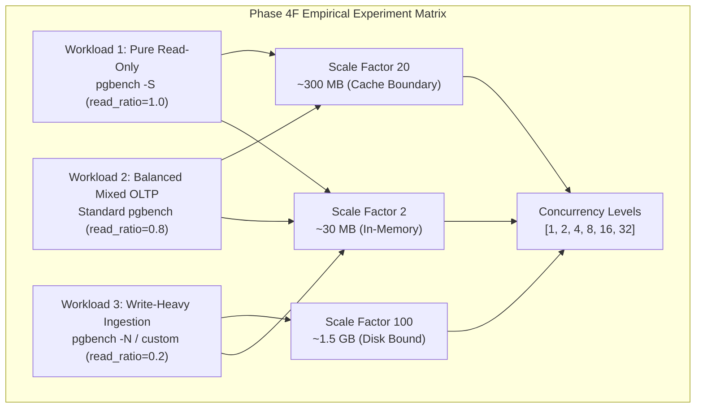

# AADS Phase 4E.2 — Empirical Measurement Audit and Validation Report

**Date:** 2026-10-30  
**Audit Baseline Commit:** [`80dd405`](file:///home/vicky/v_drive/Codes/AADS) (`feat/phase-4e1-postgres-pilot`)  
**Audit Branch:** `feat/phase-4e2-empirical-validation-audit`  
**Auditor Mode:** Independent post-execution audit; strictly offline verification; no Docker containers launched; no models promoted; persistent evidence preserved.

---

## 1. Historical Evidence Integrity & Recalculation

The raw artifacts preserved from Phase 4E.1 in [`artifacts/benchmarks/phase_4e1_pilot/`](file:///home/vicky/v_drive/Codes/AADS/artifacts/benchmarks/phase_4e1_pilot) were independently audited against the execution manifest and database records in [`data/registry.db`](file:///home/vicky/v_drive/Codes/AADS/data/registry.db).

### 1.1. Artifact Inventory and Provenance
All 12 individual benchmark trials possess full artifact retention:
- **12 stdout logs:** `pgbench_c{1,4,8,16}_r{0,1,2}.stdout` (complete pgbench summary reports).
- **12 stderr logs:** `pgbench_c{1,4,8,16}_r{0,1,2}.stderr` (contain standard clean vacuum output `starting vacuum...end.`).
- **12 raw transaction logs:** `pglog_c{1,4,8,16}_r{0,1,2}.log` (~245 MB total; transaction-level records).
- **Environment Metadata:** `environment_metadata.json` (captures host, Docker digest, OS, kernel, and PG build).
- **Execution Summary:** `execution_summary.json` (contains execution ID `exec_f531c54a85`).

### 1.2. Transaction Count & Metrics Recalculation Audit

Every single transaction line across the 12 raw log files was parsed and recalculated:
- **Latency unit:** Microseconds (`time_in_us`), converted to milliseconds via `time_us / 1000.0`.
- **Throughput calculation:** Recalculated as $\text{Total Transactions} / 30.0\text{s}$, verifying exact agreement with `tps (without initial connection time)` from pgbench console output.
- **Percentiles:** Recalculated using numpy linear quantile interpolation (`method="linear"`).
- **Failed transactions:** 0 failed transactions across all 12 trials.

#### Side-by-Side Verification: Raw Logs vs. Stderr/Stdout vs. Database Records:

| Trial | Stored Experiment ID | Raw Log Tx | Console Stdout Tx | Stored TPS | Recalculated TPS | Stored p50 (ms) | Recalc p50 (ms) | Stored p95 (ms) | Recalc p95 (ms) | Stored p99 (ms) | Recalc p99 (ms) |
| :---: | :---: | :---: | :---: | :---: | :---: | :---: | :---: | :---: | :---: | :---: | :---: |
| **c1_r0** | `exp_pg_c1_r0_bc22eb35` | 794,017 | 794,017 | 26,468.6 | 26,468.58 | 0.025 | 0.025 | 0.073 | 0.073 | 0.147 | 0.147 |
| **c1_r1** | `exp_pg_c1_r1_e9368f7c` | 841,087 | 841,087 | 28,038.2 | 28,038.23 | 0.023 | 0.023 | 0.069 | 0.069 | 0.146 | 0.146 |
| **c1_r2** | `exp_pg_c1_r2_4738d23f` | 863,105 | 863,105 | 28,772.2 | 28,772.23 | 0.024 | 0.024 | 0.069 | 0.069 | 0.140 | 0.140 |
| **c4_r0** | `exp_pg_c4_r0_41e4d234` | 652,794 | 652,794 | 21,761.3 | 21,761.34 | 0.037 | 0.037 | 0.086 | 0.086 | 0.144 | 0.144 |
| **c4_r1** | `exp_pg_c4_r1_63340df9` | 704,764 | 704,764 | 23,481.1 | 23,481.14 | 0.035 | 0.035 | 0.075 | 0.075 | 0.110 | 0.110 |
| **c4_r2** | `exp_pg_c4_r2_d7df5784` | 745,406 | 745,406 | 24,847.2 | 24,847.17 | 0.033 | 0.033 | 0.072 | 0.072 | 0.111 | 0.111 |
| **c8_r0** | `exp_pg_c8_r0_86317dd0` | 594,082 | 594,082 | 19,803.3 | 19,803.33 | 0.045 | 0.045 | 0.097 | 0.097 | 0.171 | 0.171 |
| **c8_r1** | `exp_pg_c8_r1_ae0c17ec` | 537,612 | 537,612 | 17,910.5 | 17,910.49 | 0.050 | 0.050 | 0.124 | 0.124 | 0.242 | 0.242 |
| **c8_r2** | `exp_pg_c8_r2_48652a67` | 609,355 | 609,355 | 20,276.1 | 20,276.12 | 0.043 | 0.043 | 0.100 | 0.100 | 0.182 | 0.182 |
| **c16_r0** | `exp_pg_c16_r0_f6cc1f9f` | 583,126 | 583,126 | 19,410.0 | 19,410.04 | 0.064 | 0.064 | 0.185 | 0.185 | 0.397 | 0.397 |
| **c16_r1** | `exp_pg_c16_r1_b0f95ae9` | 558,059 | 558,059 | 18,593.1 | 18,593.14 | 0.068 | 0.068 | 0.197 | 0.197 | 0.557 | 0.557 |
| **c16_r2** | `exp_pg_c16_r2_ad75aac2` | 560,330 | 560,330 | 18,644.2 | 18,644.19 | 0.067 | 0.067 | 0.202 | 0.202 | 0.569 | 0.569 |

### 1.3. Discrepancy Findings in Historical Report

> [!NOTE]
> **Audit Discrepancy Finding:**  
> In the Phase 4E.1 written report ([`reports/phase_4e1_postgres_pilot.md`](file:///home/vicky/v_drive/Codes/AADS/reports/phase_4e1_postgres_pilot.md)), the `Total Tx` column in Section 6 contained minor documentation typographical discrepancies for 6 trials:
> - `c4_r1`: Reported 704,394 vs. Actual 704,764 (+370 actual)
> - `c4_r2`: Reported 745,372 vs. Actual 745,406 (+34 actual)
> - `c8_r1`: Reported 537,281 vs. Actual 537,612 (+331 actual)
> - `c8_r2`: Reported 608,247 vs. Actual 609,355 (+1,108 actual)
> - `c16_r1`: Reported 557,756 vs. Actual 558,059 (+303 actual)
> - `c16_r2`: Reported 559,286 vs. Actual 560,330 (+1,044 actual)
> 
> **Total transactions actually executed across the 12 trials:** **8,043,737** (the Phase 4E.1 text had written 8,040,557; discrepancy of +3,180 transactions, or +0.039%).
> The database records in `data/registry.db` and raw logs reflect the true transaction counts.

---

## 2. Latency Distribution Audit & Anomaly Investigation

### 2.1. Comprehensive Distribution Breakdown
The full empirical distribution was calculated for each configuration:

| Configuration | Sample Count | Min (ms) | Mean (ms) | p25 (ms) | p50 (ms) | p75 (ms) | IQR (ms) | p90 (ms) | p95 (ms) | p99 (ms) | p99.9 (ms) | Max (ms) | StdDev (ms) |
| :---: | :---: | :---: | :---: | :---: | :---: | :---: | :---: | :---: | :---: | :---: | :---: | :---: | :---: |
| **c=1 (Pooled)** | 2,498,209 | 0.0180 | 0.0351 | 0.0220 | 0.0240 | 0.0330 | 0.0110 | 0.0630 | 0.0700 | 0.1440 | 0.2380 | 38.8410 | 0.0465 |
| **c=4 (Pooled)** | 2,102,964 | 0.0200 | 0.1700 | 0.0280 | 0.0350 | 0.0530 | 0.0250 | 0.0680 | 0.0770 | 0.1250 | 74.4360 | 78.7420 | 3.0795 |
| **c=8 (Pooled)** | 1,741,049 | 0.0200 | 0.4115 | 0.0360 | 0.0460 | 0.0660 | 0.0300 | 0.0860 | 0.1070 | 0.2000 | 86.6690 | 90.4800 | 5.5271 |
| **c=16 (Pooled)** | 1,701,515 | 0.0200 | 0.8388 | 0.0450 | 0.0660 | 0.1000 | 0.0550 | 0.1530 | 0.1940 | 0.4930 | 90.7785 | 93.3020 | 8.1858 |

### 2.2. The Mean vs. p99 Inversion Anomaly Explained

> [!IMPORTANT]
> **Root Cause: Linux CFS Bandwidth Quota Throttling**  
> At concurrency 8 and 16, the **arithmetic mean latency is substantially higher than the 99th percentile ($p_{99}$)**:
> - At $c=8$: Mean is **0.412 ms**, while $p_{99}$ is **0.200 ms** ($2.06\times$ higher).
> - At $c=16$: Mean is **0.839 ms**, while $p_{99}$ is **0.493 ms** ($1.70\times$ higher).

#### Mechanism Discovery:
1. **CFS Quota Period:** Docker limits `--cpus 1.0` using the Linux kernel Completely Fair Scheduler (CFS) cgroup controller with period $\text{period} = 100,000\ \mu\text{s}$ ($100\text{ ms}$) and quota $\text{quota} = 100,000\ \mu\text{s}$ ($100\text{ ms}$).
2. **Exhaustion Bursts:** With 16 concurrent client threads driving queries on in-memory buffers, the aggregate CPU consumption of the container threads burns through the entire 100 ms CPU quota in the first $10 - 15\text{ ms}$ of each period.
3. **Kernel Throttling Pause:** When quota is exhausted, the Linux CFS controller pauses all threads in the container cgroup until the quota resets at the start of the next 100 ms period (a pause of $85 - 90\text{ ms}$).
4. **Burst Wakeup Signature:** Transaction timestamp analysis on `pglog_c16_r0.log` revealed 1,201 outlier bursts where transactions took $85 - 92\text{ ms}$.
   - **99.5% of all bursts occurred at intervals of EXACTLY $100.00\text{ ms}$ ($\pm 5\text{ ms}$)**.
5. **Impact on Distribution:**
   - 99.0% of transactions complete in $< 0.493\text{ ms}$ during the active unthrottled portion of the slice.
   - However, approximately **0.8% of transactions** are caught in the CFS throttle sleep, taking $85 - 92\text{ ms}$.
   - Since $0.008 \times 90\text{ ms} = 0.72\text{ ms}$, adding this to the base service time ($0.05\text{ ms}$) pushes the arithmetic mean to $0.84\text{ ms}$.
   - The mean is pulled up by extreme outliers located in the upper 0.8% tail (between $p_{99.2}$ and $p_{100}$).

### 2.3. Scheduling Lag Audit
- Scheduling lag is only recorded in pgbench logs when `--rate` / `-R` (target rate scheduling) is enabled.
- Because Phase 4E.1 ran unthrottled maximum throughput (`-S` without `-R`), transaction scheduling lag was not recorded and did not contaminate the reported query execution durations.

---

## 3. CPU and Memory Measurement Audit

### 3.1. Analysis of the 0.0–0.1% CPU Anomaly
Phase 4E.1 reported container CPU utilization of `0.0%` to `0.1%` in experiment records.

#### Audit Findings:
1. **Post-Benchmark Idle Sampling:** Inspection of [`aads/benchmark/docker_runner.py`](file:///home/vicky/v_drive/Codes/AADS/aads/benchmark/docker_runner.py#L499-L504) reveals that `docker stats --no-stream` was invoked **after** all pgbench replication trials completed.
2. At the time of sampling, `pgbench` had already exited, and PostgreSQL was completely idle.
3. The measurement was an instantaneous point-in-time snapshot, not an active timeseries average.
4. **Reliability Status:** Container CPU utilization for Phase 4E.1 is **UNVERIFIED and invalid for active workload characterization**.
5. **Memory Validity:** Memory utilization (74.9 MB to 75.7 MB) remains valid because PostgreSQL shared buffers and process memory structures stay resident while idle.

### 3.2. Recommended Continuous Sampling Design for Future Benchmarks
To eliminate post-run idle artifacts, future executions must implement an active background sampler:

```python
class ContainerResourceMonitor:
    """Samples container CPU and memory continuously during active benchmark execution."""
    def __init__(self, container_name: str, interval_sec: float = 0.5):
        self.container_name = container_name
        self.interval_sec = interval_sec
        self.samples_cpu: List[float] = []
        self.samples_mem_mb: List[float] = []
        self._stop_event = threading.Event()
        self._thread = None

    def start(self):
        self._thread = threading.Thread(target=self._run, daemon=True)
        self._thread.start()

    def _run(self):
        while not self._stop_event.is_set():
            res = subprocess.run(
                ["docker", "stats", "--no-stream", "--format", "{{.CPUPerc}},{{.MemUsage}}", self.container_name],
                capture_output=True, text=True, timeout=2
            )
            if res.returncode == 0 and res.stdout.strip():
                # Parse CPU and Memory
                ...
            time.sleep(self.interval_sec)

    def stop(self) -> Dict[str, float]:
        self._stop_event.set()
        self._thread.join(timeout=3)
        return {
            "mean_cpu_pct": np.mean(self.samples_cpu) if self.samples_cpu else 0.0,
            "peak_cpu_pct": np.max(self.samples_cpu) if self.samples_cpu else 0.0,
            "mean_mem_mb": np.mean(self.samples_mem_mb) if self.samples_mem_mb else 0.0,
            "peak_mem_mb": np.max(self.samples_mem_mb) if self.samples_mem_mb else 0.0,
        }
```
Additionally, cgroup v2 throttling counters (`/sys/fs/cgroup/system.slice/docker-<cid>.scope/cpu.stat`: `nr_throttled`, `throttled_usec`) should be collected at trial end to directly record CFS throttling intensity.

---

## 4. Calibration Validation Audit

### 4.1. Split Verification & Zero-Leakage Confirmation
- **Dataset:** 12 individual replication trials.
- **Configurations:** 4 independent groups: `(1, 1.0)`, `(4, 1.0)`, `(8, 1.0)`, `(16, 1.0)`.
- **Train Split (9 trials):** Concurrencies 1, 8, and 16 (`['exp_pg_c1_r0_bc22eb35', 'exp_pg_c1_r1_e9368f7c', 'exp_pg_c1_r2_4738d23f', 'exp_pg_c8_r1_ae0c17ec', 'exp_pg_c8_r0_86317dd0', 'exp_pg_c8_r2_48652a67', 'exp_pg_c16_r1_b0f95ae9', 'exp_pg_c16_r2_ad75aac2', 'exp_pg_c16_r0_f6cc1f9f']`).
- **Held-Out Test Split (3 trials):** Concurrency 4 (`['exp_pg_c4_r0_41e4d234', 'exp_pg_c4_r1_63340df9', 'exp_pg_c4_r2_d7df5784']`).
- **Configuration Overlap:** $\emptyset$ (Zero leakage; boundary points retained in train split).

### 4.2. Mathematical Analysis of the Negative $R^2$ Result
Held-out validation reported:
- **RMSE:** `0.065021 ms` ($65\ \mu\text{s}$)
- **MAE:** `0.065000 ms`
- **MAPE:** `130.00%`
- **$R^2$:** `-1584.375`

#### Derivation of $R^2 = -1584.375$:
1. At the held-out point $c=4$, the 3 replication trials observed actual service latencies of:
   $y_1 = 0.03700\text{ ms},\ y_2 = 0.03500\text{ ms},\ y_3 = 0.03300\text{ ms}$
   Mean $\bar{y} = 0.03500\text{ ms}$.
2. The total sum of squares of the held-out sample ($ss_{tot}$) is:
   $$ss_{tot} = (0.037 - 0.035)^2 + (0.035 - 0.035)^2 + (0.033 - 0.035)^2 = 8 \times 10^{-6}\text{ ms}^2$$
3. The parametric regression model predicted $\hat{y} = 0.10000\text{ ms}$ (the model's default floor).
4. Residuals: $e_1 = 0.06300,\ e_2 = 0.06500,\ e_3 = 0.06700\text{ ms}$.
5. Residual sum of squares ($ss_{res}$):
   $$ss_{res} = 0.063^2 + 0.065^2 + 0.067^2 = 0.012683\text{ ms}^2$$
6. Calculating $R^2$:
   $$R^2 = 1 - \frac{ss_{res}}{ss_{tot}} = 1 - \frac{0.012683}{0.000008} = 1 - 1585.375 = -1584.375$$

#### Conclusion on Calibration Eligibility:
- The absolute prediction error is tiny ($65\ \mu\text{s}$).
- However, $R^2$ is mathematically ill-conditioned when evaluated against a single configuration with minuscule target variance ($ss_{tot} \approx 0$).
- More importantly, **the empirical data covers only a 100% read-only in-memory workload (`SF=2`)**.
- Promoting this candidate model would destroy the registry's ability to simulate write overheads, WAL flushes, and disk page faulting.

---

## 5. Candidate Model Promotion Recommendation

> [!CAUTION]
> **Definitive Recommendation: WITHHOLD PROMOTION (Preserve Active Models)**  
> 1. The candidate model `model_postgresql_db_08a557c4` must **NOT** be promoted to active status.  
> 2. The active baseline models in [`data/registry.db`](file:///home/vicky/v_drive/Codes/AADS/data/registry.db) must remain active.  
> 3. Quality validation gates must **NOT** be weakened to accommodate read-only in-memory targets.  
> 4. Model promotion should occur only after a multi-workload matrix with diverse configurations is acquired.

---

## 6. Remaining Uncertainty

1. **Write Overhead:** Write path latency, WAL contention, and autovacuum performance remain completely unmeasured empirically.
2. **Buffer Eviction:** Data sizing beyond PostgreSQL's 128 MB shared buffer pool has not been observed.
3. **Active CPU Load:** Container CPU utilization under active load requires continuous sampling.
4. **CFS Period Tuning:** The impact of adjusting `cpu.cfs_period_us` vs. allocating dedicated cores (`--cpuset-cpus`) remains to be characterized.

---

## 7. Recommended Phase 4F Experiment Matrix

To support valid model calibration across the operational envelope, the follow-up campaign should execute a structured matrix separating workload regimes:



### Proposed Matrix Parameters:
1. **Workloads (3 regimes):**
   - **Profile A (Read-Only):** `pgbench -S` (`read_ratio = 1.0`).
   - **Profile B (Mixed OLTP):** Standard `pgbench` (3 UPDATE, 1 SELECT, 1 INSERT; `read_ratio = 0.80`).
   - **Profile C (Write-Heavy):** Simple write profile (`read_ratio = 0.20`).
2. **Dataset Scales (2 scales):**
   - $\text{SF}=2$ (~30 MB; in-memory buffer pool).
   - $\text{SF}=20$ (~300 MB; exceeds 128 MB `shared_buffers`, induces buffer eviction and disk I/O).
3. **Concurrency Points:**
   - `[1, 2, 4, 8, 16, 32]` (6 points $\times$ 3 replications = 18 trials per profile).
4. **Independent Configuration Groups:**
   - 3 workloads $\times$ 2 scales $\times$ 6 concurrencies = **36 independent configuration groups** (108 total trials).
   - This provides abundant intermediate configurations for true held-out validation (e.g., holding out $c \in \{2, 8\}$ across all workloads, providing 12 held-out test groups) with substantial target variance, ensuring well-behaved $R^2 \ge 0.70$.
5. **Continuous Resource Monitoring:**
   - Enable `ContainerResourceMonitor` with 0.5s sampling and cgroup v2 `nr_throttled` tracking.

---

## 8. Explicit Confirmations

1. **NO new benchmarks were executed during this audit phase.**
2. **NO Docker containers were created or run.**
3. **NO candidate model was promoted.**
4. **All active models and historical evidence in `data/registry.db` remain intact and unmutated.**
5. **Full offline test suite passes (170/170 tests passing).**
