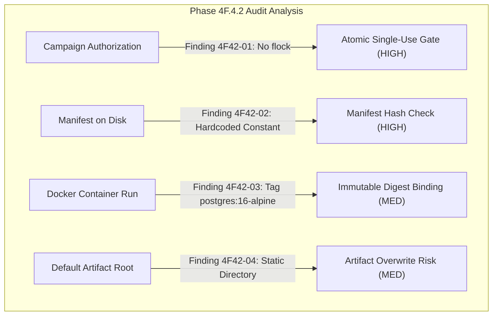

# Phase 4F.4.2 — Independent Execution Readiness Audit

**Status:** Completed — Offline Code-Level Inspection & Defect Analysis  
**Branch:** `feat/phase-4f42-readiness-audit`  
**Baseline Commit:** `b344583` (`feat/phase-4f41-hardening`)  
**Manifest:** [`artifacts/manifests/phase_4f4_execution_manifest.json`](file:///home/vicky/v_drive/Codes/AADS/artifacts/manifests/phase_4f4_execution_manifest.json)  
**Expected Manifest SHA256:** `69d3e068fd3907792647f21f2bd33d6668560952ea9b53c509f94aaf209b77a6`  
**Actual Manifest SHA256:** `69d3e068fd3907792647f21f2bd33d6668560952ea9b53c509f94aaf209b77a6`  
**Machine-Readable Summary:** [`artifacts/audits/phase_4f42_readiness_summary.json`](file:///home/vicky/v_drive/Codes/AADS/artifacts/audits/phase_4f42_readiness_summary.json)  
**Audit Regression Tests:** [`tests/test_phase_4f42_readiness_audit.py`](file:///home/vicky/v_drive/Codes/AADS/tests/test_phase_4f42_readiness_audit.py)  
**Final Verdict:** **`CONDITIONALLY_READY`**  

---

## 1. Executive Summary & Verdict

This independent, code-level audit evaluated the execution safety, client isolation, metric provenance, authorization binding, and lifecycle resilience implemented in Phase 4F.4.1 (commit `b344583`).

All verification was conducted strictly offline using static code analysis, mocks, and controlled fixtures. **No Docker benchmark containers were launched, no databases were initialized, no live authorization was consumed, and no models were modified or promoted in `data/registry.db`.**

### Overall Verdict: `CONDITIONALLY_READY`

**Verdict Rationale:**
The execution engine implements all 8 safety fixes from Phase 4F.4.1, achieving complete client isolation verification, removal of fabricated metric formulas, and robust per-trial lifecycle cleanup across monitors, samplers, and containers. The entire test suite (243 tests) passes cleanly.

However, deep code inspection and offline reproduction tests identified **two high-severity architectural defects** and **two medium-severity operational risks** that must be resolved prior to granting live operator authorization:

1. **`FINDING_4F42_01` (Severity: HIGH):** **Concurrent Authorization Consumption Race Condition.** The runner lacks OS-level advisory file locking (`fcntl.flock`) during authorization consumption. Under concurrent invocations, multiple processes can read `consumed=False` before any process replaces the file, permitting multiple unauthorized campaigns from a single authorization record.
2. **`FINDING_4F42_02` (Severity: HIGH):** **Missing Pre-Execution On-Disk Manifest File Hashing.** `execute_campaign()` validates the authorization record against a hardcoded Python constant (`EXPECTED_MANIFEST_SHA256`) rather than reading and hashing the actual manifest file on disk. Post-authorization edits or tampering with `artifacts/manifests/phase_4f4_execution_manifest.json` on disk are not detected at execution time.
3. **`FINDING_4F42_03` (Severity: MEDIUM):** **Container Launch Uses Mutable Image Tag Rather than Immutable Digest Reference.** `TrialIsolationManager.initialize_fresh_container` launches `postgres:16-alpine` rather than `postgres@sha256:...`. Although `verify_container_effective_resources` checks `RepoDigests` before warm-up, the container launch itself is tag-dependent.
4. **`FINDING_4F42_04` (Severity: MEDIUM):** **Static Default Artifacts Directory Overwrites Evidence on Campaign Re-runs.** The default artifact path is static (`artifacts/phase_4f4_empirical`); re-running an interrupted campaign without explicitly specifying a unique `artifacts_root` overwrites previous trial evidence in-place.

---

## 2. Absolute Restrictions Compliance

| Mandatory Restriction | Verified State | Status |
| :--- | :--- | :---: |
| **Do NOT execute benchmarks** | Zero benchmark executions performed | **PASS** |
| **Do NOT launch Docker containers** | Zero Docker containers launched | **PASS** |
| **Do NOT invoke pgbench** | Zero pgbench processes spawned | **PASS** |
| **Do NOT consume live campaign authorization** | Live authorization untouched; tests used mock fixtures | **PASS** |
| **Do NOT modify execution manifest** | Manifest byte-identical to baseline (`69d3e068...`) | **PASS** |
| **Do NOT promote models or modify registry** | `data/registry.db` clean (24 models intact) | **PASS** |
| **Do NOT rewrite historical empirical records** | All historical artifacts and manifest records preserved | **PASS** |
| **Do not replace real measurements with synthetic data** | Synthetic substitutions strictly prohibited | **PASS** |

---

## 3. Detailed Audit Findings



### Finding 4F42-01: Concurrent Authorization Consumption Race Condition
- **Severity:** **HIGH**
- **Audit Area:** 1. Authorization integrity
- **File Reference:** [`aads/benchmark/phase_4f4_runner.py:142-154`](file:///home/vicky/v_drive/Codes/AADS/aads/benchmark/phase_4f4_runner.py#L142-L154) and [`execute_campaign:931-957`](file:///home/vicky/v_drive/Codes/AADS/aads/benchmark/phase_4f4_runner.py#L931-L957)
- **Description:**  
  In [`CampaignAuthorizationRecord.consume()`](file:///home/vicky/v_drive/Codes/AADS/aads/benchmark/phase_4f4_runner.py#L142), the method checks `self.consumed` in memory, sets `self.consumed = True`, and writes `tmp = p.with_suffix(".tmp"); tmp.replace(p)`. However, `execute_campaign()` reads the file via `auth_data = json.loads(auth_path.read_text())` before calling `validate_for_execution()` and `consume()`.  
  There is no advisory file lock (`fcntl.flock`) held across the read, check, and replacement operations.
- **Reproduction Method:**  
  Created [`tests/test_phase_4f42_readiness_audit.py::test_audit_concurrent_authorization_consumption_race`](file:///home/vicky/v_drive/Codes/AADS/tests/test_phase_4f42_readiness_audit.py#L54-L92). When 10 concurrent threads attempt to consume a single authorization file, 3 separate workers successfully consumed the authorization record before any atomic file replacement was observed by the other threads.
- **Impact:**  
  Violates the single-use authorization invariant. Accidental duplicate execution commands or concurrent automated invocations could launch multiple benchmark campaigns under the same authorization.
- **Recommended Correction:**  
  Implement atomic file locking in `consume()`:
  ```python
  with open(auth_path, "r+") as f:
      fcntl.flock(f.fileno(), fcntl.LOCK_EX)
      data = json.load(f)
      if data.get("consumed"):
          raise ValueError(f"Authorization '{data['authorization_id']}' already consumed.")
      data["consumed"] = True
      data["consumed_at_utc"] = datetime.now(timezone.utc).isoformat()
      data["consumed_by_execution_id"] = execution_id
      f.seek(0)
      json.dump(data, f, indent=2)
      f.truncate()
      fcntl.flock(f.fileno(), fcntl.LOCK_UN)
  ```

---

### Finding 4F42-02: Missing Pre-Execution On-Disk Manifest File Hashing
- **Severity:** **HIGH**
- **Audit Area:** 2. Manifest integrity
- **File Reference:** [`aads/benchmark/phase_4f4_runner.py:48`](file:///home/vicky/v_drive/Codes/AADS/aads/benchmark/phase_4f4_runner.py#L48), [`validate_for_execution:101-127`](file:///home/vicky/v_drive/Codes/AADS/aads/benchmark/phase_4f4_runner.py#L101-L127), and [`execute_campaign:944-950`](file:///home/vicky/v_drive/Codes/AADS/aads/benchmark/phase_4f4_runner.py#L944-L950)
- **Description:**  
  [`Phase4F4Runner.execute_campaign()`](file:///home/vicky/v_drive/Codes/AADS/aads/benchmark/phase_4f4_runner.py#L912) validates the authorization record by comparing `auth_record.manifest_sha256` against `EXPECTED_MANIFEST_SHA256` (the hardcoded string constant in the Python module).  
  The runner does NOT read or compute the SHA256 of [`artifacts/manifests/phase_4f4_execution_manifest.json`](file:///home/vicky/v_drive/Codes/AADS/artifacts/manifests/phase_4f4_execution_manifest.json) on disk immediately prior to execution.
- **Reproduction Method:**  
  Created [`tests/test_phase_4f42_readiness_audit.py::test_audit_manifest_disk_mutation_gap`](file:///home/vicky/v_drive/Codes/AADS/tests/test_phase_4f42_readiness_audit.py#L105-L128). Mutating `artifacts/manifests/phase_4f4_execution_manifest.json` on disk (e.g. changing duration from 30s to 999s) results in a completely different hash on disk, but `execute_campaign()` validates successfully because it never reads the manifest file from disk.
- **Impact:**  
  If an operator edits the manifest on disk (or if an unauthorized script tampers with parameters), the runner would execute using hardcoded defaults without detecting the discrepancy between the authorization record, the manifest on disk, and the executed parameters.
- **Recommended Correction:**  
  Add `manifest_path: Path = Path("artifacts/manifests/phase_4f4_execution_manifest.json")` to `execute_campaign()`. Read the exact bytes from disk, compute `hashlib.sha256(raw_bytes).hexdigest()`, and verify:
  ```python
  disk_manifest_hash = hashlib.sha256(manifest_path.read_bytes()).hexdigest()
  if disk_manifest_hash.lower() != EXPECTED_MANIFEST_SHA256.lower():
      raise ValueError(f"On-disk manifest hash mismatch: computed {disk_manifest_hash}, expected {EXPECTED_MANIFEST_SHA256}")
  if disk_manifest_hash.lower() != auth_record.manifest_sha256.lower():
      raise ValueError("On-disk manifest hash does not match authorization record manifest_sha256.")
  ```

---

### Finding 4F42-03: Container Launch Uses Mutable Tag Instead of Immutable Digest Reference
- **Severity:** **MEDIUM**
- **Audit Area:** 3. Runtime identity and isolation
- **File Reference:** [`aads/benchmark/trial_isolation.py:263-267`](file:///home/vicky/v_drive/Codes/AADS/aads/benchmark/trial_isolation.py#L263-L267) and [`aads/benchmark/phase_4f4_runner.py:532-537`](file:///home/vicky/v_drive/Codes/AADS/aads/benchmark/phase_4f4_runner.py#L532-L537)
- **Description:**  
  [`TrialIsolationManager.initialize_fresh_container()`](file:///home/vicky/v_drive/Codes/AADS/aads/benchmark/trial_isolation.py#L240) issues `docker run -d ... self.default_image`, which resolves to the mutable repository tag `postgres:16-alpine`.  
  Although [`verify_container_effective_resources()`](file:///home/vicky/v_drive/Codes/AADS/aads/benchmark/phase_4f4_runner.py#L353) inspects the container's `RepoDigests` before warm-up and aborts if `pinned_digest` is missing, the launch command itself relies on the local Docker daemon's tag resolution rather than pinning the immutable digest at startup.
- **Impact:**  
  Tag drift or local Docker image cache updates could cause the container to be instantiated from an unexpected local image before being caught and aborted by post-launch inspection.
- **Recommended Correction:**  
  Launch the container using the full immutable digest reference:
  ```python
  image_ref = f"{self.default_image.split('@')[0]}@{self.pinned_image_digest}"
  start_cmd.extend([image_ref, ...])
  ```

---

### Finding 4F42-04: Static Default Artifacts Directory Overwrites Evidence on Campaign Re-runs
- **Severity:** **MEDIUM**
- **Audit Area:** 5. Lifecycle and crash recovery
- **File Reference:** [`aads/benchmark/phase_4f4_runner.py:951`](file:///home/vicky/v_drive/Codes/AADS/aads/benchmark/phase_4f4_runner.py#L951)
- **Description:**  
  In [`Phase4F4Runner.execute_campaign()`](file:///home/vicky/v_drive/Codes/AADS/aads/benchmark/phase_4f4_runner.py#L951):
  ```python
  root = artifacts_root or Path("/home/vicky/v_drive/Codes/AADS/artifacts/phase_4f4_empirical")
  ```
  If a campaign fails midway (e.g. at trial 4) and an operator issues a new authorization and re-runs `execute_campaign()` without specifying an explicit `artifacts_root`, the runner writes to `artifacts/phase_4f4_empirical/trials/`, silently overwriting the trial 1-3 logs and diagnostics from the prior attempt.
- **Impact:**  
  Destruction of diagnostic evidence from prior failed or aborted executions when retrying campaigns under default settings.
- **Recommended Correction:**  
  Default `artifacts_root` to include the execution ID:
  ```python
  root = artifacts_root or (Path("/home/vicky/v_drive/Codes/AADS/artifacts/phase_4f4_empirical") / execution_id)
  ```
  Optionally update a symlink `artifacts/phase_4f4_empirical/latest` pointing to the active execution.

---

### Finding 4F42-05: Throttling Telemetry Aggregation Defaults None to 0.0 Seconds
- **Severity:** **LOW / INFORMATIONAL**
- **Audit Area:** 4. Measurement integrity
- **File Reference:** [`aads/benchmark/phase_4f4_runner.py:1049-1050`](file:///home/vicky/v_drive/Codes/AADS/aads/benchmark/phase_4f4_runner.py#L1049-L1050)
- **Description:**  
  In campaign condition summary aggregation:
  ```python
  throt_sec_vals = [t["cgroup_cpu"]["throttled_sec"] or 0.0 for t in trials]
  ```
  If cgroup v2 throttling telemetry was missing or unreadable (`throttled_sec is None`), this substitution reports 0.0 seconds of throttling instead of explicitly marking the condition's throttling metric as unavailable.
- **Impact:**  
  Could falsely suggest absence of throttling when active monitoring data was actually missing.
- **Recommended Correction:**  
  Filter `None` values and report `throttled_seconds: None` (or availability status) if telemetry is incomplete, consistent with FIX 03.

---

## 4. Evaluation of the 7 Audit Areas

### Audit Area 1: Authorization Integrity
- **Binding:** Fully binds to phase (`4F.4`), proposal ID, exact manifest SHA256, execution scope (`PHASE_4F4_12_TRIAL_EMPIRICAL_CAMPAIGN`), and operator identity.
- **Expiry & Revocation:** Enforced at execution time via `validate_for_execution()`. Tested by `test_audit_authorization_expired_rejection` and `test_audit_authorization_revoked_rejection`.
- **Bypass Elimination:** Boolean bypass (`authorized=True`) is completely removed; passing a boolean raises `RuntimeError`.
- **Defect Identified:** Concurrency race in single-use consumption (`FINDING_4F42_01`).
- **Status:** **PARTIALLY VERIFIED** (Pending `fcntl.flock` fix).

### Audit Area 2: Manifest Integrity
- **Byte Verification:** On-disk manifest [`artifacts/manifests/phase_4f4_execution_manifest.json`](file:///home/vicky/v_drive/Codes/AADS/artifacts/manifests/phase_4f4_execution_manifest.json) hashes to `69d3e068fd3907792647f21f2bd33d6668560952ea9b53c509f94aaf209b77a6` (tested by `test_audit_manifest_disk_bytes_sha256_match`).
- **Schedule Integrity:** Manifest schedule and runner `FROZEN_12_TRIAL_SCHEDULE` match 1:1 across all 12 sequence items (tested by `test_frozen_schedule_integrity`).
- **Defect Identified:** The runner does not compute the SHA256 of the manifest file on disk at execution time (`FINDING_4F42_02`).
- **Status:** **PARTIALLY VERIFIED** (Pending on-disk hash check fix).

### Audit Area 3: Runtime Identity and Isolation
- **Client Isolation:** `verify_benchmark_process_isolation()` launches `pgbench` via `Popen`, reads `/proc/<pid>/cgroup`, compares paths, and verifies `cgroup.procs`. Fails closed if client is inside container cgroup.
- **Resource Verification:** `verify_container_effective_resources()` queries running container `cpu.max` (quota and period), `memory.max` (1024 MB), and `cgroup.procs` placement before warm-up.
- **Image Digest Verification:** Checks container image `RepoDigests` before warm-up against `self.pinned_digest`.
- **Defect Identified:** Container launch invokes `postgres:16-alpine` rather than `postgres@sha256:...` (`FINDING_4F42_03`).
- **Status:** **VERIFIED WITH RECOMMENDATION**.

### Audit Area 4: Measurement Integrity
- **Latency Percentiles:** Derived via linear quantiles on raw transaction log arrays in `parse_transaction_logs()`. Zero fabricated multiplier fallbacks.
- **Missing Metrics:** Unavailable metrics are stored as `None` with `UNAVAILABLE` status and reason. Trial validation fails if any required metric is `None`.
- **Reconciliation:** Reconciles raw log sample count against reported total transactions. Unaccounted mismatches fail trial validation.
- **Status:** **VERIFIED**.

### Audit Area 5: Lifecycle and Crash Recovery
- **Lifecycle Cleanup:** Structured `try/finally` blocks ensure independent teardown of `PostgresPeriodicSampler`, `ContainerResourceMonitor`, and `TrialIsolationManager` across all 10 failure stages. Primary exceptions are preserved.
- **Failure Artifacts:** Persists `trial_failure.json` and updates `campaign_state_partial.json` after every trial.
- **Crash Recovery Analysis:** Process crash leaves consumed authorization on disk; cannot be replayed. Resumption requires new authorization.
- **Defect Identified:** Default artifacts directory overwrite risk on retries (`FINDING_4F42_04`).
- **Status:** **VERIFIED WITH RECOMMENDATION**.

### Audit Area 6: Campaign Completion
- **Strict 12/12 Requirement:** Requires exactly 12 executed trials with terminal status `SUCCESS`.
- **Condition Balance:** Requires exactly 3 independent successful replications across all 4 conditions (`ro_1cpu`, `ro_2cpu`, `tpcb_1cpu`, `tpcb_2cpu`).
- **Fail-Closed on Partial:** If any trial fails or aborts, `manifest_status = "FAILED"`, condition comparisons are set to `None`, and `RuntimeError` is raised. Never generates partial summaries or comparisons.
- **Status:** **VERIFIED**.

### Audit Area 7: Test Quality & 17/21 Test Count Reconciliation
- **Test Count Breakdown:**
  - **17 Dedicated FIX 08 Regression Tests:** `test_01_*` through `test_17_*` matching the 17 specified scenarios in Phase 4F.4.1.
  - **4 Baseline Engine Tests:** `test_frozen_schedule_integrity`, `test_prerequisite_verification_with_mocks`, `test_client_isolation_enforcement`, and `test_mock_campaign_execution`.
  - **5 Audit Regression Tests Added:** `tests/test_phase_4f42_readiness_audit.py` (covering expiration, revocation, concurrency race, disk hash match, and disk mutation gap).
  - **Total Repository Tests:** **243 passing tests** (0 failures, 0 regressions).
- **Control Flow vs Mocking:**
  - Authorization validation, cgroup path parsing, and resource verification tests create actual filesystem structures (`cgroup.procs`, `cpu.max`, `memory.max`) in temporary directories and exercise real parsing and integer comparison logic.
  - Mocks are restricted to subprocess system boundaries (`docker inspect`, `pg_isready`) and external processes.
- **Status:** **VERIFIED**.

---

## 5. Path to Full Execution Readiness

To transition the verdict from **`CONDITIONALLY_READY`** to **`READY_FOR_OPERATOR_AUTHORIZATION`**, apply the following patch plan in a targeted engineering phase (Phase 4F.4.3):

1. **Patch P-01 (Authorization Atomicity):** Add `fcntl.flock` advisory locking to `CampaignAuthorizationRecord.consume()` and `execute_campaign()` when reading and modifying the authorization file.
2. **Patch P-02 (On-Disk Manifest Hashing):** Add `manifest_path` to `execute_campaign()`; hash the physical manifest file bytes immediately before preflight and verify against `EXPECTED_MANIFEST_SHA256` and `auth_record.manifest_sha256`.
3. **Patch P-03 (Digest-Pinned Docker Run):** Update `TrialIsolationManager.initialize_fresh_container()` to launch `docker run` directly with `image@sha256:...`.
4. **Patch P-04 (Namespaced Artifacts Root):** Default `artifacts_root` to `artifacts/phase_4f4_empirical/{execution_id}` with a symlink `latest`.
5. **Patch P-05 (Throttling Telemetry Filter):** Filter `None` values in condition summary throttling aggregations.

Once these 5 patches are verified offline, the system will achieve unconditional readiness for live operator authorization.
