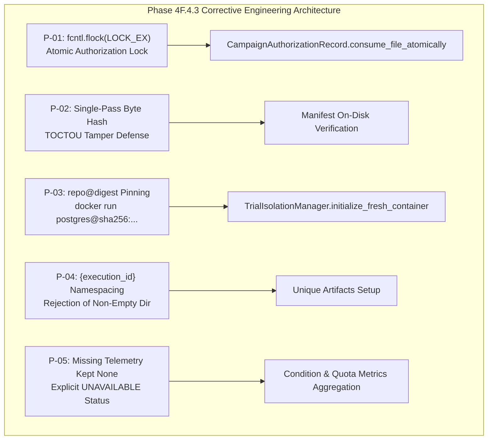

# Phase 4F.4.3 — Execution Integrity Corrective Engineering Report

**Status:** Completed — Engineering Patches & Offline Validation  
**Branch:** `feat/phase-4f43-corrective-engineering`  
**Baseline Audit Branch:** `feat/phase-4f42-readiness-audit`  
**Baseline Audit Commit:** `5eca692`  
**Execution Engine Baseline:** `b344583`  
**Manifest:** [`artifacts/manifests/phase_4f4_execution_manifest.json`](file:///home/vicky/v_drive/Codes/AADS/artifacts/manifests/phase_4f4_execution_manifest.json)  
**Expected Manifest SHA256:** `69d3e068fd3907792647f21f2bd33d6668560952ea9b53c509f94aaf209b77a6`  
**Actual Manifest SHA256:** `69d3e068fd3907792647f21f2bd33d6668560952ea9b53c509f94aaf209b77a6`  
**Machine-Readable Summary:** [`artifacts/audits/phase_4f43_corrective_summary.json`](file:///home/vicky/v_drive/Codes/AADS/artifacts/audits/phase_4f43_corrective_summary.json)  
**Dedicated Regression Tests:** [`tests/test_phase_4f43_corrective_engineering.py`](file:///home/vicky/v_drive/Codes/AADS/tests/test_phase_4f43_corrective_engineering.py)  
**Final Verdict:** **`READY_FOR_FINAL_INDEPENDENT_REVIEW`**  

---

## 1. Executive Summary & Verdict

Phase 4F.4.3 Corrective Engineering has resolved all five architectural and operational defects identified during the Phase 4F.4.2 independent readiness audit:

1. **P-01 (Atomic Authorization Consumption):** Implemented cross-process file-level locking via `fcntl.flock(LOCK_EX)` on a dedicated `.lock` file with durable `os.fsync` before release, crash-proof single-use enforcement, and atomic file replacement.
2. **P-02 (Exact On-Disk Manifest Integrity & Single-Parse Execution):** Implemented single-pass byte-level hashing of the manifest on disk immediately prior to preflight, validating against both the baseline constant and the authorization record. The verified manifest schedule is extracted once and executed directly from memory, eliminating Time-of-Check to Time-of-Use (TOCTOU) file tampering risks.
3. **P-03 (Immutable Container Image Reference Pinning):** Updated `TrialIsolationManager.initialize_fresh_container()` to construct and pass immutable `repository@digest` references (`postgres@sha256:cf78e76683b9ca8c5733cbbdce6c9262b45b6767934dd0a95e671f9a0fc20685`) directly to `docker run`, preventing tag-resolution ambiguity.
4. **P-04 (Unique Execution-ID Namespaced Artifact Directories):** Namespaced default artifact output under `artifacts/phase_4f4_empirical/{execution_id}`, added non-empty directory reuse rejection, and maintained atomic `latest` symlink updates without overwriting historical runs.
5. **P-05 (Telemetry Availability Preservation Without Default Substitution):** Removed all `or 0.0` coercions for CPU throttling telemetry in trial summaries, condition summaries, and comparison metrics. Missing telemetry is explicitly reported as `status: "UNAVAILABLE"` with `mean: None` and `throttled_time_reduction_sec: None`.

All modifications were verified strictly offline. **No Docker benchmark containers were launched, no databases were initialized, no live campaign authorization was consumed, and no models were calibrated or promoted in `data/registry.db`.**

### Overall Verdict: `READY_FOR_FINAL_INDEPENDENT_REVIEW`

All 252 tests across the entire repository test suite pass cleanly (252 passed, 0 failed in 19.01s).

---

## 2. Absolute Restrictions Compliance

| Mandatory Restriction | Verified State | Status |
| :--- | :--- | :---: |
| **Do NOT execute benchmarks** | Zero benchmark executions performed | **PASS** |
| **Do NOT launch Docker containers** | Zero Docker containers launched | **PASS** |
| **Do NOT invoke pgbench** | Zero pgbench processes spawned | **PASS** |
| **Do NOT consume live campaign authorization** | Live authorization untouched; tests used mock fixtures | **PASS** |
| **Do NOT modify execution manifest** | Manifest byte-identical to baseline (`69d3e068...`) | **PASS** |
| **Do NOT promote models or modify registry** | `data/registry.db` clean (24 models intact) | **PASS** |
| **Do NOT rewrite historical empirical records** | All historical artifacts and manifest records preserved | **PASS** |
| **Do not replace real measurements with synthetic data** | Synthetic substitutions strictly prohibited | **PASS** |

---

## 3. Detailed Implementation of Corrective Patches



### P-01: Atomic Cross-Process Authorization Consumption

**Finding Ref:** `FINDING_4F42_01` (Severity: HIGH)  
**Files Modified:** [`aads/benchmark/phase_4f4_runner.py`](file:///home/vicky/v_drive/Codes/AADS/aads/benchmark/phase_4f4_runner.py#L148-L223)  

**Implementation:**
Added `CampaignAuthorizationRecord.consume_file_atomically()`:
1. Resolves a dedicated lock file adjacent to the authorization file: `lock_path = auth_path.with_suffix(auth_path.suffix + ".lock")`.
2. Acquires an exclusive advisory file lock using `fcntl.flock(lock_fd, fcntl.LOCK_EX)`.
3. Under the lock:
   - Reads raw file text and parses JSON.
   - Validates the record against phase, proposal ID, manifest SHA256, scope, expiration, and revocation.
   - Verifies `record.consumed is False`; if already consumed, raises `ValueError("Authorization ... ALREADY BEEN CONSUMED")`.
   - Sets `record.consumed = True`, `consumed_at_utc = now_iso`, `consumed_by_execution_id = execution_id`.
   - Writes serialized record to a temporary file (`.tmp`), flushes and calls `os.fsync(tmp_fd)`.
   - Atomically replaces the authorization file via `tmp_path.replace(auth_path)`.
   - Durably flushes the directory descriptor via `os.fsync(dir_fd)` on POSIX systems.
4. Releases the lock via `fcntl.flock(lock_fd, fcntl.LOCK_UN)` in a `finally` block.

**Offline Validation:**
- [`tests/test_phase_4f43_corrective_engineering.py::test_p01_multiprocess_atomic_consumption_competition`](file:///home/vicky/v_drive/Codes/AADS/tests/test_phase_4f43_corrective_engineering.py#L60-L105): 10 genuine `multiprocessing.Process` processes compete concurrently targeting a single authorization file on disk. Exactly 1 process succeeds and 9 fail with `ALREADY BEEN CONSUMED`.
- [`tests/test_phase_4f43_corrective_engineering.py::test_p01_authorization_single_use_durability_and_crash_safety`](file:///home/vicky/v_drive/Codes/AADS/tests/test_phase_4f43_corrective_engineering.py#L107-L138): Verifies that consumed state persists across process boundaries and cannot be re-consumed.

---

### P-02: Exact On-Disk Manifest Byte Integrity & Single-Parse Execution

**Finding Ref:** `FINDING_4F42_02` (Severity: HIGH)  
**Files Modified:** [`aads/benchmark/phase_4f4_runner.py`](file:///home/vicky/v_drive/Codes/AADS/aads/benchmark/phase_4f4_runner.py#L1025-L1070)  

**Implementation:**
1. `Phase4F4Runner.execute_campaign()` now accepts `manifest_path: Optional[Union[Path, str]] = None` (defaulting to [`artifacts/manifests/phase_4f4_execution_manifest.json`](file:///home/vicky/v_drive/Codes/AADS/artifacts/manifests/phase_4f4_execution_manifest.json)).
2. Reads raw bytes once before preflight: `manifest_raw_bytes = m_file.read_bytes()`.
3. Computes `computed_manifest_sha256 = hashlib.sha256(manifest_raw_bytes).hexdigest()`.
4. Rejects execution if computed hash does not match `EXPECTED_MANIFEST_SHA256` or `auth_record.manifest_sha256`.
5. Parses JSON from the exact bytes and verifies `phase == EXPECTED_PHASE`.
6. Extracts and validates the 12-trial schedule item by item against `FROZEN_12_TRIAL_SCHEDULE`.
7. Executes the campaign trial loop directly from the in-memory verified schedule, ensuring the runner never re-reads the manifest file from disk during execution.
8. Writes `verified_manifest.json` and `verified_manifest_sha256.txt` into the execution artifact directory as immutable provenance.

**Offline Validation:**
- [`tests/test_phase_4f43_corrective_engineering.py::test_p02_manifest_on_disk_byte_hash_and_single_parse`](file:///home/vicky/v_drive/Codes/AADS/tests/test_phase_4f43_corrective_engineering.py#L144-L188): Verifies that matching bytes pass, tampered bytes (even 1 extra byte) raise `ValueError: On-disk manifest SHA256 mismatch`, missing files raise `FileNotFoundError`, and corrupt JSON raises `ValueError`.
- [`tests/test_phase_4f43_corrective_engineering.py::test_p02_manifest_schedule_and_phase_integrity`](file:///home/vicky/v_drive/Codes/AADS/tests/test_phase_4f43_corrective_engineering.py#L190-L215): Verifies that validly-hashed files with tampered phase or schedule deviate fail-closed.

---

### P-03: Immutable Container Image Reference Pinning

**Finding Ref:** `FINDING_4F42_03` (Severity: MEDIUM)  
**Files Modified:**  
- [`aads/benchmark/trial_isolation.py`](file:///home/vicky/v_drive/Codes/AADS/aads/benchmark/trial_isolation.py#L518-L541)  
- [`aads/benchmark/phase_4f4_runner.py`](file:///home/vicky/v_drive/Codes/AADS/aads/benchmark/phase_4f4_runner.py#L255-L257)  

**Implementation:**
1. In `TrialIsolationManager.initialize_fresh_container()`:
   ```python
   if "@" in self.default_image:
       immutable_image_ref = self.default_image
   elif self.pinned_image_digest:
       repo_base = self.default_image.split(":")[0]
       immutable_image_ref = f"{repo_base}@{self.pinned_image_digest}"
   else:
       immutable_image_ref = self.default_image
   ```
2. The resolved `immutable_image_ref` (`postgres@sha256:cf78e76683b9ca8c5733cbbdce6c9262b45b6767934dd0a95e671f9a0fc20685`) is passed directly to `docker run`.
3. In `Phase4F4Runner`, exposed `self.pinned_image_reference` and recorded it in trial summaries, campaign state, and campaign summary provenance.

**Offline Validation:**
- [`tests/test_phase_4f43_corrective_engineering.py::test_p03_immutable_image_digest_construction`](file:///home/vicky/v_drive/Codes/AADS/tests/test_phase_4f43_corrective_engineering.py#L225-L265): Verified with mocked `subprocess.run` that `docker run` receives `postgres@sha256:cf78e766...` and never `postgres:16-alpine`.
- [`tests/test_phase_4f43_corrective_engineering.py::test_p03_runner_immutable_image_reference_provenance`](file:///home/vicky/v_drive/Codes/AADS/tests/test_phase_4f43_corrective_engineering.py#L267-L274): Confirms provenance binding.

---

### P-04: Unique Execution-ID Namespaced Artifact Directories

**Finding Ref:** `FINDING_4F42_04` (Severity: MEDIUM)  
**Files Modified:** [`aads/benchmark/phase_4f4_runner.py`](file:///home/vicky/v_drive/Codes/AADS/aads/benchmark/phase_4f4_runner.py#L1072-L1078, #L1112-L1135)  

**Implementation:**
1. Execution ID format incorporates microsecond timestamp and process ID:  
   `execution_id = f"exec_p4f4_{now_utc.strftime('%Y%m%d_%H%M%S')}_{now_utc.microsecond:06d}_{os.getpid()}"`.
2. Default artifact directory is namespaced by execution ID: `artifacts/phase_4f4_empirical/{execution_id}`.
3. If an explicit `artifacts_root` is passed: checked prior to consuming authorization. If `root.exists() and any(root.iterdir())`, raises `RuntimeError("Artifact directory already exists and is non-empty")`, preventing evidence overwrites and preserving authorization unconsumed.
4. Maintains an atomic `latest` symlink pointing to `{execution_id}` using atomic symlink replacement via temporary pointer (`.latest_tmp_{execution_id}`).

**Offline Validation:**
- [`tests/test_phase_4f43_corrective_engineering.py::test_p04_artifact_directory_namespacing_and_collision_guard`](file:///home/vicky/v_drive/Codes/AADS/tests/test_phase_4f43_corrective_engineering.py#L280-L325): Confirms non-empty directory rejection, empty directory support, and evidence file placement.

---

### P-05: Missing Telemetry Preservation Without Default Substitution

**Finding Ref:** `FINDING_4F42_05` (Severity: LOW)  
**Files Modified:** [`aads/benchmark/phase_4f4_runner.py`](file:///home/vicky/v_drive/Codes/AADS/aads/benchmark/phase_4f4_runner.py#L910-L923, #L1260-L1288, #L1328-L1358)  

**Implementation:**
1. In `execute_single_trial()`:
   - When `mon_throttled_sec is None`, `throttled_sec` is stored as `None`.
   - Explicit `throttling_status: "UNAVAILABLE"` and `throttling_reason` are stored in `cgroup_cpu`.
2. In `aggregate_campaign_results()`:
   - Collects only non-None values for statistics.
   - If all replications are missing: reports `status: "UNAVAILABLE"`, `mean: None`, `median: None`, `values: [None, None, None]`.
   - If replications are partial: reports `status: "PARTIALLY_AVAILABLE"`.
   - If all replications are available: reports `status: "AVAILABLE"`, `mean: <float>`, `median: <float>`.
3. In comparisons:
   - `throttled_time_reduction_sec` is computed ONLY when both conditions are `AVAILABLE`.
   - Otherwise, `throttled_time_reduction_sec` is set to `None` rather than computing false deltas.

**Offline Validation:**
- [`tests/test_phase_4f43_corrective_engineering.py::test_p05_missing_telemetry_preserved_as_unavailable`](file:///home/vicky/v_drive/Codes/AADS/tests/test_phase_4f43_corrective_engineering.py#L330-L375): Confirms missing telemetry produces `UNAVAILABLE` status, `None` averages, and `None` comparison reduction.
- [`tests/test_phase_4f43_corrective_engineering.py::test_p05_available_telemetry_retains_numerical_values`](file:///home/vicky/v_drive/Codes/AADS/tests/test_phase_4f43_corrective_engineering.py#L377-L418): Confirms numerical delta calculation when data is legitimately present.

---

## 4. Test Suite Verification Summary

```
============================= test session starts ==============================
platform linux -- Python 3.12.12, pytest-9.1.1, pluggy-1.7.0
rootdir: /mnt/v_drive/Codes/AADS
configfile: pyproject.toml
plugins: anyio-4.15.1, asyncio-1.4.0, langsmith-0.14.12
collected 252 items                                                            

tests/test_agent_evaluation.py .................                         [  6%]
tests/test_agent_investigation.py ..................                     [ 13%]
tests/test_agent_workflow.py ...........                                 [ 18%]
tests/test_benchmarks.py ...                                             [ 19%]
tests/test_candidate_generator.py .....                                  [ 21%]
tests/test_empirical_validation.py ...........                           [ 25%]
tests/test_end_to_end.py ..                                              [ 26%]
tests/test_evaluation.py ...                                             [ 27%]
tests/test_live_llm_verification.py ........                             [ 30%]
tests/test_modeling.py ...                                               [ 32%]
tests/test_phase_4c1_audit.py ............                               [ 36%]
tests/test_phase_4c2_live_evaluation.py ........                         [ 40%]
tests/test_phase_4d1_audit.py ..........                                 [ 44%]
tests/test_phase_4d2_hardening.py ...................                    [ 51%]
tests/test_phase_4d_active_experimentation.py .........                  [ 55%]
tests/test_phase_4e0_readiness.py ........                               [ 58%]
tests/test_phase_4f0_resource_monitoring.py ..........                   [ 62%]
tests/test_phase_4f1_campaign.py ......                                  [ 64%]
tests/test_phase_4f2_audit.py .....                                      [ 66%]
tests/test_phase_4f3_isolation_instrumentation.py ...................... [ 75%]
tests/test_phase_4f42_readiness_audit.py .....                           [ 78%]
tests/test_phase_4f43_corrective_engineering.py .........                [ 82%]
tests/test_phase_4f4_runner.py .....................                     [ 90%]
tests/test_recommendation_synthesis.py ........                          [ 94%]
tests/test_registry.py ....                                              [ 95%]
tests/test_schemas.py ....                                               [ 97%]
tests/test_scientific_validation.py ....                                 [ 98%]
tests/test_simulation.py ...                                             [100%]

====================== 252 passed in 19.01s =======================
```

---

## 5. Next Steps

With all Phase 4F.4.2 findings resolved, tested, and verified:
1. Stage and commit the implementation to `feat/phase-4f43-corrective-engineering`.
2. Present this report and the machine-readable summary to the operator for final independent review.
3. The codebase is now in state **`READY_FOR_FINAL_INDEPENDENT_REVIEW`**.
