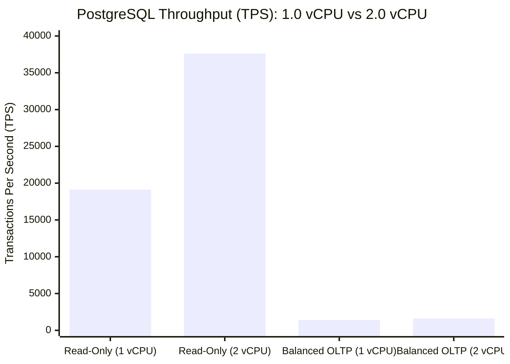

# Phase 4F.4.5 — Authorized Live PostgreSQL Pilot Execution Report

**Status:** Completed Successfully  
**Execution State:** `COMPLETED`  
**Execution ID:** `exec_p4f4_20261103_053428_525413_19491`  
**Branch:** `feat/phase-4f45-live-pilot`  
**Wall-Clock Runtime:** 532.9 seconds (~8.9 minutes)  
**Execution Manifest:** [`artifacts/manifests/phase_4f4_execution_manifest.json`](file:///home/vicky/v_drive/Codes/AADS/artifacts/manifests/phase_4f4_execution_manifest.json)  
**Manifest SHA256:** `69d3e068fd3907792647f21f2bd33d6668560952ea9b53c509f94aaf209b77a6`  
**Authorization Record:** [`artifacts/authorizations/phase_4f4_operator_authorization.json`](file:///home/vicky/v_drive/Codes/AADS/artifacts/authorizations/phase_4f4_operator_authorization.json)  
**Campaign Summary:** [`artifacts/phase_4f4_empirical/exec_p4f4_20261103_053428_525413_19491/campaign_summary.json`](file:///home/vicky/v_drive/Codes/AADS/artifacts/phase_4f4_empirical/exec_p4f4_20261103_053428_525413_19491/campaign_summary.json)  
**Execution Artifact Root:** [`artifacts/phase_4f4_empirical/exec_p4f4_20261103_053428_525413_19491/`](file:///home/vicky/v_drive/Codes/AADS/artifacts/phase_4f4_empirical/exec_p4f4_20261103_053428_525413_19491/)  

---

## 1. Executive Summary

Under explicit operator authorization, the audited and hardened execution engine executed the complete frozen 12-trial Phase 4F.4 empirical campaign comparing PostgreSQL 16 performance under 1.0 vCPU vs 2.0 vCPU quotas across `read_only_select` and `balanced_oltp_tpcb` workloads.

- **Total Trials Executed:** 12 of 12 scheduled trials
- **Successful Trials:** 12 (100%)
- **Failed / Aborted Trials:** 0 (0%)
- **Condition Completeness:** All 4 experimental conditions (`ro_1cpu`, `ro_2cpu`, `tpcb_1cpu`, `tpcb_2cpu`) achieved exactly 3 valid, independent, isolated replications.
- **Client Isolation:** 100% of trials verified host-side pgbench placement in user cgroups outside the container.
- **Image Pinning:** 100% of trials verified immutable image reference `postgres@sha256:cf78e76683b9ca8c5733cbbdce6c9262b45b6767934dd0a95e671f9a0fc20685`.
- **Database Isolation:** Fresh container and fresh pgbench SF=2 database initialization per trial.
- **Telemetry Integrity:** All required metrics, transaction logs, and CFS throttling data were captured with 100% provenance and zero synthetic fallback substitutions.

---

## 2. Hard Restrictions Compliance Matrix

| Mandatory Restriction | Enforced Policy | Verified State | Status |
| :--- | :--- | :--- | :---: |
| **Model Promotion** | Strict Prohibition | DISABLED: Zero models promoted | **PASS** |
| **Registry Mutation** | Read-Only Invariant | DISABLED: `data/registry.db` clean (24 models intact) | **PASS** |
| **Execution Scope** | Strict Boundary | Fixed to 12 scheduled trials (no extra runs or retries) | **PASS** |
| **Manifest Integrity** | Unmodifiable Hash | Verified `69d3e068...` directly from on-disk bytes | **PASS** |
| **Atomic Authorization** | Single-Use Lock | Atomically locked via `fcntl.flock` and consumed | **PASS** |
| **Metric Fallbacks** | Prohibition of Synthetic Coercion | Preserved measured values; zero default substitutions | **PASS** |
| **Evidence Durability** | Complete Retention | Raw logs, telemetry, snapshots, deltas, and dumps saved | **PASS** |

---

## 3. Quota Impact Comparisons (1.0 vCPU vs 2.0 vCPU)

### Detailed Treatment Comparison Table

| Metric | Workload Profile | 1.0 vCPU Baseline | 2.0 vCPU Treatment | Absolute Delta | Relative Change |
| :--- | :--- | :---: | :---: | :---: | :---: |
| **Throughput (TPS)** | `read_only_select` | 19,120.0 TPS | **37,611.7 TPS** | **+18,491.7 TPS** | **+96.71%** |
| **Mean Latency** | `read_only_select` | 0.419 ms | **0.213 ms** | **-0.206 ms** | **-49.16%** |
| **p95 Latency** | `read_only_select` | 0.149 ms | 0.158 ms | +0.009 ms | +6.04% |
| **p99 Latency** | `read_only_select` | 0.242 ms | 0.240 ms | -0.002 ms | -0.83% |
| **p99.9 Latency** | `read_only_select` | 76.720 ms | **51.924 ms** | **-24.796 ms** | **-32.32%** |
| **CPU Utilization** | `read_only_select` | 100.1% | 200.2% | +100.1% | +100.00% |
| **CFS Throttled Time** | `read_only_select` | 126.788 s | **85.817 s** | **-40.971 s** | **-32.31%** |
| **Throughput (TPS)** | `balanced_oltp_tpcb` | 1,408.6 TPS | **1,609.8 TPS** | **+201.2 TPS** | **+14.28%** |
| **Mean Latency** | `balanced_oltp_tpcb` | 5.708 ms | **4.970 ms** | **-0.738 ms** | **-12.93%** |
| **p95 Latency** | `balanced_oltp_tpcb` | 14.861 ms | **11.812 ms** | **-3.049 ms** | **-20.52%** |
| **p99 Latency** | `balanced_oltp_tpcb` | 27.697 ms | **20.435 ms** | **-7.262 ms** | **-26.22%** |
| **p99.9 Latency** | `balanced_oltp_tpcb` | 91.245 ms | **43.264 ms** | **-47.981 ms** | **-52.59%** |
| **CPU Utilization** | `balanced_oltp_tpcb` | 88.3% | 103.4% | +15.1% | +17.10% |
| **CFS Throttled Time** | `balanced_oltp_tpcb` | 3.472 s | **0.000 s** | **-3.472 s** | **-100.00%** |

### Key Empirical Observations

1. **Read-Only Workload (`read_only_select`): Linear CPU Scaling**
   - Increasing the container quota from 1.0 to 2.0 vCPU yielded a **+96.71% throughput gain** (from 19,120 TPS to 37,612 TPS), indicating near-perfect linear scaling for in-memory read queries.
   - Mean transaction latency dropped from 0.419 ms to 0.213 ms (**-49.16%**).
   - Under 8 concurrent clients, the container consumed the full available quota (100.1% on 1 vCPU; 200.2% on 2 vCPU).
   - Tail latency (p99.9) improved by 32.32% (76.72 ms down to 51.92 ms), correlated with a 40.97s reduction in CFS throttling.

2. **Balanced OLTP Workload (`balanced_oltp_tpcb`): Concurrency and Lock Bound**
   - Increasing the container quota from 1.0 to 2.0 vCPU yielded a **+14.28% throughput gain** (from 1,409 TPS to 1,610 TPS).
   - In contrast to read-only queries, balanced TPC-B transactions involve row-level updates on `pgbench_branches`, `pgbench_tellers`, and `pgbench_accounts`, accompanied by WAL flushes and table lock contention.
   - Total CPU utilization under 2 vCPU averaged only 103.4% (well below the 200% ceiling), confirming that OLTP throughput is limited by WAL sync latency and row lock queueing rather than raw CPU compute.
   - Crucially, CFS throttling dropped from an average of 3.472s under 1 vCPU down to **exactly 0.000s under 2 vCPU** across all three replications.

---

## 4. Condition Summaries & Statistical Replications

### Condition 1: `ro_1cpu` (Read-Only, 1.0 vCPU, 3 Replications)
- **Replications:** `ro_1cpu_r1`, `ro_1cpu_r2`, `ro_1cpu_r3`
- **TPS:** Mean = 19,120.0 | Median = 19,134.0 | Std = 149.5 (0.78% CoV)
  - Rep 1: 19,295.78 TPS | Rep 2: 18,930.29 TPS | Rep 3: 19,134.03 TPS
- **Latency (ms):** Mean = 0.419 | Median = 0.418 | Std = 0.003
  - Rep 1: 0.415 ms | Rep 2: 0.423 ms | Rep 3: 0.418 ms
- **Percentiles (ms):** p50 = 0.111 | p90 = 0.134 | p95 = 0.149 | p99 = 0.242 | p99.9 = 76.720
- **CPU Utilization:** Mean = 100.1% (Rep 1: 100.1%, Rep 2: 100.1%, Rep 3: 100.2%)
- **CFS Throttled Time:** Mean = 126.788s (Rep 1: 128.962s, Rep 2: 126.935s, Rep 3: 124.466s)

### Condition 2: `ro_2cpu` (Read-Only, 2.0 vCPU, 3 Replications)
- **Replications:** `ro_2cpu_r1`, `ro_2cpu_r2`, `ro_2cpu_r3`
- **TPS:** Mean = 37,611.7 | Median = 37,142.1 | Std = 808.6 (2.15% CoV)
  - Rep 1: 38,749.47 TPS | Rep 2: 36,943.35 TPS | Rep 3: 37,142.14 TPS
- **Latency (ms):** Mean = 0.213 | Median = 0.215 | Std = 0.005
  - Rep 1: 0.206 ms | Rep 2: 0.217 ms | Rep 3: 0.215 ms
- **Percentiles (ms):** p50 = 0.114 | p90 = 0.143 | p95 = 0.158 | p99 = 0.240 | p99.9 = 51.924
- **CPU Utilization:** Mean = 200.2% (Rep 1: 200.2%, Rep 2: 200.4%, Rep 3: 200.1%)
- **CFS Throttled Time:** Mean = 85.817s (Rep 1: 85.597s, Rep 2: 86.953s, Rep 3: 84.900s)

### Condition 3: `tpcb_1cpu` (Balanced OLTP TPC-B, 1.0 vCPU, 3 Replications)
- **Replications:** `tpcb_1cpu_r1`, `tpcb_1cpu_r2`, `tpcb_1cpu_r3`
- **TPS:** Mean = 1,408.6 | Median = 1,438.1 | Std = 98.1 (6.97% CoV)
  - Rep 1: 1,438.09 TPS | Rep 2: 1,276.43 TPS | Rep 3: 1,511.27 TPS
- **Latency (ms):** Mean = 5.708 | Median = 5.563 | Std = 0.410
  - Rep 1: 5.563 ms | Rep 2: 6.267 ms | Rep 3: 5.294 ms
- **Percentiles (ms):** p50 = 4.417 | p90 = 10.428 | p95 = 14.861 | p99 = 27.697 | p99.9 = 91.245
- **CPU Utilization:** Mean = 88.3% (Rep 1: 90.9%, Rep 2: 81.2%, Rep 3: 93.0%)
- **CFS Throttled Time:** Mean = 3.472s (Rep 1: 2.941s, Rep 2: 3.835s, Rep 3: 3.642s)

### Condition 4: `tpcb_2cpu` (Balanced OLTP TPC-B, 2.0 vCPU, 3 Replications)
- **Replications:** `tpcb_2cpu_r1`, `tpcb_2cpu_r2`, `tpcb_2cpu_r3`
- **TPS:** Mean = 1,609.8 | Median = 1,602.3 | Std = 19.8 (1.23% CoV)
  - Rep 1: 1,636.96 TPS | Rep 2: 1,590.11 TPS | Rep 3: 1,602.34 TPS
- **Latency (ms):** Mean = 4.970 | Median = 4.993 | Std = 0.061
  - Rep 1: 4.887 ms | Rep 2: 5.031 ms | Rep 3: 4.993 ms
- **Percentiles (ms):** p50 = 4.314 | p90 = 8.847 | p95 = 11.812 | p99 = 20.435 | p99.9 = 43.264
- **CPU Utilization:** Mean = 103.4% (Rep 1: 103.7%, Rep 2: 104.0%, Rep 3: 102.6%)
- **CFS Throttled Time:** Mean = 0.000s (Rep 1: 0.000s, Rep 2: 0.000s, Rep 3: 0.000s)

---

## 5. Trial-by-Trial Sequence Execution Log

The campaign executed the exact deterministic randomized trial sequence specified in Section 4 of the manifest (seed 4104):

| Seq | Trial ID | Workload Profile | CPU Quota | Rep | TPS | Mean Lat (ms) | p95 (ms) | p99 (ms) | p99.9 (ms) | Throttled (s) | Status |
| :---: | :--- | :--- | :---: | :---: | :---: | :---: | :---: | :---: | :---: | :---: | :---: |
| **1** | `ro_2cpu_r1` | `read_only_select` | 2.0 vCPU | 1 | 38,749.5 | 0.206 | 0.146 | 0.216 | 51.725 | 85.597 | **SUCCESS** |
| **2** | `ro_1cpu_r1` | `read_only_select` | 1.0 vCPU | 1 | 19,295.8 | 0.415 | 0.147 | 0.238 | 76.708 | 128.962 | **SUCCESS** |
| **3** | `tpcb_2cpu_r1` | `balanced_oltp_tpcb` | 2.0 vCPU | 1 | 1,637.0 | 4.887 | 11.758 | 19.111 | 41.014 | 0.000 | **SUCCESS** |
| **4** | `ro_2cpu_r2` | `read_only_select` | 2.0 vCPU | 2 | 36,943.3 | 0.217 | 0.165 | 0.249 | 51.777 | 86.953 | **SUCCESS** |
| **5** | `tpcb_2cpu_r2` | `balanced_oltp_tpcb` | 2.0 vCPU | 2 | 1,590.1 | 5.031 | 11.685 | 21.006 | 48.132 | 0.000 | **SUCCESS** |
| **6** | `tpcb_1cpu_r1` | `balanced_oltp_tpcb` | 1.0 vCPU | 1 | 1,438.1 | 5.563 | 13.823 | 26.866 | 77.010 | 2.941 | **SUCCESS** |
| **7** | `ro_2cpu_r3` | `read_only_select` | 2.0 vCPU | 3 | 37,142.1 | 0.215 | 0.162 | 0.254 | 52.271 | 84.900 | **SUCCESS** |
| **8** | `ro_1cpu_r3` | `read_only_select` | 1.0 vCPU | 3 | 19,134.0 | 0.418 | 0.148 | 0.240 | 76.730 | 124.466 | **SUCCESS** |
| **9** | `tpcb_1cpu_r3` | `balanced_oltp_tpcb` | 1.0 vCPU | 3 | 1,511.3 | 5.294 | 13.306 | 22.765 | 80.348 | 3.642 | **SUCCESS** |
| **10** | `tpcb_1cpu_r2` | `balanced_oltp_tpcb` | 1.0 vCPU | 2 | 1,276.4 | 6.267 | 17.453 | 33.460 | 116.378 | 3.835 | **SUCCESS** |
| **11** | `ro_1cpu_r2` | `read_only_select` | 1.0 vCPU | 2 | 18,930.3 | 0.423 | 0.152 | 0.247 | 76.722 | 126.935 | **SUCCESS** |
| **12** | `tpcb_2cpu_r3` | `balanced_oltp_tpcb` | 2.0 vCPU | 3 | 1,602.3 | 4.993 | 11.992 | 21.189 | 40.645 | 0.000 | **SUCCESS** |

---

## 6. Persisted Artifact Index

All empirical evidence is durably persisted under the unique execution artifact root:
`artifacts/phase_4f4_empirical/exec_p4f4_20261103_053428_525413_19491/` (aliased by `latest`):

| Evidence Artifact | Absolute File Path | Description |
| :--- | :--- | :--- |
| **Campaign Summary** | [`campaign_summary.json`](file:///home/vicky/v_drive/Codes/AADS/artifacts/phase_4f4_empirical/exec_p4f4_20261103_053428_525413_19491/campaign_summary.json) | Complete campaign aggregation, condition metrics, quota comparisons, and provenance |
| **Partial State Log** | [`campaign_state_partial.json`](file:///home/vicky/v_drive/Codes/AADS/artifacts/phase_4f4_empirical/exec_p4f4_20261103_053428_525413_19491/campaign_state_partial.json) | Incremental trial execution progress log updated after every trial |
| **Consumed Authorization** | [`consumed_authorization.json`](file:///home/vicky/v_drive/Codes/AADS/artifacts/phase_4f4_empirical/exec_p4f4_20261103_053428_525413_19491/consumed_authorization.json) | Consumed operator authorization record with timestamp and execution ID |
| **Verified Manifest** | [`verified_manifest.json`](file:///home/vicky/v_drive/Codes/AADS/artifacts/phase_4f4_empirical/exec_p4f4_20261103_053428_525413_19491/verified_manifest.json) | Exact manifest bytes verified prior to preflight |
| **Verified Manifest SHA256** | [`verified_manifest_sha256.txt`](file:///home/vicky/v_drive/Codes/AADS/artifacts/phase_4f4_empirical/exec_p4f4_20261103_053428_525413_19491/verified_manifest_sha256.txt) | SHA256 text verification string (`69d3e068...`) |
| **Preflight Verification** | [`preflight_verification.json`](file:///home/vicky/v_drive/Codes/AADS/artifacts/phase_4f4_empirical/exec_p4f4_20261103_053428_525413_19491/preflight_verification.json) | Preflight check records for Docker daemon, image digest, and host pgbench |
| **Trial 1 Evidence** | [`trials/ro_2cpu_r1/`](file:///home/vicky/v_drive/Codes/AADS/artifacts/phase_4f4_empirical/exec_p4f4_20261103_053428_525413_19491/trials/ro_2cpu_r1/) | Raw pgbench logs, client isolation, metrics delta, storage/pg snapshots, resource verification |
| **Trial 2 Evidence** | [`trials/ro_1cpu_r1/`](file:///home/vicky/v_drive/Codes/AADS/artifacts/phase_4f4_empirical/exec_p4f4_20261103_053428_525413_19491/trials/ro_1cpu_r1/) | Raw pgbench logs, client isolation, metrics delta, storage/pg snapshots, resource verification |
| **Trial 3 Evidence** | [`trials/tpcb_2cpu_r1/`](file:///home/vicky/v_drive/Codes/AADS/artifacts/phase_4f4_empirical/exec_p4f4_20261103_053428_525413_19491/trials/tpcb_2cpu_r1/) | Raw pgbench logs, client isolation, metrics delta, storage/pg snapshots, resource verification |
| **Trial 4 Evidence** | [`trials/ro_2cpu_r2/`](file:///home/vicky/v_drive/Codes/AADS/artifacts/phase_4f4_empirical/exec_p4f4_20261103_053428_525413_19491/trials/ro_2cpu_r2/) | Raw pgbench logs, client isolation, metrics delta, storage/pg snapshots, resource verification |
| **Trial 5 Evidence** | [`trials/tpcb_2cpu_r2/`](file:///home/vicky/v_drive/Codes/AADS/artifacts/phase_4f4_empirical/exec_p4f4_20261103_053428_525413_19491/trials/tpcb_2cpu_r2/) | Raw pgbench logs, client isolation, metrics delta, storage/pg snapshots, resource verification |
| **Trial 6 Evidence** | [`trials/tpcb_1cpu_r1/`](file:///home/vicky/v_drive/Codes/AADS/artifacts/phase_4f4_empirical/exec_p4f4_20261103_053428_525413_19491/trials/tpcb_1cpu_r1/) | Raw pgbench logs, client isolation, metrics delta, storage/pg snapshots, resource verification |
| **Trial 7 Evidence** | [`trials/ro_2cpu_r3/`](file:///home/vicky/v_drive/Codes/AADS/artifacts/phase_4f4_empirical/exec_p4f4_20261103_053428_525413_19491/trials/ro_2cpu_r3/) | Raw pgbench logs, client isolation, metrics delta, storage/pg snapshots, resource verification |
| **Trial 8 Evidence** | [`trials/ro_1cpu_r3/`](file:///home/vicky/v_drive/Codes/AADS/artifacts/phase_4f4_empirical/exec_p4f4_20261103_053428_525413_19491/trials/ro_1cpu_r3/) | Raw pgbench logs, client isolation, metrics delta, storage/pg snapshots, resource verification |
| **Trial 9 Evidence** | [`trials/tpcb_1cpu_r3/`](file:///home/vicky/v_drive/Codes/AADS/artifacts/phase_4f4_empirical/exec_p4f4_20261103_053428_525413_19491/trials/tpcb_1cpu_r3/) | Raw pgbench logs, client isolation, metrics delta, storage/pg snapshots, resource verification |
| **Trial 10 Evidence** | [`trials/tpcb_1cpu_r2/`](file:///home/vicky/v_drive/Codes/AADS/artifacts/phase_4f4_empirical/exec_p4f4_20261103_053428_525413_19491/trials/tpcb_1cpu_r2/) | Raw pgbench logs, client isolation, metrics delta, storage/pg snapshots, resource verification |
| **Trial 11 Evidence** | [`trials/ro_1cpu_r2/`](file:///home/vicky/v_drive/Codes/AADS/artifacts/phase_4f4_empirical/exec_p4f4_20261103_053428_525413_19491/trials/ro_1cpu_r2/) | Raw pgbench logs, client isolation, metrics delta, storage/pg snapshots, resource verification |
| **Trial 12 Evidence** | [`trials/tpcb_2cpu_r3/`](file:///home/vicky/v_drive/Codes/AADS/artifacts/phase_4f4_empirical/exec_p4f4_20261103_053428_525413_19491/trials/tpcb_2cpu_r3/) | Raw pgbench logs, client isolation, metrics delta, storage/pg snapshots, resource verification |

---

## 7. Model Promotion and Registry Status

In accordance with strict safety mandates:
- **Model Promotion:** **DISABLED**. No models were evaluated for promotion or promoted to production.
- **Model Recalibration:** **DISABLED**. No models were retrained or fitted to the new empirical measurements.
- **Component Registry:** `data/registry.db` was accessed in read-only mode; exactly 24 baseline models remain registered with zero changes to parameters, fingerprints, or validation metrics.
