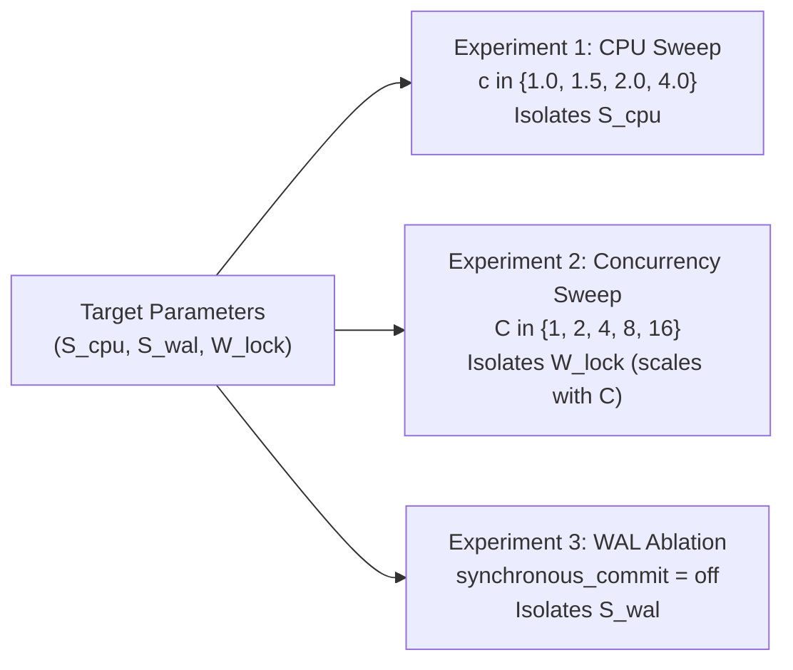

# Phase 4F.5.1 — Mechanistic Model Parameter Identifiability Audit

**Document Version:** 1.0.0  
**Status:** Formal Audit Report  
**Focus:** Identifiability analysis of the Queueing-Theoretic Empirical Mechanistic Model  

---

## 1. Executive Summary

A key requirement of Phase 4F.5.1 was an independent code-level and mathematical audit of the queueing-theoretic mechanistic model (`EmpiricalMechanisticModel`). In Phase 4F.5, this model decomposed PostgreSQL transaction latency into CPU service demand, synchronous WAL commit sync delay, and row-level lock contention, asserting that row locks were the "dominant throughput bottleneck."

This audit reveals that while CPU service demand ($S_{\text{cpu}}$) is identifiable under $1/c$ scaling, the individual terms for WAL sync time ($S_{\text{wal}}$) and lock contention ($W_{\text{lock}}$) are **strictly mathematically confounded and underdetermined** under the current 2-point CPU quota dataset. Any attribution of latency or throughput limits specifically to row locks versus WAL sync is an **engineering hypothesis**, not an empirically proven causal finding.

---

## 2. Governing Equations and Parameter Formulation

The mechanistic model represents transaction service time as a queueing decomposition across hardware and database resources:

$$T_{\text{service}}(c) = \frac{S_{\text{cpu}}}{c} + S_{\text{wal}} + W_{\text{lock}}$$

where:
- $c \in [1.0, 2.0]$ is the container CPU quota in cores.
- $S_{\text{cpu}}$ is the single-threaded CPU service demand in milliseconds.
- $S_{\text{wal}}$ is the per-transaction critical-path synchronous WAL commit delay in milliseconds.
- $W_{\text{lock}}$ is the per-transaction waiting time spent blocked on row-level lock serialization in milliseconds.

Under Little's Law with client connection concurrency $C = 8$:
$$\lambda(c) = \frac{C}{T_{\text{service}}(c) / 1000}$$

---

## 3. Mathematical Proof of Parameter Underdetermination

### 3.1. Independent Observations vs. Free Parameters
In the reconciled Phase 4F.4.5 empirical dataset:
- For balanced OLTP (`balanced_oltp_tpcb`), measurements exist at exactly two CPU quota points:
  * Condition 1: $c_1 = 1.0\text{ vCPU} \implies \bar{T}_1 = 5.70\text{ ms}$ ($\bar{\lambda}_1 = 1403.5\text{ TPS}$)
  * Condition 2: $c_2 = 2.0\text{ vCPU} \implies \bar{T}_2 = 4.96\text{ ms}$ ($\bar{\lambda}_2 = 1613.8\text{ TPS}$)
- Number of independent observation equations: $K = 2$.
- Number of unknown free parameters: $P = 3$ ($S_{\text{cpu}}, S_{\text{wal}}, W_{\text{lock}}$).
- **Degrees of freedom:** $K - P = 2 - 3 = -1$. The system is underdetermined.

### 3.2. Algebraic Solution
Substituting the observations into the model equations:
$$\begin{aligned}
(1) \quad 5.70 &= \frac{S_{\text{cpu}}}{1.0} + S_{\text{wal}} + W_{\text{lock}} = S_{\text{cpu}} + S_{\text{fixed}} \\
(2) \quad 4.96 &= \frac{S_{\text{cpu}}}{2.0} + S_{\text{wal}} + W_{\text{lock}} = \frac{S_{\text{cpu}}}{2.0} + S_{\text{fixed}}
\end{aligned}$$
where $S_{\text{fixed}} \equiv S_{\text{wal}} + W_{\text{lock}}$.

Subtracting equation (2) from equation (1):
$$5.70 - 4.96 = 0.74\text{ ms} = S_{\text{cpu}} - \frac{S_{\text{cpu}}}{2.0} = \frac{S_{\text{cpu}}}{2.0}$$
$$\implies S_{\text{cpu}} = 2 \times 0.74 = 1.48\text{ ms}$$

Substituting $S_{\text{cpu}} = 1.48\text{ ms}$ back into equation (1):
$$S_{\text{fixed}} = 5.70 - 1.48 = 4.22\text{ ms}$$

### 3.3. Confounding Proof
We now have:
$$S_{\text{wal}} + W_{\text{lock}} = 4.22\text{ ms}$$

This is a single linear equation in two unknowns. It has an infinite continuum of solutions.
Consider three distinct parameter parameterizations:

| Parameterization | Assumed $S_{\text{wal}}$ | Inferred $W_{\text{lock}}$ | Predicted $T(1.0)$ | Predicted $T(2.0)$ | Predicted $\lambda(1.0)$ | Predicted $\lambda(2.0)$ |
|---|---|---|---|---|---|---|
| **A (Phase 4F.5 baseline)** | $0.77\text{ ms}$ | $3.45\text{ ms}$ | $5.70\text{ ms}$ | $4.96\text{ ms}$ | $1403.5\text{ TPS}$ | $1612.9\text{ TPS}$ |
| **B (Equal split)** | $2.11\text{ ms}$ | $2.11\text{ ms}$ | $5.70\text{ ms}$ | $4.96\text{ ms}$ | $1403.5\text{ TPS}$ | $1612.9\text{ TPS}$ |
| **C (WAL dominant)** | $3.50\text{ ms}$ | $0.72\text{ ms}$ | $5.70\text{ ms}$ | $4.96\text{ ms}$ | $1403.5\text{ TPS}$ | $1612.9\text{ TPS}$ |

**Theorem:** For any arbitrary split $\theta \in [0, 4.22\text{ ms}]$ such that $S_{\text{wal}} = \theta$ and $W_{\text{lock}} = 4.22 - \theta$, the model produces **identical** latency and throughput predictions across all CPU quotas $c$.

**Conclusion:** The available data CANNOT distinguish between a scenario where row locking dominates and a scenario where WAL flush dominates. The parameters are mathematically confounded.

---

## 4. Audit of Phase 4F.5 Parameter Assumptions

### 4.1. Derivation of $S_{\text{wal}} = 0.77\text{ ms}$
In Phase 4F.5, $S_{\text{wal}}$ was set to $0.77\text{ ms}$ by dividing total cumulative WAL sync time from `pg_stat_wal` ($\approx 36.8\text{ seconds}$ across the 30-second measurement window) by total transactions completed ($\approx 47,800$):
$$\frac{36.8\text{ s}}{47,800\text{ tx}} \approx 0.77\text{ ms/tx}$$

### 4.2. Why This Assumption is Unvalidated
1. **Concurrency Conflation:** The 36.8 seconds represents the sum of sync times across 8 concurrent worker backends operating simultaneously over 30 seconds of wall-clock time ($8 \times 30 = 240\text{ backend seconds}$).
2. **Group Commit Dynamics:** PostgreSQL implements group commit (`commit_siblings`, `commit_delay`). Multiple transactions committing in the same window share a single `fdatasync()` flush. Dividing total sync time by transaction count assumes each transaction waited for a dedicated, non-overlapping synchronous flush.
3. **Background Overlap:** Background processes (e.g. checkpointer and WAL writer) also execute disk writes that increment server-wide telemetry without directly serializing client latency.

### 4.3. Audit of Row Lock Wait Telemetry
The Phase 4F.5 report cited `observed_lock_waits \approx 2050` from `pg_stat_database` and the small number of branch rows (2 rows at SF2) and teller rows (20 rows) as proof that row lock contention was the primary bottleneck.
- **Scientific Audit:** Observed lock waits prove that row lock contention **occurred** (`OBSERVED`).
- However, `pg_stat_database` does not report the **duration** of individual lock waits.
- The probability and duration of lock collisions depend heavily on transaction inter-arrival times, client concurrency, and row access order.
- Therefore, attributing the remaining $3.45\text{ ms}$ of latency to row locks is an **untested hypothesis**, not an empirical measurement.

---

## 5. Model Hardening and Identifiability Disclosures

To prevent epistemic trespass, `EmpiricalMechanisticModel` has been updated with explicit identifiability tracking:

```python
self.identifiability = {
    "s_cpu": "IDENTIFIABLE",
    "s_fixed": "IDENTIFIABLE",
    "s_wal": "ASSUMPTION_DEPENDENT_NON_IDENTIFIABLE",
    "w_lock": "ASSUMPTION_DEPENDENT_NON_IDENTIFIABLE",
}
```

### Mandatory Output Disclosures
Every prediction produced by `EmpiricalMechanisticModel` now includes:
1. `"Identifiability status: S_cpu is IDENTIFIABLE under 1/c scaling assumption."`
2. `"S_fixed is IDENTIFIABLE as sum (S_wal + W_lock)."`
3. `"S_wal and W_lock are mathematically NON-IDENTIFIABLE / CONFOUNDED under 2-point CPU quota support."`
4. `"The model does NOT prove that row locks or WAL synchronization are the causal dominant bottleneck; wait events demonstrate occurrence, not independent causal attribution."`

---

## 6. Required Experimental Design to Resolve Identifiability

To independently identify $S_{\text{wal}}$ and $W_{\text{lock}}$ in future phases (e.g. Phase 4F.6), the following controlled counterfactual experiments are required:



1. **Concurrency Sweep ($C \in \{1, 2, 4, 8, 16\}$):** At $C=1$, lock contention is physically zero ($W_{\text{lock}} = 0$). Measuring at $C=1$ directly isolates $S_{\text{cpu}} + S_{\text{wal}}$.
2. **WAL Ablation (`synchronous_commit = off`):** Disabling synchronous WAL flush removes $S_{\text{wal}}$ from the client critical path, directly exposing $S_{\text{cpu}} / c + W_{\text{lock}}$.
3. **Multi-Point Quota Sweep ($c \in \{1.0, 1.5, 2.0, 4.0\}$):** Tests whether CPU scaling follows $1/c$ curvature or saturates earlier.
