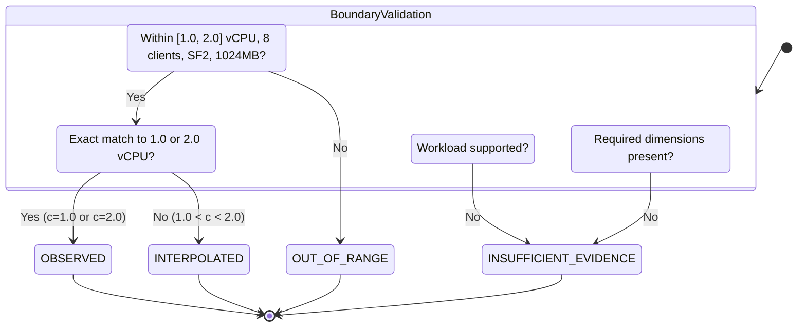

# Phase 4F.5.1 — Prediction Evidence Contract Specification

**Document Version:** 1.0.0  
**Status:** Enforced  
**Applicability:** All empirical PostgreSQL performance candidate models and consumers  

---

## 1. Overview and Purpose

The Prediction Evidence Contract defines the formal scientific boundaries, epistemological classifications, schema requirements, and consumption rules governing predictions produced by empirical PostgreSQL performance models.

The primary objective is to prevent **epistemic trespass** — ensuring that the AADS simulation and recommendation engines explicitly distinguish between:
1. What has been directly observed and measured.
2. What is estimated through interpolation assumptions between support points.
3. What is unvalidated extrapolation beyond empirical boundaries.
4. What cannot be responsibly predicted due to missing evidence or unidentifiable parameters.

---

## 2. Evidence Classification Hierarchy

Every prediction produced by an empirical model MUST be categorized into exactly one of four mutually exclusive evidence states:



### 2.1. OBSERVED
A prediction corresponds directly to a configuration represented by empirical measurement support in the reconciled benchmark dataset.

**Exact Criteria for Current Empirical Dataset:**
- **Workload:** `read_only_select` or `balanced_oltp_tpcb`
- **CPU Quota:** $1.0\text{ vCPU}$ or $2.0\text{ vCPU}$ ($|c - 1.0| < 10^{-4}$ or $|c - 2.0| < 10^{-4}$)
- **Client Concurrency:** 8 connections
- **Database Scale:** Scale Factor SF2 ($\approx 32\text{ MB}$ base data)
- **Container Memory:** 1024 MB
- **Database Engine:** PostgreSQL 16.15 on Alpine Linux (`sha256:cf78e76683b9ca8c5733cbbdce6c9262b45b6767934dd0a95e671f9a0fc20685`)

**Prediction Rules:**
- Point estimates represent empirical sample means across $N=3$ independent replications.
- Uncertainty type MUST be `UncertaintyType.REPLICATION_SAMPLE_STD` or `UncertaintyType.PARAMETER_UNCERTAINTY`.
- `is_heuristic` MUST be `False`.
- Small-sample 95% confidence interval may be reported with sample size qualification ($N=3$).

### 2.2. INTERPOLATED
A prediction falls strictly between observed empirical support endpoints for a continuous input parameter, while all other dimensions match the supported environment.

**Exact Criteria:**
- **Workload:** supported (`read_only_select` or `balanced_oltp_tpcb`)
- **CPU Quota:** $1.0 < c < 2.0$ (e.g. 1.25, 1.5, 1.75 vCPU)
- **Concurrency, Scale, Memory:** Match supported baseline ($8, 2, 1024\text{ MB}$)

**Mandatory Contract Constraints:**
- **Strict Prohibition:** An interpolated prediction MUST NEVER be classified as `OBSERVED` or `IN_RANGE`.
- **Heuristic Labeling:** `is_heuristic` MUST be `True`.
- **No Statistical CI:** `confidence_interval_95` MUST be `None`. Heuristic bounds MUST be exposed via `heuristic_interval`.
- **Limitation Disclosure:** Prediction metadata MUST disclose that the estimate relies on an interpolation functional form assumption (linear, inverse, or knee) that has not been empirically verified at the requested point.

### 2.3. OUT_OF_RANGE
A prediction is outside the model's measured support envelope or deviates from supported environmental/workload dimensions.

**Examples:**
- CPU quota $< 1.0$ or $> 2.0$ vCPU (e.g. 0.5, 3.0, 4.0 vCPU)
- Client concurrency $\neq 8$ (e.g. 1, 4, 16, 32 clients)
- Database scale $\neq \text{SF2}$ (e.g. SF10, SF100)
- Container memory $\neq 1024\text{ MB}$ (e.g. 512 MB, 2048 MB)
- Unsupported PostgreSQL major version or operating system

**Mandatory Contract Constraints:**
- `is_extrapolated` MUST be `True`.
- `uncertainty_type` MUST be `UncertaintyType.EXTRAPOLATION_HEURISTIC`.
- `is_heuristic` MUST be `True`.
- `confidence_interval_95` MUST be `None`.
- Applied penalty multiplier ($2.0 + 1.5 \times \text{distance}$) MUST be recorded in `heuristic_multiplier`.
- Simulation results using this prediction MUST flag `OUT_OF_RANGE` in warnings.

### 2.4. INSUFFICIENT_EVIDENCE
Used when the model cannot responsibly generate a quantitative prediction because required evidence is absent, dimensions are unsupported, or model parameters are unidentifiable.

**Examples:**
- Unsupported workload profile (e.g. ad-hoc analytical queries, bulk loading)
- Missing required query dimensions (`cpu_quota_cores` is `None`)
- Requests for independent parameter decomposition that are mathematically unidentifiable without unsupported assumptions

**Mandatory Contract Constraints:**
- Point estimate MUST be `None` (NEVER an invented default).
- Uncertainty standard deviation MUST be `None` (NEVER silently set to 0.0).
- `uncertainty_type` MUST be `UncertaintyType.UNAVAILABLE`.
- Recommendation engines MUST treat this output as inconclusive and reject silent constraint satisfaction.

---

## 3. Data Schemas

### 3.1. Target Query (`EmpiricalPostgresQuery`)
```python
class EmpiricalPostgresQuery(BaseModel):
    workload_profile: WorkloadProfile
    cpu_quota_cores: float = Field(..., description="Container CPU quota in cores (e.g. 1.0, 2.0)")
    concurrency: int = Field(default=8, description="Client connection concurrency")
    scale_factor: int = Field(default=2, description="pgbench scale factor (SF)")
    memory_mb: float = Field(default=1024.0, description="Container memory limit in MB")
```

### 3.2. Metric Prediction (`MetricPrediction`)
```python
class MetricPrediction(BaseModel):
    point_estimate: Optional[float] = None
    uncertainty_std: Optional[float] = None
    uncertainty_type: UncertaintyType = UncertaintyType.REPLICATION_SAMPLE_STD
    is_heuristic: bool = False
    confidence_interval_95: Optional[Tuple[float, float]] = None
    heuristic_interval: Optional[Tuple[float, float]] = None
    heuristic_multiplier: Optional[float] = None
    notes: List[str] = Field(default_factory=list)
```

### 3.3. Response Payload (`EmpiricalPostgresPrediction`)
```python
class EmpiricalPostgresPrediction(BaseModel):
    # Epistemological contract fields
    evidence_status: EvidenceStatus
    prediction_method: str
    measured_support: Dict[str, Any]
    requested_configuration: Dict[str, Any]
    uncertainty: Optional[float]
    uncertainty_type: UncertaintyType
    limitations: List[str]
    identifiability_notes: List[str]
    provenance: Dict[str, Any]

    # Backward compatibility fields
    state: ModelState
    is_extrapolated: bool
    uncertainty_notes: List[str]

    # Configuration echo
    workload_profile: str
    cpu_quota_cores: float
    concurrency: int
    scale_factor: int
    memory_mb: float

    # Metric predictions
    throughput_tps: MetricPrediction
    latency_mean_ms: MetricPrediction
    p50_ms: MetricPrediction
    p90_ms: MetricPrediction
    p95_ms: MetricPrediction
    p99_ms: MetricPrediction
    p999_ms: MetricPrediction
    max_ms: MetricPrediction
    cpu_utilization_pct: MetricPrediction
    throttling_frequency_pct: Optional[MetricPrediction] = None
    throttled_seconds: Optional[MetricPrediction] = None
    wal_bytes_per_sec: Optional[MetricPrediction] = None
    wal_sync_time_ms: Optional[MetricPrediction] = None
    observed_lock_waits: Optional[MetricPrediction] = None
```

---

## 4. Consumer Integration Contracts

### 4.1. SimPy Discrete-Event Simulation Integration
When SimPy queries an empirical component model:
1. The model implements `predict_service_time_ms(op_type, concurrency, offered_rps)`.
2. It returns a `ServiceTimeResult` 3-tuple `(service_time_ms, uncertainty_ms, is_extrapolated)` that unpacks seamlessly while carrying `.evidence_status`.
3. **Double-Counting Guard:** SimPy simulates queueing delays via `simpy.Resource`. The component model outputs pure single-request service demand ($p50 / concurrency$), ensuring contention is not counted twice.
4. If `.evidence_status` is `OUT_OF_RANGE` or `INSUFFICIENT_EVIDENCE`, the simulation engine records an explicit warning into `SimulationResult.warnings`.

### 4.2. Architecture Recommendation Engine Integration
1. **Deterministic SLA Evaluation:** `FeasibilityFilter` evaluates hard SLA constraints (p95 latency, minimum throughput, budget).
2. **Evidence Integrity Filter:** If `SimulationResult.warnings` contains `OUT_OF_RANGE` or `INSUFFICIENT_EVIDENCE`, `FeasibilityFilter` marks candidate feasibility as `FeasibilityStatus.UNCERTAIN`.
3. **No Silent Validation:** An extrapolated or inconclusive candidate can NEVER silently be rated `FEASIBLE`.
4. **Rationale Disclosure:** `ArchitectureRecommender` discloses evidence limitations in `validation_gaps`.
