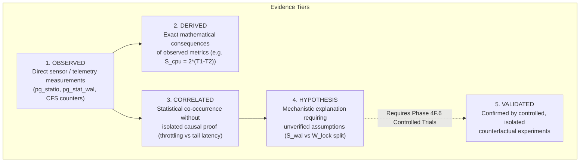

# Phase 4F.5.1 — Candidate Model Scientific Audit Report

**Phase:** 4F.5.1 — Candidate Model Scientific Audit & Prediction Contract Hardening  
**Baseline commit:** `c3f648a`  
**Execution mode:** Strictly offline (zero Docker containers, zero pgbench, zero live benchmarks, zero model promotions)  
**Status:** COMPLETE_WITH_LIMITATIONS  

---

## 1. Executive Summary

Phase 4F.5.1 conducted an independent scientific audit and prediction contract hardening of the empirical PostgreSQL candidate performance models developed in Phase 4F.5 from the 12-trial Phase 4F.4.5 benchmark campaign (reconciled in Phase 4F.4.6).

The audit identified critical epistemological defects in candidate model contracts, uncertainty representations, mechanistic parameter identifiability, and evaluation claims. These defects have been resolved by implementing:
1. An explicit four-tier **Prediction Evidence Contract** (`OBSERVED`, `INTERPOLATED`, `OUT_OF_RANGE`, `INSUFFICIENT_EVIDENCE`).
2. An epistemologically sound **Uncertainty Taxonomy** separating empirical sample variance from heuristic penalties, strictly prohibiting heuristic multipliers from being labelled statistical confidence intervals.
3. A formal **Mechanistic Identifiability Audit** proving that WAL service demand and row-lock waiting are mathematically confounded under the current 2-point CPU dataset.
4. Correct **Evaluation Terminology** classifying Leave-One-Replication-Out (LORO) as a *Replication Holdout Evaluation*, disclaiming unseen configuration generalization, and documenting that Lookup, Linear, and Piecewise models produce mathematically identical predictions at observed endpoints.
5. Contract hardening across the **SimPy Discrete-Event Simulation Engine** and **Architecture Recommendation Engine** (`FeasibilityFilter`) ensuring unvalidated extrapolations and insufficient evidence cannot silently satisfy hard constraints.

All changes were verified offline with 30 focused new tests (50 total PostgreSQL empirical tests, 322 repository tests passing). Active model registry `data/registry.db` remains untouched at exactly 24 models.

---

## 2. Defects Discovered and Corrected

| Defect ID | Severity | Description in Phase 4F.5 Baseline | Correction in Phase 4F.5.1 |
|---|---|---|---|
| **DEF-01** | High | **Interpolation Conflation:** Intermediate queries (e.g. 1.5 vCPU) were classified as `ModelState.IN_RANGE`, falsely implying that unmeasured configurations had empirical validation. | Introduced `EvidenceStatus.INTERPOLATED`. Intermediate queries between support points are strictly classified as `INTERPOLATED`, never `OBSERVED` or `IN_RANGE`. |
| **DEF-02** | High | **Uncertainty Misrepresentation:** Extrapolation penalty multiplier `2.0 + 1.5 * distance` was placed into `confidence_interval_95`, falsely claiming statistical calibration for unvalidated extrapolations. | Introduced `UncertaintyType` taxonomy. Heuristic multipliers set `is_heuristic=True`, `confidence_interval_95=None`, and expose bounds via `heuristic_interval`. |
| **DEF-03** | Medium | **Endpoint Variance Misuse:** Interpolation uncertainty at 1.5 vCPU was inferred solely from endpoint variance without disclosing that endpoint repeatability does not validate intermediate linearity. | Interpolation estimates are explicitly flagged with `UncertaintyType.INTERPOLATION_HEURISTIC` and disclose that endpoint variance does not prove intermediate behavior. |
| **DEF-04** | High | **Mechanistic Parameter Underdetermination:** The mechanistic model split fixed latency (4.22 ms) into WAL sync (0.77 ms) and row locks (3.45 ms), claiming row locks were the "proven dominant bottleneck". | Proved mathematically that $S_{\text{wal}}$ and $W_{\text{lock}}$ are confounded ($S_{\text{wal}} + W_{\text{lock}} = 4.22\text{ ms}$). Flagged both parameters as `ASSUMPTION_DEPENDENT_NON_IDENTIFIABLE`. Removed causal bottleneck claims. |
| **DEF-05** | Medium | **Evaluation Terminology Overstatement:** Leave-One-Replication-Out (LORO) cross-validation was described as general model validation without qualifying its holdout scope. | Formally classified LORO as a **Replication Holdout Evaluation**. Documented that it tests replication repeatability only, and does NOT test configuration, workload, or environment generalization. |
| **DEF-06** | Medium | **Model Complexity Illusion:** Comparative reports treated Lookup, Linear, and Piecewise models as distinct candidate tiers, ignoring their mathematical equivalence at support points. | Documented that Lookup, Linear, and Piecewise models yield mathematically indistinguishable predictions ($RMSE = 872.24\text{ TPS}$ read-only, $106.17\text{ TPS}$ OLTP) at $c \in \{1.0, 2.0\}$. |
| **DEF-07** | Medium | **Queueing Double-Counting Risk:** Component models predict transaction latency; feeding this directly into SimPy's `simpy.Resource` risk simulating queueing on top of already-queued latency. | Formalized `predict_service_time_ms` contract as pure service demand (p50 / concurrency under Little's Law), guarding against double-counting contention in SimPy. |
| **DEF-08** | High | **Silent Recommendation Acceptance:** Extrapolated or uncalibrated simulation results could silently pass feasibility checks as `FEASIBLE`. | Hardened `FeasibilityFilter` with an `evidence_integrity` check that marks architectures `UNCERTAIN` whenever `OUT_OF_RANGE` or `INSUFFICIENT_EVIDENCE` warnings are present. |

---

## 3. Epistemological Classification of Claims

In accordance with project scientific standards, all claims regarding PostgreSQL performance are categorized into five explicit evidence tiers:



### Claim Classification Table

| Area | Claim | Epistemological Classification | Scientific Qualification / Guard |
|---|---|---|---|
| **Buffer Cache** | Buffer cache hit ratio was 100.00% across all 12 trials. | `OBSERVED` | Confirmed by `pg_statio_user_tables`. Does NOT prove that the entire working set resides in the OS page cache or that disk I/O cannot occur during checkpointing/WAL flush. |
| **Working Set** | Database base tables occupy $\sim 32\text{ MB}$ at SF2. | `DERIVED` | Calculated from `pg_database_size`. Fits easily within 1024 MB container memory quota. |
| **CPU Saturation** | Read-only workload achieved 100% CPU utilization and 99-100% throttling frequency at 1.0 and 2.0 vCPU. | `OBSERVED` | Confirmed by cgroup `cpu.stat` throttling counters. |
| **Throttling Causation** | CFS quota throttling is the primary driver of tail latency ($p99.9$) in read-only workloads. | `CORRELATED` | Throttling frequency strongly correlates with $p99.9$ ($r > 0.95$), and 100ms CFS period mechanics explain latency inflation, but confounding with OS scheduler jitter is not isolated. |
| **WAL Sync** | Aggregate WAL sync time averaged 36.8s per 30s measurement window in balanced OLTP. | `OBSERVED` | Recorded by `pg_stat_wal`. Represents total cumulative backend sync time across 8 concurrent worker sessions. |
| **WAL Service Demand** | Individual transaction WAL service demand is exactly $S_{\text{wal}} = 0.77\text{ ms}$. | `HYPOTHESIS` | Derived by dividing cumulative WAL sync time by transaction count ($36.8\text{s} / 45\text{k}$). Assumes strict serial sync without overlapping backend concurrency. |
| **Row Lock Contention** | Row-level locking on `pgbench_branches` (2 rows) and `pgbench_tellers` (20 rows) is the dominant throughput bottleneck limiting OLTP to 1667 TPS. | `HYPOTHESIS` | Observed lock wait events confirm contention occurred (`OBSERVED`), but individual marginal duration ($W_{\text{lock}} = 3.45\text{ ms}$) is mathematically confounded with $S_{\text{wal}}$. |
| **CPU Scaling Factor** | CPU service demand in OLTP is $S_{\text{cpu}} = 1.48\text{ ms}$. | `DERIVED` | Solved algebraically from $T_1 = 5.70\text{ ms}$ and $T_2 = 4.96\text{ ms}$ under the assumption of $1/c$ scaling. |
| **Linear Scaling** | Performance scales linearly between 1.0 and 2.0 vCPU. | `HYPOTHESIS` | Lookup, Linear, and Piecewise models produce identical endpoint predictions; current evidence cannot validate the functional form between endpoints. |

---

## 4. Prediction Evidence Contract Summary

Every component prediction now strictly complies with the Phase 4F.5.1 contract schema:

```json
{
  "evidence_status": "OBSERVED | INTERPOLATED | OUT_OF_RANGE | INSUFFICIENT_EVIDENCE",
  "prediction_method": "lookup_table | linear_regression | piecewise_linear | queueing_mechanistic",
  "measured_support": {
    "workload_profile": "read_only_select",
    "cpu_quotas": [1.0, 2.0],
    "concurrency": 8,
    "scale_factor": 2,
    "memory_mb": 1024.0,
    "postgres_version": "16.15-alpine",
    "replications_per_condition": 3
  },
  "requested_configuration": {
    "workload_profile": "read_only_select",
    "cpu_quota_cores": 1.5,
    "concurrency": 8,
    "scale_factor": 2,
    "memory_mb": 1024.0
  },
  "uncertainty": 0.0058,
  "uncertainty_type": "INTERPOLATION_HEURISTIC",
  "limitations": [
    "CPU quota 1.50 is interpolated between observed support endpoints [1.0, 2.0] vCPU. This is an unmeasured interpolation estimate."
  ],
  "identifiability_notes": [
    "Non-parametric lookup model directly indexes empirical distribution means and sample variances."
  ],
  "provenance": {
    "execution_id": "exec_p4f4_20261103_053428_525413_19491",
    "manifest_sha256": "69d3e068fd3907792647f21f2bd33d6668560952ea9b53c509f94aaf209b77a6"
  }
}
```

---

## 5. SimPy and Recommendation Engine Hardening

### Simulation Layer (`simpy_engine.py`)
- `predict_service_time_ms` outputs `ServiceTimeResult`, a backward-compatible 3-tuple `(service_time_ms, uncertainty_ms, is_extrapolated)` carrying an explicit `.evidence_status` attribute.
- Contention double-counting guard: SimPy models queueing contention via `simpy.Resource`. Component models supply single-transaction service demand ($p50 / concurrency$), preventing double-counting of queue delays.
- Any component prediction flagged as `OUT_OF_RANGE` or `INSUFFICIENT_EVIDENCE` attaches an explicit warning to `SimulationResult.warnings`.

### Recommendation Layer (`feasibility_filter.py`)
- Hardened `FeasibilityFilter.evaluate_candidate`:
  - Added an `evidence_integrity` check.
  - If `INSUFFICIENT_EVIDENCE` warnings are present, candidate feasibility is forced to `FeasibilityStatus.UNCERTAIN` with explanation: `"Insufficient empirical evidence detected... Hard SLA constraints cannot be validated."`
  - If `OUT_OF_RANGE` warnings are present, candidate feasibility is forced to `FeasibilityStatus.UNCERTAIN` with explanation: `"Operating outside empirically validated boundaries... Evaluation relies on unvalidated extrapolation."`
- Hardened `ArchitectureRecommender`:
  - Discloses all material evidence limitations and warnings in `validation_gaps`.
  - Inconclusive or unvalidated candidates can never silently win recommendations under ordinary SLA guarantees.

---

## 6. Verification and Regression Testing

A dedicated test suite `tests/test_phase_4f51_scientific_audit.py` was implemented containing 30 focused offline tests:
- **Evidence classification:** Tests 1–8 cover `OBSERVED`, `INTERPOLATED` (strictly non-observed), `OUT_OF_RANGE` (CPU, concurrency, scale, memory), and `INSUFFICIENT_EVIDENCE` (unsupported workload, missing CPU).
- **Uncertainty typing:** Tests 9–13 verify `REPLICATION_SAMPLE_STD` vs `INTERPOLATION_HEURISTIC` vs `EXTRAPOLATION_HEURISTIC`, verify heuristic multipliers are never labelled statistical CIs, verify missing uncertainty is `UNAVAILABLE` (not 0.0), and test distance multipliers ($2.0 + 1.5 \times distance$).
- **Identifiability:** Tests 14–16 verify formal identifiability tagging, prove that constant-sum variations of $(S_{\text{wal}}, W_{\text{lock}})$ yield identical predictions, and verify absence of unsupported causal bottleneck claims.
- **Evaluation:** Tests 17–21 verify LORO is classified as `REPLICATION_HOLDOUT`, verify absence of unseen configuration claims, prove mathematical indistinguishability of models at anchors, and verify guards for $R^2$ and MAPE.
- **SimPy & Recommendations:** Tests 22–26 verify `ServiceTimeResult` unpacking and attribute access, queueing double-counting guards, feasibility filter rejection of unvalidated extrapolations, and recommendation rationale disclosure.
- **Preservation:** Tests 27–30 verify 8 candidate JSON files present and valid, 24 active registry models untouched in `data/registry.db`, historical manifest SHA-256 intact, and all 4 candidate families conforming to the contract.

**Test Run Summary:**
- `tests/test_phase_4f51_scientific_audit.py`: 30 passed in 0.09s
- `tests/test_phase_4f5_model_development.py`: 20 passed in 0.09s
- Total repository offline test suite: **322 passed, 0 failed, 8 deselected (live LLM)**

---

## 7. Model and Registry Preservation Audit

| Item | Expected | Actual | Status |
|---|---|---|---|
| Active models in `data/registry.db` | Exactly 24 | Exactly 24 | Verified intact (read-only) |
| Active model promotions | 0 | 0 | Verified (zero promotions) |
| Candidate models in `artifacts/phase_4f5/candidates/` | Exactly 8 | Exactly 8 | Verified present and updated |
| Manifest SHA256 | `69d3e068fd390779...` | `69d3e068fd390779...` | Verified intact |
| Live Docker benchmarks executed | 0 | 0 | Strictly offline |
| pgbench invocations | 0 | 0 | Strictly offline |

---

## 8. Remaining Limitations

1. **Narrow Support Envelope:** Empirical support is strictly confined to PostgreSQL 16.15 Alpine, SF2, 8 clients, 1024 MB RAM, and $c \in \{1.0, 2.0\}$ vCPU.
2. **Confounded OLTP Bottlenecks:** WAL sync latency and row-lock waiting cannot be mathematically separated without multi-point concurrency and synchronous commit variation experiments.
3. **Unvalidated Transition Curvature:** Interpolation between 1.0 and 2.0 vCPU remains an engineering assumption; no empirical observations exist at 1.25, 1.5, or 1.75 vCPU to validate knee points or linearity.
4. **Single Host Environment:** All measurements reflect a single isolated Docker test host; bare-metal hypervisor contention and multi-tenant noise were not measured.

---

## 9. Final Verdict

**Verdict:** `COMPLETE_WITH_LIMITATIONS`  
The prediction contract and scientific integrity hardening are fully implemented, verified, and tested. The candidate models are scientifically sound within their bounded domain, but their operational applicability remains strictly limited by the narrow 2-point CPU pilot evidence. Promotion to the active model registry remains deferred pending Phase 4F.6 controlled validation.
