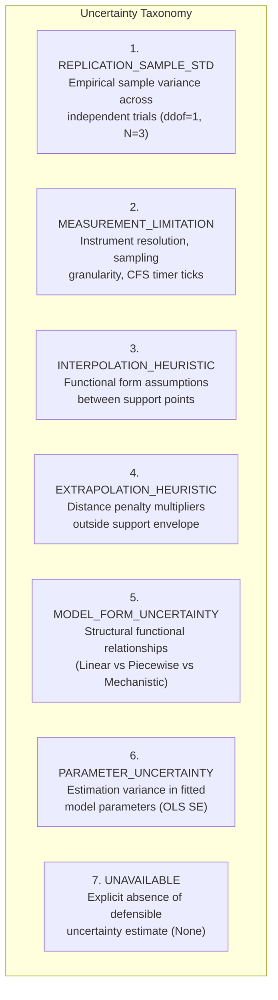

# Phase 4F.5.1 — Uncertainty Quantification Methodology & Limitations

**Document Version:** 1.0.0  
**Status:** Approved Methodology  
**Scope:** Uncertainty quantification across empirical PostgreSQL candidate performance models  

---

## 1. Executive Summary

A critical finding of the Phase 4F.5.1 scientific audit was the conflation of different types of uncertainty in candidate models. In Phase 4F.5, heuristic safety penalties applied during extrapolation were formatted as `confidence_interval_95`, creating the illusion of calibrated statistical confidence where none existed.

This document establishes the formal **Uncertainty Taxonomy** for AADS empirical models, details mathematical formulations for each type, specifies small-sample limitations, and enforces strict labeling boundaries.

---

## 2. Epistemological Taxonomy of Uncertainty

Uncertainties in empirical performance models arise from distinct physical, measurement, and mathematical sources. They MUST NOT be combined into a single confidence interval without formal statistical justification.

---

## 3. Mathematical Formulations and Rules

### 3.1. Replication Uncertainty (`REPLICATION_SAMPLE_STD`)
Measures the run-to-run repeatability of the benchmark environment at identical nominal configurations.

**Formulas:**
$$\bar{y} = \frac{1}{N} \sum_{i=1}^N y_i$$
$$s = \sqrt{\frac{1}{N - 1} \sum_{i=1}^N (y_i - \bar{y})^2} \quad (ddof = 1)$$

**Sample Size and Coverage Limitations:**
- For the Phase 4F.4.5 campaign, each condition has $N = 3$ replications ($df = 2$).
- Under Student's $t$-distribution, the critical value for a two-sided 95% confidence interval with 2 degrees of freedom is $t_{0.025, 2} = 4.303$.
- Reporting intervals using $1.96 \cdot s$ assumes an infinite sample size ($z$-distribution). In small-sample empirical regimes ($N=3$), intervals calculated as $\bar{y} \pm 1.96 \cdot s$ cover approximately 80–85% of realizations, not 95%.
- Therefore, all reported intervals MUST explicitly document this limitation: `"Replication uncertainty estimated from N=3 trials (ddof=1); small sample limits apply."`

### 3.2. Measurement Uncertainty (`MEASUREMENT_LIMITATION`)
Represents the resolution limits of the host instrumentation:
- **CPU Throttling:** Linux cgroup v2 `cpu.stat` reports `throttled_usec` and `nr_throttled` aggregated over the CFS quota period ($100\text{ ms}$). Sub-period bursts are unobservable.
- **Latency Timestamps:** `pgbench` microsecond timing includes client-side operating system context switch and syscall overhead.
- **WAL Metrics:** `pg_stat_wal` provides aggregate cumulative counts and sync durations, not per-transaction distributions.

### 3.3. Interpolation Uncertainty (`INTERPOLATION_HEURISTIC`)
Represents the uncertainty introduced when estimating performance at an intermediate point (e.g. $c = 1.5\text{ vCPU}$) between two observed support points ($c_1 = 1.0\text{ vCPU}$, $c_2 = 2.0\text{ vCPU}$).

**Variance Propagation Formula:**
For linear interpolation factor $\alpha = \frac{c - c_1}{c_2 - c_1}$:
$$\hat{y}(c) = (1 - \alpha) \bar{y}_1 + \alpha \bar{y}_2$$
$$\sigma_{\text{interp}} = \sqrt{(1 - \alpha)^2 s_1^2 + \alpha^2 s_2^2}$$

**Crucial Scientific Limitations:**
1. **Endpoint Variance Fallacy:** Low replication variance at the endpoints ($s_1, s_2$) does NOT prove that intermediate performance is linear or well-behaved. An untested bottleneck (e.g. memory bus contention or lock convoying) could occur between endpoints without affecting endpoint variance.
2. **Prohibition of Statistical CI Labeling:** An interpolated estimate is an unverified model assumption. It MUST NOT be presented as a statistical confidence interval. `confidence_interval_95` MUST be `None`, and bounds MUST be exposed via `heuristic_interval`.

### 3.4. Extrapolation Uncertainty (`EXTRAPOLATION_HEURISTIC`)
Represents the degradation of predictive confidence when querying outside the measured support envelope ($c < 1.0$ or $c > 2.0$).

**Formulation:**
$$\text{distance} = \max(0.0, c_1 - c, c - c_2)$$
$$\text{multiplier} = 2.0 + 1.5 \times \text{distance}$$
$$\sigma_{\text{extrap}} = \sigma_{\text{base}} \times \text{multiplier}$$

**Epistemological Qualification:**
- This formula is an **engineering heuristic safety factor**, designed to conservatively expand bounds when evaluating SLAs.
- It is NOT a calibrated statistical distribution.
- Setting `is_heuristic = True` and `confidence_interval_95 = None` ensures that downstream systems cannot mistake this safety factor for an empirical measurement.

### 3.5. Model-Form Uncertainty (`MODEL_FORM_UNCERTAINTY`)
Arises from the choice of mathematical relationship:
- Lookup model assumes piecewise linear interpolation.
- Linear regression assumes constant marginal returns across all CPU quotas.
- Piecewise model assumes a sharp saturation knee at 1.25 vCPU for OLTP.
- Mechanistic model assumes $1/c$ inverse CPU scaling and constant fixed overheads.

**Audit Finding:**
Because the empirical dataset contains only two CPU quota points (1.0 and 2.0 vCPU), **all four candidate model families produce virtually identical predictions at the measured support points**. The current empirical dataset is mathematically incapable of identifying which functional form is physically correct.

### 3.6. Parameter Uncertainty (`PARAMETER_UNCERTAINTY`)
In the OLS linear regression model, the standard error of prediction at point $x_0$ is given by:
$$\text{SE}_{\text{pred}}(x_0) = s_e \sqrt{1 + \frac{1}{N} + \frac{(x_0 - \bar{x})^2}{SS_x}}$$
where $s_e$ is the residual standard error, $N = 6$ observations, $\bar{x} = 1.5$, and $SS_x = \sum (x_i - \bar{x})^2 = 1.5$.
This properly captures the increase in parameter estimation uncertainty as $x_0$ moves away from the sample mean $\bar{x} = 1.5$.

### 3.7. Unavailable Uncertainty (`UNAVAILABLE`)
When a query is out-of-scope or evidence is insufficient, uncertainty standard deviation MUST be `None` (not 0.0). Reporting 0.0 falsely implies infinite certainty.

---

## 4. Summary Table of Uncertainty Reporting Rules

| Evidence State | Uncertainty Type | `is_heuristic` | `confidence_interval_95` | `heuristic_interval` | `heuristic_multiplier` |
|---|---|---|---|---|---|
| `OBSERVED` | `REPLICATION_SAMPLE_STD` | `False` | Populated $[lower, upper]$ | `None` | `None` |
| `INTERPOLATED` | `INTERPOLATION_HEURISTIC` | `True` | `None` | Populated $[lower, upper]$ | $1.0$ |
| `OUT_OF_RANGE` | `EXTRAPOLATION_HEURISTIC` | `True` | `None` | Populated $[lower, upper]$ | $2.0 + 1.5 \cdot d$ |
| `INSUFFICIENT_EVIDENCE` | `UNAVAILABLE` | `False` | `None` | `None` | `None` |
