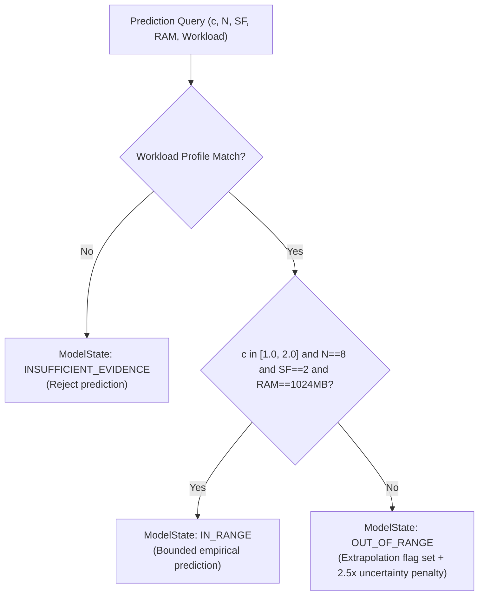

# AADS Phase 4F.5 — Empirical PostgreSQL Evidence Coverage Assessment

**Campaign Execution ID:** `exec_p4f4_20261103_053428_525413_19491`  
**Execution Manifest SHA-256:** `69d3e068fd3907792647f21f2bd33d6668560952ea9b53c509f94aaf209b77a6`  
**Primary Evidence Location:** `artifacts/phase_4f46/reconciliation/`  
**Base Commit:** `af0b1a7`  

---

## 1. Executive Assessment

Before training empirical component models, this document audits and establishes the exact multidimensional coverage of the empirical benchmark dataset.

The empirical evidence consists exclusively of the 12 controlled pilot trials executed during Phase 4F.4.5 and reconciled during Phase 4F.4.6. All observations were captured within a strictly controlled container environment on a single physical host.

> [!WARNING]
> Models trained in this phase are strictly empirical characterization models valid **only** within the verified support boundaries. They must **never** be presented as generally validated PostgreSQL performance models across unmeasured dimensions.

---

## 2. Tested Operating Matrix

The verified empirical data covers exactly four discrete operating conditions across a $2 \times 2$ factorial matrix (2 workload profiles $\times$ 2 CPU quotas $\times$ 3 independent replications):

| Condition ID | Workload Profile | CPU Quota | Replications | Client Concurrency | Scaling Factor (SF) | Container RAM | PostgreSQL Image | Duration (Warm-up / Measured) |
|---|---|---:|---:|---:|---:|---:|---|---|
| `ro_1cpu` | `read_only_select` | 1.0 vCPU | 3 (`r1`, `r2`, `r3`) | 8 clients (2 threads) | SF2 (200,000 accounts) | 1,024 MB | `postgres:16-alpine` | 10.0s / 30.0s |
| `ro_2cpu` | `read_only_select` | 2.0 vCPU | 3 (`r1`, `r2`, `r3`) | 8 clients (2 threads) | SF2 (200,000 accounts) | 1,024 MB | `postgres:16-alpine` | 10.0s / 30.0s |
| `tpcb_1cpu` | `balanced_oltp_tpcb` | 1.0 vCPU | 3 (`r1`, `r2`, `r3`) | 8 clients (2 threads) | SF2 (200,000 accounts) | 1,024 MB | `postgres:16-alpine` | 10.0s / 30.0s |
| `tpcb_2cpu` | `balanced_oltp_tpcb` | 2.0 vCPU | 3 (`r1`, `r2`, `r3`) | 8 clients (2 threads) | SF2 (200,000 accounts) | 1,024 MB | `postgres:16-alpine` | 10.0s / 30.0s |

Total independent experimental trials: **12**.  
Total reconciled transaction records: **5,376,068**.

---

## 3. Explicit Gap Analysis (Missing Dimensions)

The empirical support region is highly localized. The following operational dimensions are completely unmeasured in the empirical dataset:

### A. Client Concurrency ($C \neq 8$)
- **Measured Value:** $C = 8$ clients (fixed across all 12 trials).
- **Missing Coverage:** Concurrency levels $C \in \{1, 2, 4, 16, 32, 64, 128\}$.
- **Impact:** Queueing contention, connection pool contention, and lock waiting vary non-linearly with concurrency. Models cannot infer concurrency scaling from the pilot dataset.

### B. Database Scale Factor ($\text{SF} \neq 2$)
- **Measured Value:** $\text{SF} = 2$ (2 branches, 20 tellers, 200,000 accounts; $\approx 32\text{ MB}$ raw data).
- **Missing Coverage:** $\text{SF} \in \{1, 10, 50, 100, 500, 1000\}$.
- **Impact:** At $\text{SF} = 2$, TPC-B experiences severe artificial tuple-lock contention on the 2 branch rows ($P(\text{collision}) > 0.85$ at $C=8$). Larger databases (e.g. $\text{SF} = 100$) have 100 branches, drastically mitigating lock contention. The empirical data cannot predict performance for larger table footprints.

### C. Container Memory Limits ($\text{RAM} \neq 1024\text{ MB}$)
- **Measured Value:** $1,024\text{ MB}$ container limit (`shared_buffers = 128MB`).
- **Missing Coverage:** Memory allocations $\in \{256\text{ MB}, 512\text{ MB}, 2\text{ GB}, 4\text{ GB}, 8\text{ GB}\}$.
- **Impact:** At $\text{SF} = 2$ with $1,024\text{ MB}$ RAM, the entire working set fits in OS page cache (100% buffer cache hit ratio observed across all trials). The dataset exhibits zero disk read activity; memory exhaustion and physical read I/O were never exercised.

### D. CPU Quotas Outside $[1.0, 2.0]$
- **Measured Values:** Exactly $1.0\text{ vCPU}$ and $2.0\text{ vCPU}$.
- **Missing Coverage:** Fractional quotas ($0.5, 0.75, 1.5\text{ vCPU}$) and multi-core allocations ($3.0, 4.0, 8.0, 16.0\text{ vCPU}$).
- **Impact:** Intermediate interpolation across $[1.0, 2.0]$ is mathematically unanchored by empirical midpoints; extrapolation above $2.0\text{ vCPU}$ assumes unknown scaling trajectories.

### E. PostgreSQL Versions and Configurations
- **Measured Value:** PostgreSQL 16.15 (Alpine Linux, default engine parameters with `track_io_timing = on`, `track_wal_io_timing = on`, `synchronous_commit = on`).
- **Missing Coverage:** PostgreSQL 14, 15, 17; Debian/glibc images; tuned parameters (`shared_buffers > 128MB`, `work_mem`, `wal_buffers`, `synchronous_commit = off`).

### F. Host Hardware and Virtualization Variations
- **Measured Host:** Single Linux host (`AMD/Intel x86_64`, NVMe storage `/dev/nvme0n1p9` on `btrfs`, Linux kernel 6.x cgroup v2).
- **Missing Coverage:** Cloud VMs (AWS EC2, GCP Compute Engine), network-attached block storage (EBS gp3/io2, Google Persistent Disk), differing CPU architectures (ARM64/Graviton).

### G. Workload Diversity
- **Measured Profiles:** `read_only_select` (pgbench `-S`) and `balanced_oltp_tpcb` (standard TPC-B-like debit/credit).
- **Missing Coverage:** Simple write ingest (inserts only), complex analytical queries (joins, aggregations, scans), batch updates, autovacuum background load.

### H. Measurement Duration and Steady-State Life-Cycle
- **Measured Duration:** 30 seconds steady-state preceded by 10 seconds warm-up.
- **Missing Coverage:** Extended durations ($5\text{ minutes}, 1\text{ hour}, 24\text{ hours}$). Checkpoints were 0 across all 30s trials; checkpoint writeback spikes and autovacuum freeze events were not captured.

---

## 4. Boundary Specification for Model Development

To prevent silent extrapolation, candidate models developed in Phase 4F.5 must enforce the following boundaries:

| Parameter | Empirically Supported Range | Boundary Behavior |
|---|---|---|
| `workload_profile` | `read_only_select`, `balanced_oltp_tpcb` | If unsupported $\rightarrow$ `INSUFFICIENT_EVIDENCE` |
| `cpu_quota_cores` | $[1.0, 2.0]$ | If $< 1.0$ or $> 2.0 \rightarrow$ `OUT_OF_RANGE` |
| `concurrency` | $8$ | If $\neq 8 \rightarrow$ `OUT_OF_RANGE` |
| `scale_factor` | $2$ | If $\neq 2 \rightarrow$ `OUT_OF_RANGE` |
| `memory_mb` | $1024.0$ | If $\neq 1024.0 \rightarrow$ `OUT_OF_RANGE` |

---

## 5. Conclusion

The empirical evidence represents a high-integrity, high-precision characterization of a single 8-client, SF2, 1024MB PostgreSQL 16 container under 1.0 and 2.0 vCPU quotas. It is fully sufficient for developing and evaluating candidate empirical response models within this localized regime, but it does **not** constitute a general PostgreSQL performance model. All candidate models must declare these constraints explicitly.
