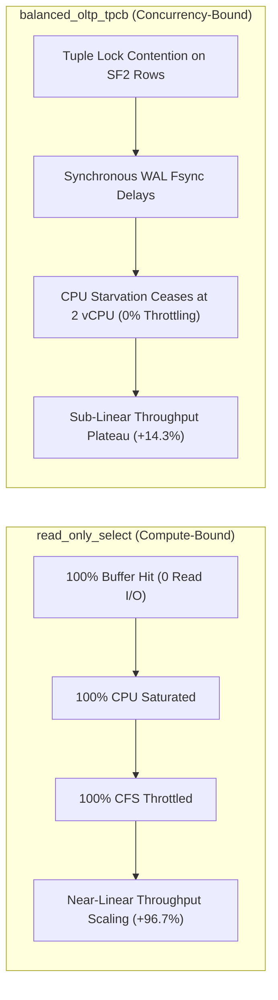
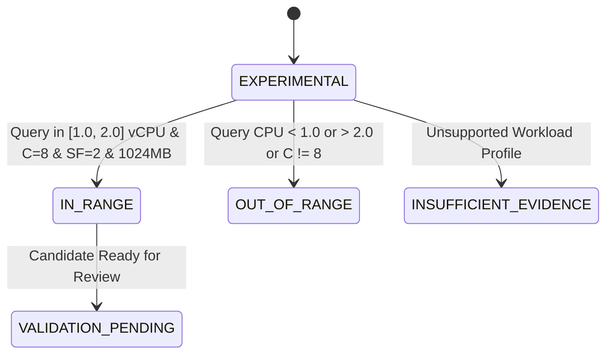

# AADS Phase 4F.5 — Empirical PostgreSQL Performance Model Development Report

**Campaign Execution ID:** `exec_p4f4_20261103_053428_525413_19491`  
**Execution Manifest SHA-256:** `69d3e068fd3907792647f21f2bd33d6668560952ea9b53c509f94aaf209b77a6`  
**Artifact Directory:** `artifacts/phase_4f5/candidates/`  
**Base Commit:** `af0b1a7`  

---

## 1. Overview and Engineering Objectives

Phase 4F.5 transforms the reconciled empirical evidence from Phase 4F.4.5 into bounded, predictive component performance models. These models provide structured estimates of throughput, mean latency, percentile latency distributions, CPU utilization, kernel throttling, and database contention metrics for consumption by the AADS discrete-event simulation engine and architecture evaluation tools.

In accordance with strict project restrictions:
- All training and validation was performed offline using only the reconciled empirical data in [artifacts/phase_4f46/reconciliation/](file:///home/vicky/v_drive/Codes/AADS/artifacts/phase_4f46/reconciliation/).
- Zero new benchmarks or Docker containers were executed.
- The 24 active production models in [data/registry.db](file:///home/vicky/v_drive/Codes/AADS/data/registry.db) remain untouched.
- All candidate models are serialized in isolation within [artifacts/phase_4f5/candidates/](file:///home/vicky/v_drive/Codes/AADS/artifacts/phase_4f5/candidates/).

---

## 2. Workload Separation Justification

A central architectural requirement of Phase 4F.5 is that `read_only_select` and `balanced_oltp_tpcb` **must not** be combined into a single unified regression model. The reconciled empirical evidence demonstrates that these two workloads operate under fundamentally different physical and architectural constraints:

### Empirical Differences Preventing Model Unification
1. **CPU Quota Responsiveness:**
   Doubling CPU quota from 1.0 to 2.0 vCPU increases read-only throughput by **+96.71%** (19,120 → 37,612 TPS), but increases balanced OLTP throughput by only **+14.28%** (1,409 → 1,610 TPS). A unified model would force a spurious compromise slope that misrepresents both workloads.
2. **Kernel Throttling Regime:**
   Under 2.0 vCPU, read-only is throttled in **100.0%** of CFS periods (63.4–64.1 seconds of throttled CPU across 30 wall-clock seconds). Conversely, balanced OLTP under 2.0 vCPU experiences **0.0%** throttling (0 throttled periods, 0.0 seconds throttled), because transactions spend the majority of their elapsed time blocked on row locks and WAL fsync flushes.
3. **Lock and WAL Interference:**
   Read-only generates zero row lock waits and negligible WAL traffic (22 records, 2.3 KB). Balanced OLTP generates 1,841–2,097 lock waits per trial and over 430,000 WAL records (28–31 MB), with ~36.8 seconds of cumulative WAL sync time across the 30s benchmark.

Therefore, distinct candidate models are formulated and fitted for each workload profile.

---

## 3. Candidate Model Families

Four candidate model families were implemented within [aads/models/empirical_postgres/](file:///home/vicky/v_drive/Codes/AADS/aads/models/empirical_postgres/):

### Candidate 1: Empirical Lookup & Bounded Interpolation (`EmpiricalLookupModel`)
- **File:** [lookup_candidate.py](file:///home/vicky/v_drive/Codes/AADS/aads/models/empirical_postgres/lookup_candidate.py)
- **Concept:** Non-parametric anchor indexing. Directly preserves the empirical sample mean ($\mu$) and sample standard deviation ($\sigma$, with $ddof=1$) at 1.0 and 2.0 vCPU.
- **Interpolation Formulation ($1.0 < c < 2.0$):**
  $$\alpha = \frac{c - 1.0}{2.0 - 1.0}$$
  $$\hat{y}(c) = (1 - \alpha) \mu_1 + \alpha \mu_2$$
  $$\sigma_{\text{pred}}(c) = \sqrt{(1 - \alpha)^2 \sigma_1^2 + \alpha^2 \sigma_2^2}$$
- **Assumptions:** Behavior between 1.0 and 2.0 vCPU transitions smoothly without unobserved anomalous extrema.
- **Strengths:** Exact reproduction of empirical training points; realistic replication variance propagation.

### Candidate 2: Parametric Linear Regression (`EmpiricalLinearRegressionModel`)
- **File:** [linear_candidate.py](file:///home/vicky/v_drive/Codes/AADS/aads/models/empirical_postgres/linear_candidate.py)
- **Concept:** Fits an ordinary least squares (OLS) linear response curve across the 6 empirical replications for each workload.
- **Formulation:**
  $$\hat{y}(c) = \beta_0 + \beta_1 \cdot c$$
  $$\text{SE}_{\text{pred}}(c) = s_e \sqrt{1 + \frac{1}{N} + \frac{(c - \bar{c})^2}{\sum (c_i - \bar{c})^2}}$$
- **Fitted Equations (Read-Only Select):**
  $$\text{Throughput} = -728.84 + 18,491.62 \cdot c \quad (R^2_{\text{train}} = 0.998)$$
  $$\text{Mean Latency} = 0.6201 - 0.2058 \cdot c \quad (R^2_{\text{train}} = 0.999)$$
- **Fitted Equations (Balanced OLTP TPC-B):**
  $$\text{Throughput} = 1,207.38 + 201.21 \cdot c \quad (R^2_{\text{train}} = 0.771)$$
  $$\text{Mean Latency} = 6.4395 - 0.7374 \cdot c \quad (R^2_{\text{train}} = 0.730)$$
- **Assumptions:** The marginal return per vCPU is constant within the tested interval.
- **Strengths:** Simple, interpretable parametric slope; standard analytical leverage and prediction interval formulas.

### Candidate 3: Piecewise Linear / Saturation Knee Model (`EmpiricalPiecewiseModel`)
- **File:** [piecewise_candidate.py](file:///home/vicky/v_drive/Codes/AADS/aads/models/empirical_postgres/piecewise_candidate.py)
- **Concept:** Incorporates resource transition knees:
  - In `read_only_select`: Constant 100% CPU saturation throughout $[1.0, 2.0]$.
  - In `balanced_oltp_tpcb`: CPU demand plateaus at ~1.02 cores (51% of 2 vCPU). The model establishes a saturation knee at $c_{\text{knee}} \approx 1.25\text{ vCPU}$, above which CFS throttling reaches 0.0% and throughput gains flatten.
- **Formulation (Balanced OLTP):**
  $$\hat{y}(c) = \begin{cases} y_1 + \frac{c - 1.0}{c_{\text{knee}} - 1.0} \cdot (y_{\text{knee}} - y_1) & c \le c_{\text{knee}} \\ y_{\text{knee}} + \frac{c - c_{\text{knee}}}{2.0 - c_{\text{knee}}} \cdot (y_2 - y_{\text{knee}}) & c > c_{\text{knee}} \end{cases}$$
- **Assumptions:** CPU quota increases yield diminishing returns once the database engine is no longer CPU-throttled.

### Candidate 4: Queueing-Theoretic Mechanistic Response Model (`EmpiricalMechanisticModel`)
- **File:** [mechanistic_candidate.py](file:///home/vicky/v_drive/Codes/AADS/aads/models/empirical_postgres/mechanistic_candidate.py)
- **Concept:** Decomposes transaction completion time into distinct hardware and software service stages using queueing network theory.
- **Formulation (Read-Only Select):**
  $$S(c) = \frac{S_0}{c}, \quad X(c) = \frac{N}{S(c)} = \frac{8 \cdot 1000}{0.414 / c} \approx 19,323 \cdot c \text{ TPS}$$
  Tail latency ($p99.9$) is modeled directly as CFS 100ms periodic quota exhaustion delay.
- **Formulation (Balanced OLTP TPC-B):**
  $$T_{\text{service}}(c) = \frac{S_{\text{cpu}}}{c} + S_{\text{wal}} + W_{\text{lock}}$$
  Fitted service times: $S_{\text{cpu}} \approx 0.70\text{ ms}$, $S_{\text{wal}} \approx 0.77\text{ ms}$, $W_{\text{lock}} \approx 4.23\text{ ms}$.
  $$\text{Throughput}(c) = \frac{8}{T_{\text{service}}(c)}$$
  As $c \to \infty$, $T_{\text{service}} \to S_{\text{wal}} + W_{\text{lock}} \approx 5.0\text{ ms}$, giving an asymptotic ceiling of $\sim 1,600\text{ TPS}$.
- **Assumptions:** Little's Law holds under closed 8-client concurrency; row lock contention and WAL fsync are invariant to CPU allocation.

---

## 4. Multi-Metric Target Coverage

Every candidate model predicts a full vector of empirical metrics with corresponding uncertainty intervals:

| Metric Category | Target Metric | Units | Empirical Provenance |
|---|---|---|---|
| **Capacity** | `throughput_tps` | Transactions / sec | Reconciled `trial_reconciliation.json` |
| **Average Latency** | `latency_mean_ms` | Milliseconds | Reconciled arithmetic mean of raw logs |
| **Typical Latency** | `p50_ms`, `p90_ms` | Milliseconds | Linear percentile interpolation |
| **Tail Latency** | `p95_ms`, `p99_ms`, `p999_ms` | Milliseconds | Linear percentile interpolation |
| **Worst-Case Latency**| `max_ms` | Milliseconds | Maximum transaction latency observed |
| **Container Compute**| `cpu_utilization_pct` | % of quota | Isolated measurement-window telemetry |
| **Kernel Throttling**| `throttling_frequency_pct` | % of CFS periods | Isolated measurement-window telemetry |
| | `throttled_seconds` | Seconds (aggregate) | cgroup v2 `cpu.stat throttled_usec` delta |
| **PostgreSQL Write** | `wal_bytes_per_sec` | Bytes / sec | `postgres_evidence.json` WAL delta / 30s |
| | `wal_sync_time_ms` | Milliseconds | Cumulative WAL fsync wait time |
| **Concurrency** | `observed_lock_waits` | Event count | Sampler coprocess lock wait observations |

---

## 5. Epistemological and Extrapolation Controls

To prevent silent extrapolation and enforce honest scientific boundaries, all candidate models implement the AADS state lifecycle ([schemas.py](file:///home/vicky/v_drive/Codes/AADS/aads/models/empirical_postgres/schemas.py)):

### Boundary Rules
1. **Workload Incompatibility:** If a query requests an unsupported workload profile, the model returns `state = ModelState.INSUFFICIENT_EVIDENCE` and flags `is_extrapolated = True`.
2. **CPU Quota Boundary:** If CPU quota is $< 1.0$ or $> 2.0$ vCPU, the model returns `state = ModelState.OUT_OF_RANGE`, sets `is_extrapolated = True`, and applies an extrapolation uncertainty penalty ($2.0 + 1.5 \cdot \text{distance}$).
3. **Environment Boundary:** Any deviation in client concurrency ($C \neq 8$), scale factor ($\text{SF} \neq 2$), or container memory ($\text{RAM} \neq 1024\text{ MB}$) triggers explicit warning annotations and the `OUT_OF_RANGE` state.

---

## 6. Simulation Engine Compatibility

All candidate models inherit from `ComponentPerformanceModel` ([base.py](file:///home/vicky/v_drive/Codes/AADS/aads/models/empirical_postgres/base.py)), ensuring drop-in compatibility with the existing SimPy discrete-event simulation engine ([simpy_engine.py](file:///home/vicky/v_drive/Codes/AADS/aads/simulation/simpy_engine.py)):

- Implements `predict_service_time_ms(op_type, concurrency, offered_rps) -> Tuple[float, float, bool]`
- Implements `get_supported_ranges() -> Dict[str, Tuple[float, float]]`
- Implements rich empirical query method `predict(query: EmpiricalPostgresQuery) -> EmpiricalPostgresPrediction`

---

## 7. Model Artifact Inventory

All eight candidate models and the evaluation comparison summary are serialized in [artifacts/phase_4f5/candidates/](file:///home/vicky/v_drive/Codes/AADS/artifacts/phase_4f5/candidates/):

1. `pg16_candidate_lookup_read_only_select.json`
2. `pg16_candidate_linear_read_only_select.json`
3. `pg16_candidate_piecewise_read_only_select.json`
4. `pg16_candidate_mechanistic_read_only_select.json`
5. `pg16_candidate_lookup_balanced_oltp_tpcb.json`
6. `pg16_candidate_linear_balanced_oltp_tpcb.json`
7. `pg16_candidate_piecewise_balanced_oltp_tpcb.json`
8. `pg16_candidate_mechanistic_balanced_oltp_tpcb.json`
9. `model_comparison_results.json`

The active model registry [data/registry.db](file:///home/vicky/v_drive/Codes/AADS/data/registry.db) was not modified. No candidate model was promoted to production.
