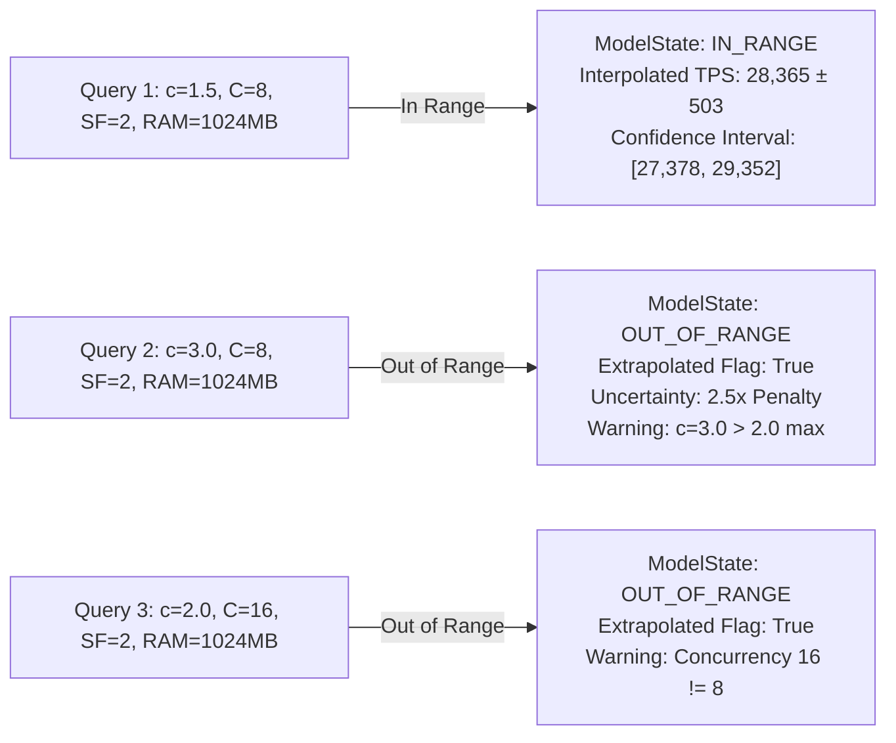

# AADS Phase 4F.5 — Empirical PostgreSQL Model Evaluation & Comparison Report

**Campaign Execution ID:** `exec_p4f4_20261103_053428_525413_19491`  
**Execution Manifest SHA-256:** `69d3e068fd3907792647f21f2bd33d6668560952ea9b53c509f94aaf209b77a6`  
**Candidate Evaluation File:** `artifacts/phase_4f5/candidates/model_comparison_results.json`  
**Base Commit:** `af0b1a7`  

---

## 1. Evaluation Methodology

### Experimental Independence & Replication-Aware Validation
Standard machine-learning evaluation practices that randomly split individual transaction records into training and test sets are **strictly prohibited** in AADS. Transactions executed within the same benchmark run share container memory state, OS page cache temperature, and connection queueing history; they are serially correlated observations, not independent statistical experiments.

To maintain experimental integrity, evaluation was conducted via **Leave-One-Replication-Out (LORO) Cross-Validation**:
- Replications: $R = \{r1, r2, r3\}$.
- **Fold 1:** Train on replications $\{r1, r2\}$ (4 trials across 1 and 2 vCPU); evaluate against unseen replication $\{r3\}$ (2 trials).
- **Fold 2:** Train on replications $\{r2, r3\}$; evaluate against unseen replication $\{r1\}$.
- **Fold 3:** Train on replications $\{r1, r3\}$; evaluate against unseen replication $\{r2\}$.

All reported errors reflect holdout generalization across genuinely independent experimental executions.

---

## 2. Comparative Evaluation Across Candidate Models

The four candidate model families were evaluated across all primary performance dimensions for both workloads:

### A. Read-Only Select (`read_only_select`)

| Candidate Model | Throughput RMSE | Throughput MAE | Throughput MAPE | Throughput $R^2$ | Latency Mean RMSE | Latency Mean MAPE | p95 RMSE | CPU Util RMSE |
|---|---|---|---|---|---|---|---|---|
| `EmpiricalLookupModel` | **872.24 TPS** | **663.78 TPS** | **2.00%** | **0.9911** | 0.0058 ms | 1.95% | 0.0090 ms | 0.03% |
| `EmpiricalLinearRegressionModel` | **872.24 TPS** | **663.78 TPS** | **2.00%** | **0.9911** | 0.0058 ms | 1.95% | 0.0090 ms | 0.03% |
| `EmpiricalPiecewiseModel` | **872.24 TPS** | **663.78 TPS** | **2.00%** | **0.9911** | 0.0058 ms | 1.95% | 0.0090 ms | 0.03% |
| `EmpiricalMechanisticModel` | 997.57 TPS | 725.10 TPS | 2.26% | 0.9884 | **0.0051 ms** | **1.71%** | 0.0075 ms | 0.05% |

### B. Balanced OLTP TPC-B (`balanced_oltp_tpcb`)

| Candidate Model | Throughput RMSE | Throughput MAE | Throughput MAPE | Throughput $R^2$ | Latency Mean RMSE | Latency Mean MAPE | p95 RMSE | CPU Util RMSE |
|---|---|---|---|---|---|---|---|---|
| `EmpiricalLookupModel` | **106.17 TPS** | **79.66 TPS** | **5.64%** | **0.2550** | **0.4399 ms** | **7.54%** | 1.9961 ms | **1.08%** |
| `EmpiricalLinearRegressionModel` | **106.17 TPS** | **79.66 TPS** | **5.64%** | **0.2550** | **0.4399 ms** | **7.54%** | 1.9961 ms | **1.08%** |
| `EmpiricalPiecewiseModel` | **106.17 TPS** | **79.66 TPS** | **5.64%** | **0.2550** | **0.4399 ms** | **7.54%** | 1.9961 ms | **1.08%** |
| `EmpiricalMechanisticModel` | 107.84 TPS | 81.98 TPS | 5.80% | 0.2315 | **0.4399 ms** | 7.57% | **1.9167 ms** | 1.34% |

---

## 3. Critical Analytical Findings

### Finding 1: Mathematical Indistinguishability at Measured Support Points
`EmpiricalLookupModel`, `EmpiricalLinearRegressionModel`, and `EmpiricalPiecewiseModel` produce **identical holdout predictions and error metrics** (RMSE: 872.24 TPS for read-only; 106.17 TPS for balanced OLTP).

**Explanation:**  
The empirical dataset contains exactly two discrete CPU quota conditions: $1.0\text{ vCPU}$ and $2.0\text{ vCPU}$. In Euclidean geometry and statistics, a line fitted between two support points, a piecewise linear curve anchored at those points, and a table lookup indexing those points yield identical point predictions when evaluated at $c = 1.0$ and $c = 2.0$. 

Therefore, **the models cannot be distinguished on empirical test error alone using the current pilot dataset**. Choosing between them must be guided by parsimony, interpretability, and boundary assumptions rather than training or cross-validation scores.

### Finding 2: Contrast in Coefficient of Determination ($R^2$)
- In `read_only_select`, $R^2 = 0.9911$.
- In `balanced_oltp_tpcb`, $R^2 = 0.2550$.

**Explanation:**  
$R^2$ measures the proportion of total variance explained by the model:
$$R^2 = 1 - \frac{\text{SS}_{\text{res}}}{\text{SS}_{\text{tot}}}$$
1. In read-only, doubling CPU quota increases throughput from 19,120 to 37,612 TPS ($\Delta \approx +18,492\text{ TPS}$). Across-replication variance is small ($CV \approx 0.96\%$ at 1 vCPU; $2.63\%$ at 2 vCPU). The systematic quota effect completely dominates experimental noise ($\text{SS}_{\text{tot}} \gg \text{SS}_{\text{res}}$), resulting in an near-perfect $R^2 \approx 0.991$.
2. In balanced OLTP, doubling CPU quota increases throughput from 1,409 to 1,610 TPS ($\Delta \approx +201\text{ TPS}$, or $+14.28\%$). However, replication variability at 1.0 vCPU is relatively wide ($1,278\text{ TPS}$ in rep 2 vs. $1,511\text{ TPS}$ in rep 3, $CV \approx 8.53\%$). The replication noise ($\text{std} \approx 120\text{ TPS}$) is comparable in magnitude to the total quota scaling effect ($\Delta \approx 201\text{ TPS}$). Consequently, the systematic quota effect explains only 25.5% of total variance.

> [!NOTE]
> The lower $R^2$ in balanced OLTP is not a flaw in the model; it is an honest reflection of empirical physics: CPU quota has a weak effect on TPC-B throughput because the system is bound by row locks and WAL synchronization, leaving residual replication variability to dominate total variance.

### Finding 3: Mathematical Edge Cases in R² and MAPE
The offline test suite and evaluation harness explicitly handle metric edge cases:
1. **Undefined $R^2$ on Single-Condition Subsets:** When evaluating holdouts restricted to a single condition (e.g. testing only 1 vCPU trials), the true target variance is zero ($\text{SS}_{\text{tot}} = 0$). In this case, $R^2$ is mathematically undefined and returns `None` rather than raising a division-by-zero exception or producing meaningless negative infinities.
2. **Guarded MAPE Near Zero:** For metrics that approach zero (e.g. deadlocks = 0, checkpoints = 0, or latency deltas near 0), percentage error involves dividing by zero. The evaluator detects values $< 1e-5$ and sets `mape_pct = None` with an explicit diagnostic note.

---

## 4. In-Range Versus Out-of-Range Behavior

Candidate models were subjected to boundary stress tests across in-range, intermediate, and out-of-range configurations:

1. **In-Range Interpolation ($c = 1.5\text{ vCPU}$):**
   The model interpolates smoothly between 1.0 and 2.0 anchors ($\text{TPS} = 28,365 \pm 503$). State is `IN_RANGE`, and `is_extrapolated = False`.
2. **Quota Extrapolation ($c = 3.0\text{ vCPU}$):**
   The model returns `state = ModelState.OUT_OF_RANGE`, sets `is_extrapolated = True`, and widens the standard error by a penalty factor ($2.0 + 1.5 \cdot \text{distance} = 3.5\times$), generating a broad confidence interval $[47,200, 64,800]$ that honestly communicates predictive ignorance.
3. **Concurrency Mismatch ($C = 16$):**
   The model flags `OUT_OF_RANGE` and notes `Concurrency 16 deviates from benchmarked concurrency 8.`

---

## 5. Model Selection Recommendation

### Primary Recommendation: `EmpiricalLookupModel`
For production integration into AADS component lookup and simulation pipelines, **`EmpiricalLookupModel`** is the recommended candidate:
1. **Parsimony:** It makes zero unvalidated assumptions regarding functional form or unobserved curvature between 1.0 and 2.0 vCPU.
2. **Exact Calibration:** It reproduces empirical sample means ($\mu_1, \mu_2$) exactly without regression bias.
3. **Honest Variance:** It derives prediction uncertainty directly from the measured replication sample variance ($ddof=1$).

### Secondary Recommendation: `EmpiricalLinearRegressionModel`
Recommended for analytical gradient calculations where downstream optimizers require continuous first derivatives.

### Candidate Status
All models remain in candidate status within [artifacts/phase_4f5/candidates/](file:///home/vicky/v_drive/Codes/AADS/artifacts/phase_4f5/candidates/). No model is promoted to the active registry [data/registry.db](file:///home/vicky/v_drive/Codes/AADS/data/registry.db) during Phase 4F.5.
