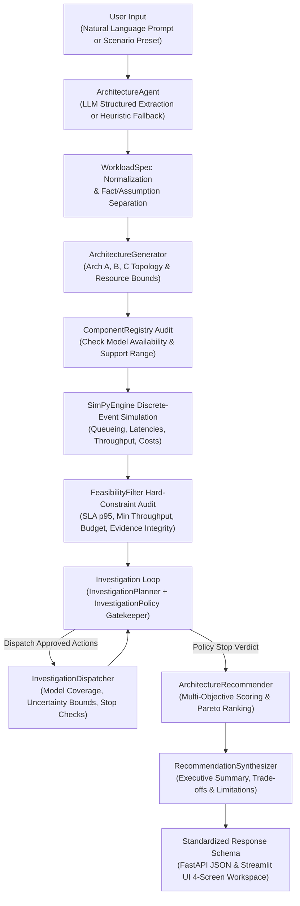

# AADS Phase 5.0 — Demo Integration Audit Report

**Date:** 2026-11-11  
**Baseline Commit:** `7d00ad5d69b4dfaeecaaf4bebe9a16495714f6bb`  
**Current Branch:** `feat/phase-5-working-demo`  
**Working Tree Status:** Clean  
**Auditor:** AADS Core Engineering Team  

---

## 1. Executive Summary & Audit Mission

In accordance with Phase 5.0 directives, empirical research and benchmark campaigns are strictly frozen. The objective of Phase 5.0 is productization and demonstration: transforming the existing AADS (Agentic Architecture Design & Simulation) backend and Streamlit frontend into a working, reliable, reproducible, and verifiable end-to-end product demo.

Before authoring code or modifying interfaces, this integration audit maps every component along the execution path from natural-language user prompt to structured architectural recommendation, identifies friction points, catalogs operational statuses, and defines the precise architectural fixes required for product delivery.

---

## 2. Baseline Provenance & Freeze Verification

The integrity of empirical assets was verified prior to starting Phase 5:
- **Baseline Commit:** `7d00ad5` (feat: audit and harden postgresql empirical candidate models and prediction contracts).
- **Active Model Registry:** `data/registry.db` contains exactly 24 active models. No models have been promoted, altered, or overwritten.
- **Empirical Candidate Models:** `artifacts/phase_4f5/candidates/` contains 8 candidate models across linear regression, lookup, mechanistic, and piecewise formulations.
- **Historical Manifest SHA-256:** `69d3e068fd3907792647f21f2bd33d6668560952ea9b53c509f94aaf209b77a6` (preserved immutable).
- **Reconciliation Evidence:** `artifacts/phase_4f46/reconciliation/` untouched.
- **Benchmarking Prohibition:** Docker container execution, `pgbench`, live benchmarks, and model promotions into `data/registry.db` remain strictly prohibited.

---

## 3. End-to-End Architecture & Integration Flow

The complete execution path operates across five modular subsystems:

---

## 4. Component Inventory & Operational Status

Each subsystem across the codebase was audited for completeness, connectivity, and empirical integrity:

| Subsystem / File | Operational Status | Working Path | Gaps & Friction Points Identified |
|---|---|---|---|
| **Workload Extraction** `aads/agent/architecture_agent.py` | **Partially Working** | Dual-mode: OpenAI/Groq structured output when configured; regex fallback when offline. | 1. Regex parser missed hyphenated "e-commerce" (defaulted to social feed). 2. "read-heavy" was inferred as an assumption rather than recognized as user intent. 3. `user_facts` values had mixed string/float types. |
| **Candidate Generation** `aads/generator/candidate_generator.py` | **Fully Working** | Generates Arch A (API → DB), Arch B (API → Redis → DB), Arch C (Async API → Queue → Worker → DB). | Consistent schema and resource limits. MongoDB optional candidate correctly exercises missing-model discovery. |
| **Model Registry** `aads/registry/component_registry.py` | **Fully Working** | SQLite backing store in `data/registry.db` with 24 active models. | Registry check functions correctly. Candidates from Phase 4F.5 reside in `artifacts/phase_4f5/candidates/` and must remain unpromoted per freeze rules. |
| **Simulation Engine** `aads/simulation/simpy_engine.py` | **Fully Working** | Discrete-event queueing simulation with real `simpy.Resource`, request tracing, and percentile calculation. | Fully operational. Distinguishes simulation results from benchmark measurements. Calculates heuristic latency uncertainty bounds. |
| **Feasibility Filter** `aads/evaluation/feasibility_filter.py` | **Fully Working** | Two-stage evaluation: hard SLA/budget constraints + Phase 4F.5.1 evidence contract checks (`OUT_OF_RANGE`, `INSUFFICIENT_EVIDENCE`). | Enforces honest boundaries: flags candidates operating outside support as `UNCERTAIN` or `INFEASIBLE`. |
| **Investigation Planner & Policy** `aads/agent/investigation_planner.py` `aads/agent/investigation_policy.py` | **Fully Working** | Bounded multi-round loop with authoritative policy gatekeeper enforcing round limits (max 3), time budget, and action allowlists. | Deterministic fallback works completely offline. Prevents duplicate actions and prohibits unauthorized benchmark execution. |
| **Investigation Dispatcher** `aads/agent/investigation_dispatcher.py` | **Fully Working** | Executes approved actions (`inspect_model_coverage`, `inspect_uncertainty`, `simulate_candidate`, `stop_and_recommend`). | Records tool input, output, duration, and policy verdict in `InvestigationRecord`. |
| **Recommender & Synthesizer** `aads/evaluation/recommender.py` `aads/agent/recommendation_synthesizer.py` | **Fully Working** | Multi-objective scoring (latency, cost, throughput, simplicity) with LLM or deterministic template synthesis. | Generates clear explanation of why the winner won, why alternatives lost, trade-offs, and conditions where recommendation changes. |
| **FastAPI Backend** `aads/api/app.py` `aads/api/routes.py` | **Partially Working** | REST endpoints (`/api/agent/run`, `/api/workflow/run`, `/api/simulate`, `/api/candidates`). | Response dictionary in `/api/agent/run` was unstandardized and lacked structured Pydantic schema sections A–E required by Phase 5.0. |
| **Streamlit Demo UI** `aads/ui/streamlit_app.py` | **Partially Working** | Multi-tab application with Tab 0 as AI Architecture Agent. | UI currently exhibits layout clutter across 8 tabs. Needs cohesive 4-screen layout (Input → Trace → Comparison → Recommendation) with 1-click scenario preset buttons. |

---

## 5. Audit Findings & Gap Analysis

### Finding 1: Natural-Language Regex Parser Hyphenation Handling
In `ArchitectureAgent.fallback_parse`:
- Matching application domain tested `"ecommerce" in text or "shop" in text or "store" in text`.
- Prompts using `"e-commerce"` (the standard spelling in user prompts) defaulted to `"social_media_feed"`.
- *Fix Required:* Normalize text (replace hyphens with spaces/empty strings) or add `"e-commerce"` explicitly.

### Finding 2: Standardized Backend Response Schema (Phase 5 Section 5)
In `aads/api/routes.py`:
- The `/api/agent/run` endpoint returned raw state fields without conforming to the required 5-section Pydantic response schema:
  - **Section A:** Request Summary (workload, constraints, facts vs. assumptions).
  - **Section B:** Investigation Summary (rounds, tools invoked, verdicts, duration, token usage).
  - **Section C:** Architecture Comparison (one record per candidate with topology, metrics, cost, SLA checks, evidence status).
  - **Section D:** Recommendation (winner, feasibility, decision rationale, trade-offs, rejected alternatives).
  - **Section E:** Evidence Disclosure (epistemological categorization of each metric: empirical, model-derived, simulated, assumed, synthetic).
- *Fix Required:* Define `DemoWorkflowResponse` and associated Pydantic models in `aads/core/schemas.py` and serialize them from `/api/agent/run`.

### Finding 3: Streamlit UI Experience & Demo Scenarios
In `aads/ui/streamlit_app.py`:
- Tab 0 provided a single prompt input, but required users to manually type prompts.
- Screen 1 needs 3 clickable scenario preset buttons:
  - **Scenario 1:** Read-heavy e-commerce (500 RPS, 90/10 read/write, p95 <= 100ms, budget $250/mo) → highlights caching.
  - **Scenario 2:** Write-heavy transactional (150 RPS, 40/60 read/write, p95 <= 150ms, budget $300/mo) → highlights DB direct / transactional trade-offs.
  - **Scenario 3:** Background processing (300 RPS incoming, async processing, p95 <= 100ms, budget $350/mo) → highlights queue/worker architecture.
- Visual presentation must clearly render:
  - Screen 1: Workload input & normalized requirement summary.
  - Screen 2: Investigation trace table/cards (tool name, purpose, args, summary, status, duration).
  - Screen 3: Architecture comparison cards/table with evidence status badges (`OBSERVED`, `INTERPOLATED`, `OUT_OF_RANGE`, `INSUFFICIENT_EVIDENCE`).
  - Screen 4: Final recommendation panel (winner, why it won, why others lost, trade-offs, evidence limitations).

### Finding 4: Startup & Demo Scripting
- Repository lacked a single, zero-dependency launch script (`scripts/run_demo.sh`) that starts both FastAPI backend and Streamlit frontend with health checks and port validation.
- `.env.example` needed clarification of optional LLM API keys versus deterministic offline operation.

---

## 6. Action Plan for Phases 1–6

1. **Phase 1: Backend Path Hardening & Pydantic Standardization**
   - Polish `aads/agent/architecture_agent.py` fallback parser (hyphenation, read-heavy intent, type cleanliness).
   - Implement `DemoWorkflowResponse` schema in `aads/core/schemas.py` covering Sections A through E.
   - Wire `AADSOrchestrator` to populate the standardized response structure.
   - Update `/api/agent/run` in `aads/api/routes.py` to return this structured schema.

2. **Phase 3: Streamlit UI Hardening**
   - Refactor Tab 0 into the unified 4-screen interactive architecture decision workspace.
   - Provide 1-click scenario preset buttons for Scenarios 1, 2, and 3.
   - Render clean tables/cards for investigation trace, architecture comparison, and recommendation.

3. **Phase 4 & 5: Demo Scenarios, Launch Scripts & Startup Verification**
   - Create `scripts/run_demo.sh` to launch FastAPI (port 8000) and Streamlit (port 8501) with graceful health polling.
   - Create reproducible scenario runner script (`scripts/run_demo_scenarios.py`).
   - Update `.env.example` and `README.md` with explicit instructions.

4. **Phase 6: Integration Testing & Verification**
   - Create `tests/test_phase_5_demo_integration.py` testing the complete user journey, the 3 scenarios, offline fallback, missing model discovery, and schema validation.
   - Verify that all existing repo tests (322 tests) continue passing.

5. **Deliver Final Reports**
   - `reports/phase_5_demo_implementation_report.md`
   - `reports/phase_5_demo_validation_report.md`
