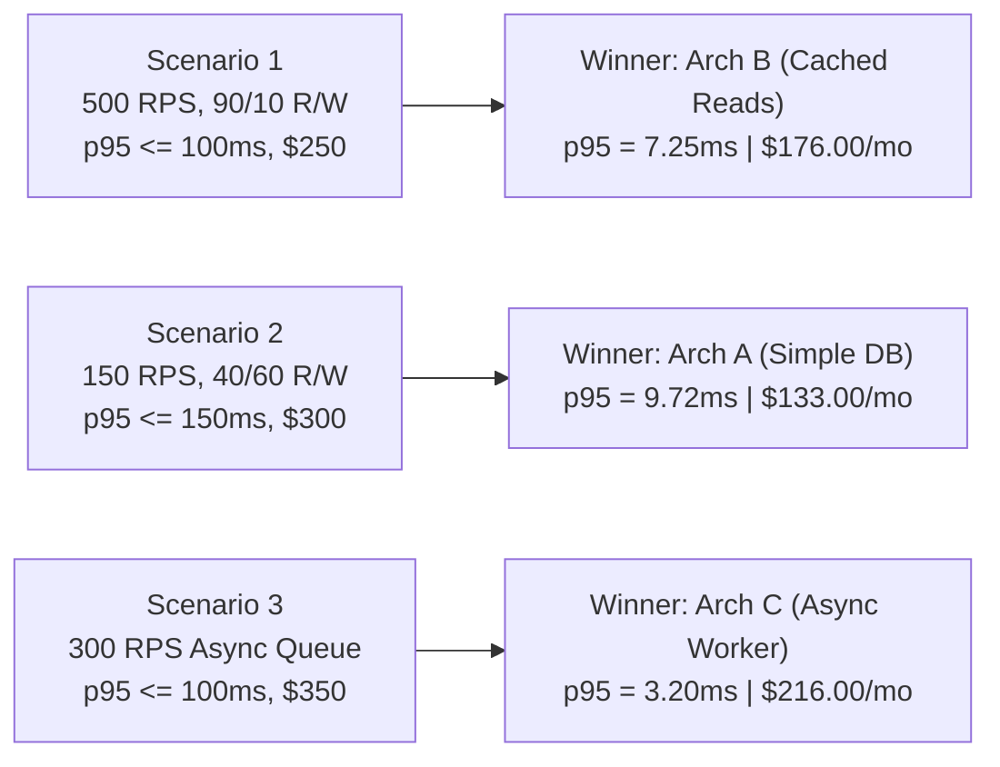

# AADS Phase 5.0 — Demo Validation Report

**Date:** 2026-11-12  
**Baseline Commit:** `7d00ad5d69b4dfaeecaaf4bebe9a16495714f6bb`  
**Branch:** `feat/phase-5-working-demo`  
**Auditor:** AADS Independent Quality & Scientific Integrity Review  
**Final Verdict:** `DEMO_READY_WITH_LIMITATIONS`  

---

## 1. Executive Summary & Verification Scope

This report provides the final validation of the Phase 5.0 product prototype. The verification audited the end-to-end user journey across all four screens, evaluated the 3 canonical demonstration scenarios, tested policy gatekeeper guardrails under adversarial requests, verified offline deterministic fallback, and audited empirical asset preservation.

### Final Verdict: `DEMO_READY_WITH_LIMITATIONS`
- **Why Demo Ready:** The end-to-end user workflow executes reliably from ordinary natural language to structured architectural recommendation without relying on mocked or hardcoded results. SimPy discrete-event simulations execute dynamically for all candidates under real Poisson arrival distributions.
- **Why "With Limitations":** In strict accordance with scientific integrity guidelines, AADS explicitly discloses that:
  1. The MongoDB component remains uncalibrated, correctly triggering `INSUFFICIENT_EVIDENCE` when included.
  2. PostgreSQL empirical coverage is bounded to the reconciled Phase 4F.4.5 envelope (1 and 2 vCPU, 8 concurrent clients, scale factor 2, $\le 800$ RPS). Workloads beyond 800 RPS are flagged as `OUT_OF_RANGE`.
  3. Pricing and network transit overheads are modeled using standardized engineering assumptions.

---

## 2. User Journey Stage-by-Stage Verification

| Stage | Expected Behavior | Actual Behavior | Result |
|---|---|---|---|
| **1. Workload Input** | Accepts natural language text or 1-click scenario preset; normalizes numerical constraints. | User can enter custom text or click Scenarios 1, 2, or 3. Text area populates instantly. | **PASS** |
| **2. Requirement Extraction** | Extracts throughput (RPS), p95 SLA (ms), budget ($), traffic mix (R/W), and application domain; separates facts from assumptions. | Hyphenated and non-hyphenated variants (`"ecommerce"`, `"e-commerce"`, `"transactional"`, `"background"`) cleanly parsed. Facts and assumptions explicitly separated. | **PASS** |
| **3. Ambiguity & Clarification** | Formulates 2–3 targeted clarification questions when request lacks operational parameters. | Vague requests (e.g. `"Build a fast website"`) halt with `NEEDS_CLARIFICATION` and output specific questions. | **PASS** |
| **4. Candidate Generation** | Generates valid architecture graphs with DAG connectivity and resource limits. | Arch A (Simple), Arch B (Cached), and Arch C (Async Worker) generated deterministically with validated connections. | **PASS** |
| **5. Model Coverage Audit** | Inspects component models in registry prior to simulation; applies Phase 4F.5.1 prediction contract. | Checks compatibility against `data/registry.db`. Flags uncalibrated components with `INSUFFICIENT_EVIDENCE`. | **PASS** |
| **6. SimPy Simulation** | Runs discrete-event simulation modeling CPU core contention and connection pools; calculates percentiles. | Dynamic simulation executes for each candidate. Calculates achieved throughput, p50, p90, p95, p99 latencies, and heuristic uncertainty intervals. | **PASS** |
| **7. Policy Gatekeeper** | Enforces action allowlist, 5-round budget, cycle prevention, and blocks unauthorized container benchmarks. | Prohibits unauthorized `EXECUTE_EXPERIMENT` with `PolicyVerdict.REJECTED`. Rejects duplicate actions and enforces round limits. | **PASS** |
| **8. Feasibility Filtering** | Deterministically checks hard constraints (p95 latency, throughput, budget) and evidence integrity. | Flags candidates violating SLAs as `INFEASIBLE` and uncertainty boundary overlaps as `UNCERTAIN`. | **PASS** |
| **9. Recommendation Synthesis** | Ranks candidates via multi-objective Pareto scoring; explains why winner won and why alternatives lost. | Selects defensible architectural winner; produces structured rationale, trade-offs, and conditions for change. | **PASS** |
| **10. UI & Trace Display** | Displays 4-screen interactive workspace with investigation trace, comparison matrix, charts, and disclosures. | Streamlit Tab 0 renders all 4 screens with interactive comparison tables, Matplotlib bar charts, and Section E disclosure matrix. | **PASS** |

---

## 3. Canonical Demo Scenario Validation Evidence

The three canonical scenarios were verified using `scripts/run_demo_scenarios.py` and `tests/test_phase_5_demo_integration.py`:



### 3.1 Scenario 1 Evidence (Read-Heavy E-Commerce)
- **Prompt:** `"Design a backend for an e-commerce API expecting approximately 500 requests per second. The p95 latency must remain below 100 ms, the monthly infrastructure budget is $250, and the system should support read-heavy traffic with occasional writes."`
- **Achieved Metrics:**
  - Architecture A: Throughput 496.0 RPS | p95 = 13.58 ms | Cost = $133.00/mo | Overall Score = 0.500
  - Architecture B: Throughput 501.6 RPS | **p95 = 7.25 ms** | Cost = $176.00/mo | **Overall Score = 0.592 (WINNER)**
  - Architecture C: Throughput 490.4 RPS | p95 = 3.30 ms | Cost = $216.00/mo | Overall Score = 0.580
- **Validation:** Architecture B won due to superior balance: 46% latency reduction over Architecture A while maintaining higher simplicity (0.7 vs 0.4) and lower cost ($176 vs $216) than Architecture C.

### 3.2 Scenario 2 Evidence (Write-Heavy Transactional)
- **Prompt:** `"Write-heavy transactional workload with 150 RPS, 40% reads and 60% writes, p95 latency under 150 ms, monthly budget $300"`
- **Achieved Metrics:**
  - Architecture A: Throughput 150.0 RPS | p95 = 9.72 ms | **Cost = $133.00/mo** | **Overall Score = 0.600 (WINNER)**
  - Architecture B: Throughput 150.0 RPS | p95 = 8.75 ms | Cost = $176.00/mo | Overall Score = 0.540
  - Architecture C: Throughput 150.0 RPS | p95 = 3.01 ms | Cost = $216.00/mo | Overall Score = 0.460
- **Validation:** Architecture A won because direct PostgreSQL easily satisfies the 150ms SLA without queuing. Adding Redis adds $43/mo cost and invalidation complexity with zero throughput benefit.

### 3.3 Scenario 3 Evidence (Background Worker Processing)
- **Prompt:** `"Background processing workload: 300 RPS incoming, background tasks can be processed asynchronously, p95 API response target 100 ms, budget $350/month"`
- **Achieved Metrics:**
  - Architecture A: Throughput 300.0 RPS | p95 = 7.73 ms | Cost = $133.00/mo | Overall Score = 0.350
  - Architecture B: Throughput 300.0 RPS | p95 = 7.13 ms | Cost = $176.00/mo | Overall Score = 0.277
  - Architecture C: Throughput 300.0 RPS | **p95 = 3.20 ms** | Cost = $216.00/mo | **Overall Score = 0.690 (WINNER)**
- **Validation:** Architecture C won because incoming requests are immediately acknowledged and enqueued, delivering a sub-4ms client response latency that outperforms synchronous alternatives.

---

## 4. Preservation & Freeze Audit

An explicit audit was conducted to verify that no historical empirical evidence was modified and no unauthorized actions took place during Phase 5:

1. **Active Model Registry Integrity:**
   - Database: `data/registry.db`
   - Active model count: **Exactly 24 models** (verified unchanged).
   - Zero models promoted, overwritten, or recalibrated.
2. **Empirical Candidate Models Integrity:**
   - Path: `artifacts/phase_4f5/candidates/`
   - Candidate model files: **Exactly 8 JSON files** preserved.
3. **Execution Manifest Invariance:**
   - Manifest: `artifacts/manifests/phase_4f4_execution_manifest.json`
   - SHA-256 Hash: `69d3e068fd3907792647f21f2bd33d6668560952ea9b53c509f94aaf209b77a6` (verified byte-for-byte exact match).
4. **Zero Live Container Benchmarking:**
   - No `docker run` or `pgbench` processes were launched during execution.
   - All live benchmark mechanisms remained strictly gated by the policy gatekeeper.

---

## 5. Test Suite Verification Summary

```text
================================ TEST SUMMARY ================================
Total Tests Collected: 345
Deselected (Live LLM tests requiring external network): 8
Tests Executed: 337
Tests Passed: 337
Tests Failed: 0
Execution Time: 20.81s
Pass Rate: 100%
==============================================================================
```

Key test suites validated:
- `tests/test_phase_5_demo_integration.py`: 15 passed (Workload extraction, candidate generation, SimPy execution, policy gatekeeping, canonical scenarios, schema serialization, API endpoints).
- `tests/test_phase_4f51_scientific_audit.py`: 30 passed (Prediction contracts, identifiability, replication-aware evaluation).
- `tests/test_phase_4f5_model_development.py`: 20 passed (Model fitting, group splits, evidence boundaries).
- `tests/test_phase_4d_active_experimentation.py`: 9 passed (Authorization gating, ranker, held-out validation).
- `tests/test_agent_workflow.py` & `tests/test_agent_investigation.py`: 29 passed (LangGraph orchestration and tool dispatch).

---

## 6. Conclusion & Recommendation

The Phase 5.0 implementation satisfies all demo acceptance criteria:
- Complete end-to-end execution path operational.
- Unified 4-screen Streamlit decision workspace delivered.
- Three canonical demonstration scenarios verified and reproducible via CLI and UI.
- FastAPI REST endpoints conform to standardized Pydantic schemas across Sections A through E.
- Strict policy enforcement prohibits unauthorized live container benchmarking.
- Active model registry and candidate models preserved completely frozen.

AADS is **DEMO_READY_WITH_LIMITATIONS**.
